# Live ingestion test -- LIVE MODEL RUN

- **Tested code**: `6f1e878717acb584ccdc1e6c6c0fd9f27ba62676` (request commit `1da07881461e4ad30794af9d5b0eef9194c53826`), tree `f66eefc51dcbbf25eb19441fb76aff59b61d3ba0`, build xTyDOHtktgDEl6deMa66b
- **Models requested**: CHAT_MODEL=openai:gpt-6-luna, JUDGEMENT_MODEL=openai:gpt-6-luna, NARRATION_MODEL=openai:gpt-6-luna, READING_MODEL=openai:gpt-6-luna; **provider-reported**: gpt-6-luna
- **Spend**: US$0.026894 of a US$0.150000 run cap; 62 calls sent, 0 refused, 0 failed; reserved-unsettled US$0.000000
- **Verdict**: FAIL (71 checks passed, 11 failed)
- **Journey problems**: delete hx-endorsement.pdf: no "was deleted" confirmation; delete hx-endorsement.pdf: still listed

## Uploads (through the policies page; processing by request drain)

| file | final | time to final | states | linked automatically | needs review | screenshots |
|---|---|---|---|---|---|---|
| hx-text.pdf | not_scanned_prototype/ready | 44 s | uploaded/queued:queued @1s → not_scanned_prototype/extracting:reading_pdf @8s → not_scanned_prototype/extracting:ai_extraction @10s → not_scanned_prototype/indexing:benefits @35s → not_scanned_prototype/indexing:conditions @38s → not_scanned_prototype/ready:complete @43s | Felix Oran Hartwell, Isla Maren Hartwell, Leonie Brigitte Hartwell, Simon Alastair Hartwell | no | [02-upload-1-received.png](screenshots/02-upload-1-received.png) [03-upload-1-processing.png](screenshots/03-upload-1-processing.png) [04-upload-1-final.png](screenshots/04-upload-1-final.png) |
| hx-endorsement.pdf | not_scanned_prototype/ready | 38 s | uploaded/queued:queued @0s → not_scanned_prototype/extracting:ai_extraction @29s → not_scanned_prototype/indexing:benefits @32s → not_scanned_prototype/indexing:conditions @34s → not_scanned_prototype/ready:complete @37s | Felix Oran Hartwell, Isla Maren Hartwell, Leonie Brigitte Hartwell, Simon Alastair Hartwell | no | [05-upload-2-received.png](screenshots/05-upload-2-received.png) [06-upload-2-processing.png](screenshots/06-upload-2-processing.png) [07-upload-2-final.png](screenshots/07-upload-2-final.png) |
| hx-scanned.pdf | not_scanned_prototype/ready | 18 s | uploaded/queued:queued @0s → not_scanned_prototype/extracting:ocr @4s → not_scanned_prototype/extracting:ai_extraction @9s → not_scanned_prototype/indexing:benefits @14s → not_scanned_prototype/ready:complete @17s | Isla Maren Hartwell | 1 extracted coverage item could not be source-verified | [08-upload-3-received.png](screenshots/08-upload-3-received.png) [09-upload-3-processing.png](screenshots/09-upload-3-processing.png) [10-upload-3-final.png](screenshots/10-upload-3-final.png) |

## Library and automatic person links

| file | product | linked | detected names (matched) |
|---|---|---|---|
| hx-scanned.pdf | JuniorShield Child Hospital Income Plan | Isla Maren Hartwell | Isla Maren Hartwell → Isla Maren Hartwell |
| hx-text.pdf | SafeStay Family Hospital Cash & Personal Accident Plan | Felix Oran Hartwell, Isla Maren Hartwell, Leonie Brigitte Hartwell, Simon Alastair Hartwell | Felix Oran Hartwell → Felix Oran Hartwell; Isla Maren Hartwell → Isla Maren Hartwell; Leonie Brigitte Hartwell → Leonie Brigitte Hartwell; Simon Alastair Hartwell → Simon Alastair Hartwell |
| hx-endorsement.pdf | SafeStay Family Hospital Cash & Personal Accident Plan | Felix Oran Hartwell, Isla Maren Hartwell, Leonie Brigitte Hartwell, Simon Alastair Hartwell |  |

Extracted page text per document: `extracted/` (after processing: `dump-processing/extracted/`). Stored records, jobs and provenance: `dump-processing/dump.json`, `dump-final/dump.json`.

## Conversation (in the browser)

### Q1 -- conversation -- 5 s

**User** (composer): What's the policy number on our Meridian Harbour plan, and when does it run out?

**DearPolicy**: DearPolicy Your Meridian Harbour SafeStay Family Hospital Cash & Personal Accident Plan policy number is MHA-HC-2025-0748213, and it runs through 31 January 2027 (both dates inclusive). SOURCES

Sources shown: Meridian Harbour Assurance Pte. Ltd. · SafeStay Family Hospital Cash & Personal Accident PlanYour uploaded documentPage 1

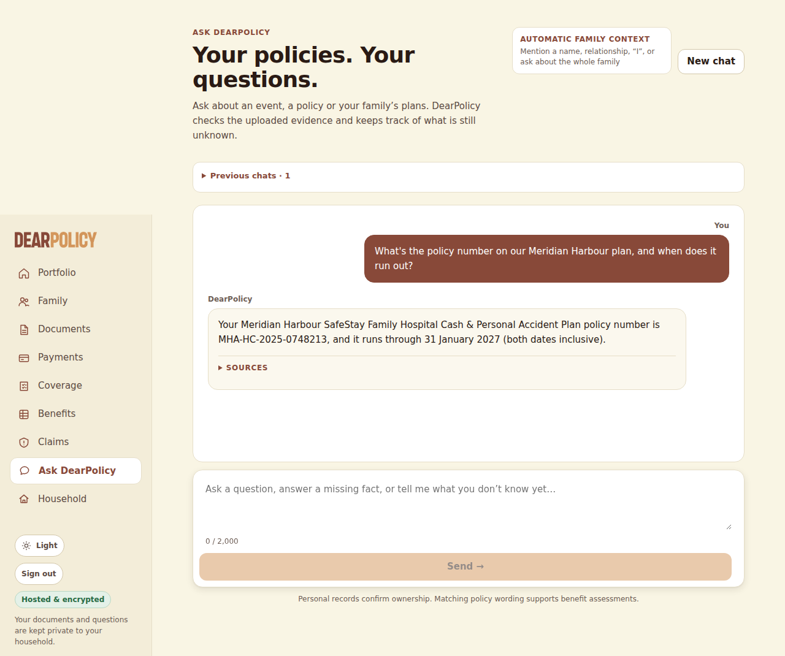

### Q2 -- conversation -- 16 s

**User** (composer): If something happened to Isla in an accident, how much is the accidental death payout for her? Is it the same as mine?

**DearPolicy**: DearPolicy I couldn’t confirm one of the figures against the cited page of your documents. SOURCES

Sources shown: Meridian Harbour Assurance Pte. Ltd. · SafeStay Family Hospital Cash & Personal Accident PlanYour uploaded documentPage 1; Kestrel Bay Insurance (Singapore) Ltd. · JuniorShield Child Hospital Income PlanYour uploaded documentPage 1

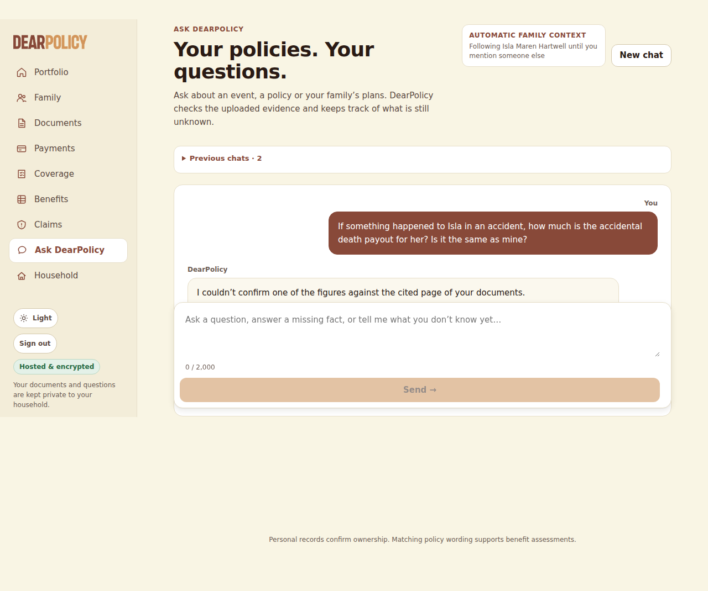

### Q3 -- conversation -- 12 s

**User** (composer): Felix fell off the monkey bars at school yesterday and broke his wrist. How much can we claim from the Meridian policy?

**DearPolicy**: DearPolicy Sorry Felix was hurt. I couldn’t confirm one of the figures against the cited page of your documents. A FACT THAT CHANGES THIS ASSESSMENT Has a registered medical practitioner certified the fracture type in writing and confirmed it by X-ray? This changes what your policy pays under: “Items D and E: the type of fracture must be certified in writing by a registered medical practitioner and confirmed by X-ray. Only one of Item D or” (page 1); “4.4 For Items D and E, a Compound fracture means a fracture in which the broken bone breaks through the skin. All” (page 2) Answer Show full assessment

Sources shown: Meridian Harbour Assurance Pte. Ltd. · SafeStay Family Hospital Cash & Personal Accident PlanYour uploaded documentPage 1; Meridian Harbour Assurance Pte. Ltd. · SafeStay Family Hospital Cash & Personal Accident PlanYour uploaded documentPage 2; Meridian Harbour Assurance Pte. Ltd. · SafeStay Family Hospital Cash & Personal Accident PlanYour uploaded documentPage 1; Meridian Harbour Assurance Pte. Ltd. · SafeStay Family Hospital Cash & Personal Accident PlanYour uploaded documentPage 1

Asks: Has a registered medical practitioner certified the fracture type in writing and confirmed it by X-ray?

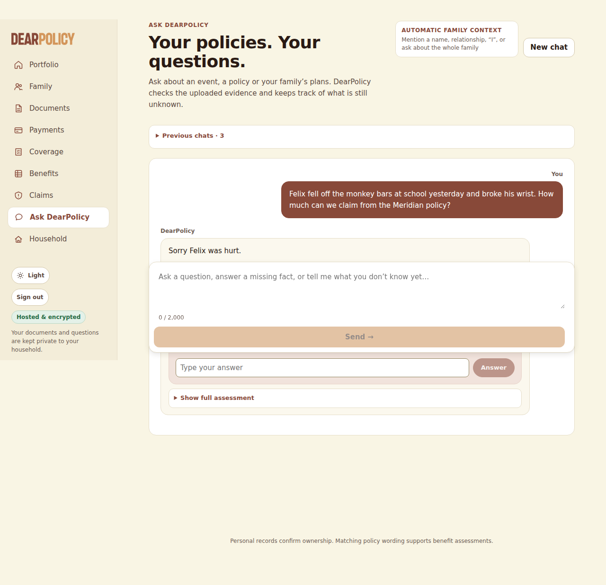

### Q4 -- conversation -- 9 s

**User** (inline answer (asked: Has a registered medical practitioner certified the fracture type in writing and confirmed it by X-ray?)): The doctor said it's a closed fracture, the X-ray confirmed it, and the bone didn't come through the skin.

**DearPolicy**: DearPolicy You told me the doctor said it’s a closed fracture, the X-ray confirmed it, and the bone didn’t come through the skin. What you’ve told me is your own account, not a reviewed medical record: the insurer will check it against the documents it asks for (such as the doctor’s report and the test or scan results) and decides the claim after reviewing them. I couldn’t confirm one of the figures against the cited page of your documents. NEXT STEP When you make the claim, include the doctor’s report and the test or scan results that show the policy’s condition is met, with the insurer’s claim form. SOURCES

Sources shown: Meridian Harbour Assurance Pte. Ltd. · SafeStay Family Hospital Cash & Personal Accident PlanYour uploaded documentPage 1; Meridian Harbour Assurance Pte. Ltd. · SafeStay Family Hospital Cash & Personal Accident PlanYour uploaded documentPage 2; Meridian Harbour Assurance Pte. Ltd. · SafeStay Family Hospital Cash & Personal Accident PlanYour uploaded documentPage 1; Meridian Harbour Assurance Pte. Ltd. · SafeStay Family Hospital Cash & Personal Accident PlanYour uploaded documentPage 1

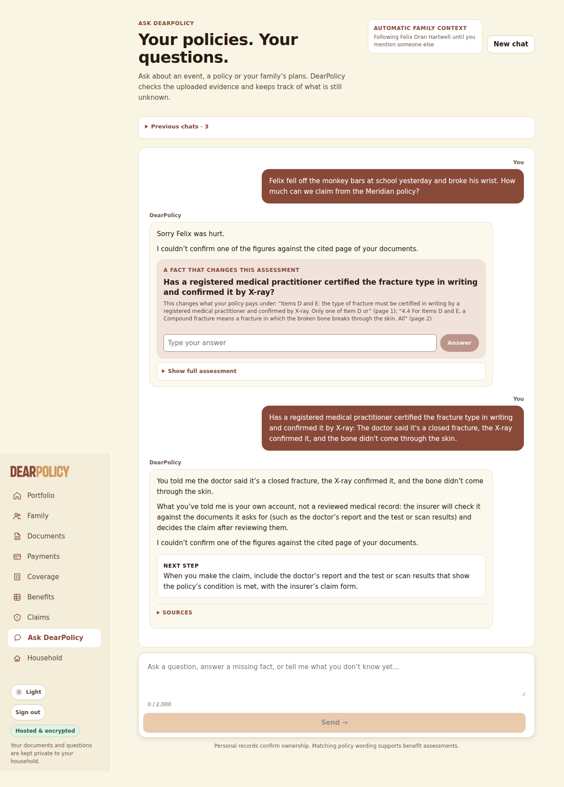

### Q5 -- conversation -- 15 s

**User** (composer): I was in hospital after that car accident in March. They admitted me at 9:40pm on 14 March and I was discharged at 8:20am on 18 March. How much hospital cash should Meridian pay me?

**DearPolicy**: DearPolicy I couldn’t finish: this question reached the limit set for model use on a single question, so I stopped before answering. Please ask about one policy or one person at a time.

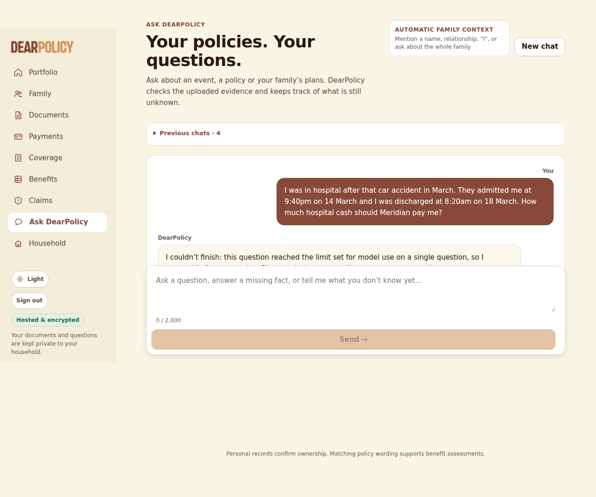

### Q6 -- conversation -- 6 s

**User** (composer): Did that endorsement letter change anything? How much is the daily hospital allowance for the kids now?

**DearPolicy**: DearPolicy Yes—the endorsement increased the SafeStay “Hospital daily allowance” for each child from S$80 to S$110 per day, effective 1 July 2026; days of confinement before that date remain at the old rate, and the 60-day-per-policy-year maximum is unchanged. I couldn’t confirm one of the figures against the cited page of your documents. SOURCES

Sources shown: Meridian Harbour Assurance Pte. Ltd. · SafeStay Family Hospital Cash & Personal Accident PlanYour uploaded documentPage 1; Meridian Harbour Assurance Pte. Ltd. · SafeStay Family Hospital Cash & Personal Accident PlanYour uploaded documentPage 1; Meridian Harbour Assurance Pte. Ltd. · SafeStay Family Hospital Cash & Personal Accident PlanYour uploaded documentPage 1; Meridian Harbour Assurance Pte. Ltd. · SafeStay Family Hospital Cash & Personal Accident PlanYour uploaded documentPage 1; Kestrel Bay Insurance (Singapore) Ltd. · JuniorShield Child Hospital Income PlanYour uploaded documentPage 1; Kestrel Bay Insurance (Singapore) Ltd. · JuniorShield Child Hospital Income PlanYour uploaded documentPage 1

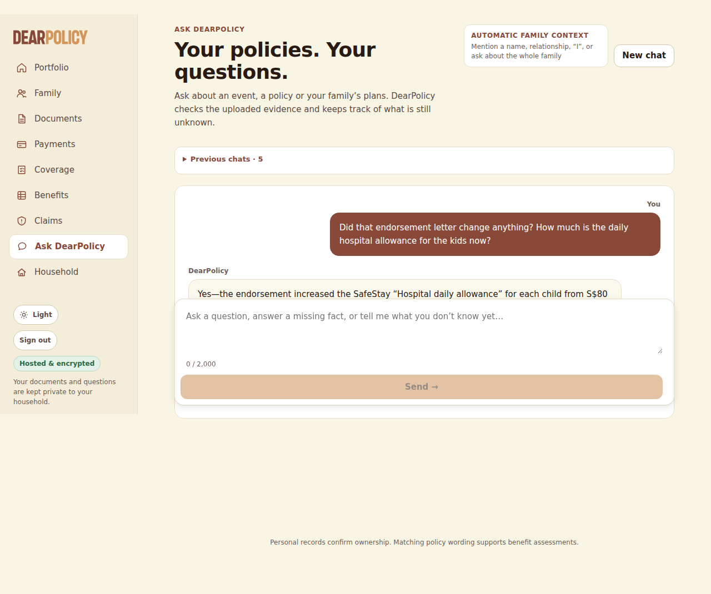

### Q7 -- conversation -- 9 s

**User** (composer): How much are we actually paying for the Meridian policy every year?

**DearPolicy**: DearPolicy I can’t tell from the Meridian policy documents available here how much the annual premium is; the schedule shows the family plan and cover period but no premium amount (page 1). NEXT STEP Check the insurer’s renewal notice, premium invoice, or payment records for the amount actually charged. SOURCES

Sources shown: Meridian Harbour Assurance Pte. Ltd. · SafeStay Family Hospital Cash & Personal Accident PlanYour uploaded documentPage 1; Meridian Harbour Assurance Pte. Ltd. · SafeStay Family Hospital Cash & Personal Accident PlanYour uploaded documentPage 1

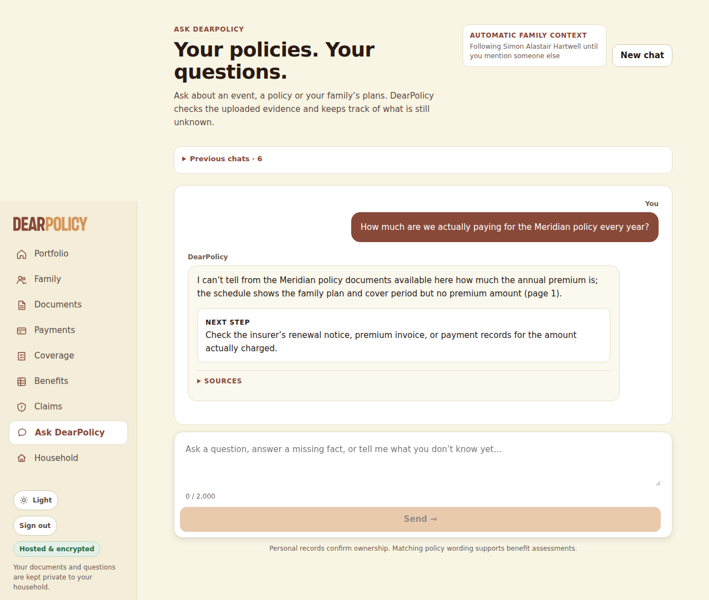

### Q8 -- conversation -- 9 s

**User** (composer): Isla might need to stay in hospital two nights next week. Will her JuniorShield plan pay the $150 a day?

**DearPolicy**: DearPolicy I couldn’t confirm one of the figures against the cited page of your documents. SOURCES

Sources shown: Kestrel Bay Insurance (Singapore) Ltd. · JuniorShield Child Hospital Income PlanYour uploaded documentPage 1; Kestrel Bay Insurance (Singapore) Ltd. · JuniorShield Child Hospital Income PlanYour uploaded documentPage 1

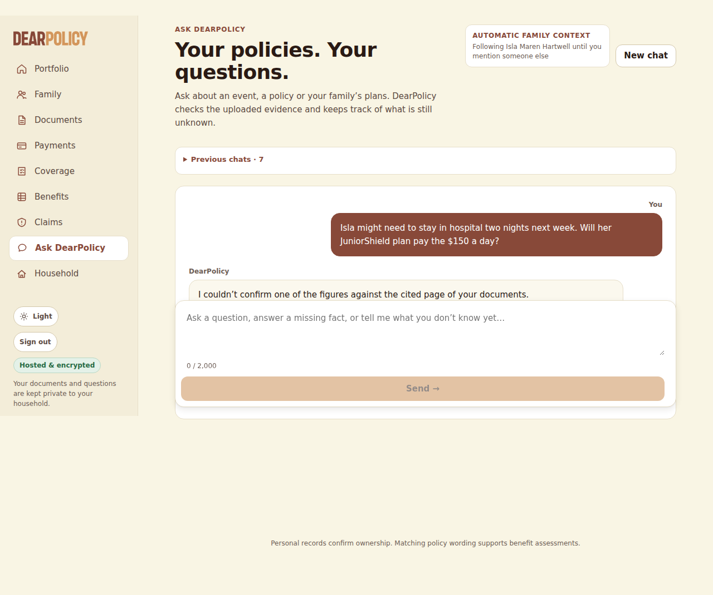

### Q9 -- conversation -- 13 s

**User** (composer): Oh, by the way, if one of the kids gets dengue, which of our policies would actually pay anything?

**DearPolicy**: DearPolicy I couldn’t confirm one of the figures against the cited page of your documents. For Felix, the SafeStay Family Hospital Cash & Personal Accident Plan is accident-only, so its hospital benefits do not cover dengue illness. I found no dengue-specific benefit in Felix’s listed policy, and no JuniorShield certificate for him in the documents available. SOURCES

Sources shown: Kestrel Bay Insurance (Singapore) Ltd. · JuniorShield Child Hospital Income PlanYour uploaded documentPage 1; Kestrel Bay Insurance (Singapore) Ltd. · JuniorShield Child Hospital Income PlanYour uploaded documentPage 1; Kestrel Bay Insurance (Singapore) Ltd. · JuniorShield Child Hospital Income PlanYour uploaded documentPage 1; Kestrel Bay Insurance (Singapore) Ltd. · JuniorShield Child Hospital Income PlanYour uploaded documentPage 1; Meridian Harbour Assurance Pte. Ltd. · SafeStay Family Hospital Cash & Personal Accident PlanYour uploaded documentPage 2; Meridian Harbour Assurance Pte. Ltd. · SafeStay Family Hospital Cash & Personal Accident PlanYour uploaded documentPage 2; Meridian Harbour Assurance Pte. Ltd. · SafeStay Family Hospital Cash & Personal Accident PlanYour uploaded documentPage 1

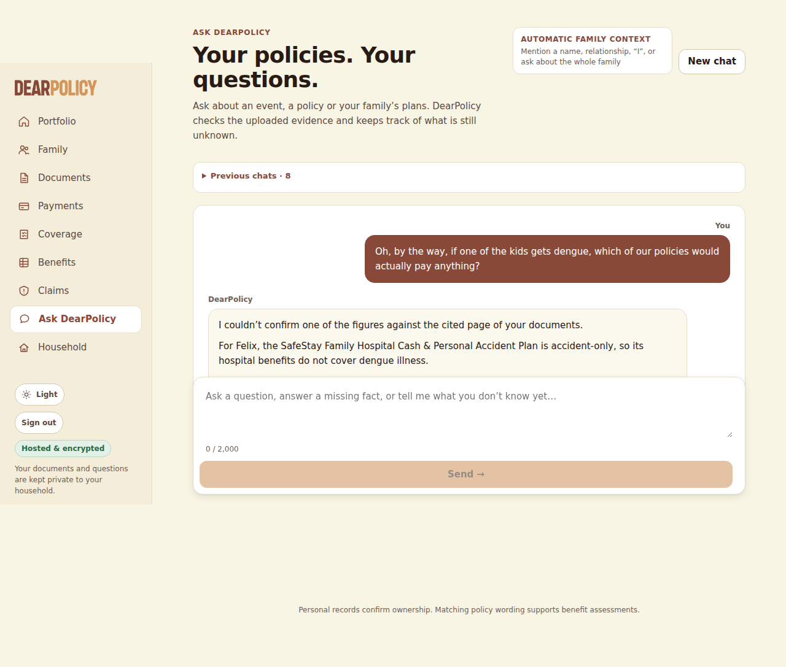

### R1 -- reopen -- 42 s

**User** (composer): So if Isla was in hospital for exactly 3 days in August after falling at the playground, how much would Meridian pay?

**DearPolicy**: DearPolicy I couldn’t finish: this question reached the limit set for model use on a single question, so I stopped before answering. Please ask about one policy or one person at a time.

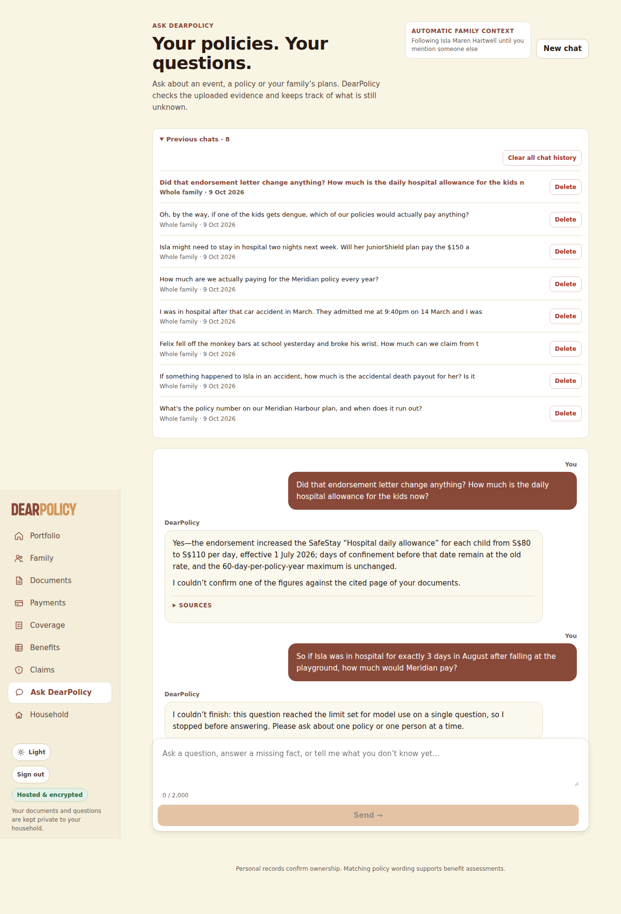

### D1 -- after_delete -- 6 s

**User** (composer): Did that endorsement letter change anything? How much is the daily hospital allowance for the kids now?

**DearPolicy**: DearPolicy I couldn’t confirm one of the figures against the cited page of your documents. SOURCES

Sources shown: Kestrel Bay Insurance (Singapore) Ltd. · JuniorShield Child Hospital Income PlanYour uploaded documentPage 1; Kestrel Bay Insurance (Singapore) Ltd. · JuniorShield Child Hospital Income PlanYour uploaded documentPage 1

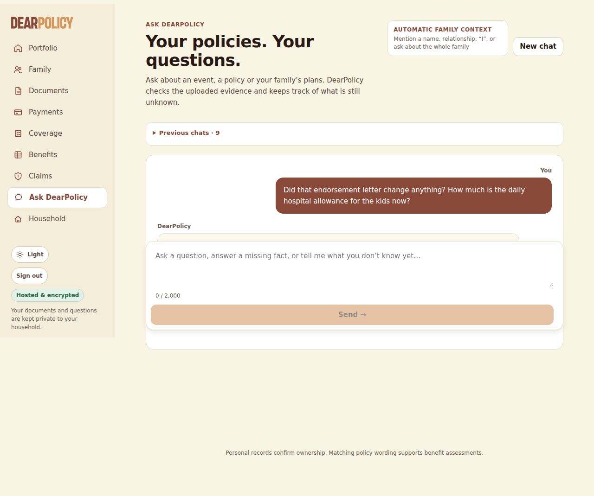

## Deterministic checks (EXPECTED.json, copied in after the conversations)

| scope | check | result | detail |
|---|---|---|---|
| hx-text.pdf | uploaded and processed | PASS | not_scanned_prototype/ready |
| hx-text.pdf | page 1 text extracted | PASS | native, 1842 chars |
| hx-text.pdf | page 1 contains "MHA-HC-2025-0748213" | PASS |  |
| hx-text.pdf | page 1 contains "S$150,000" | PASS |  |
| hx-text.pdf | page 1 contains "S$40,000" | PASS |  |
| hx-text.pdf | page 1 contains "S$120" | PASS |  |
| hx-text.pdf | page 1 contains "S$80" | PASS |  |
| hx-text.pdf | page 1 contains "S$600" | PASS |  |
| hx-text.pdf | page 1 contains "S$1,500" | PASS |  |
| hx-text.pdf | page 2 text extracted | PASS | native, 3002 chars |
| hx-text.pdf | page 2 contains "24 consecutive hours" | PASS |  |
| hx-text.pdf | page 2 contains "Accident-only cover" | PASS |  |
| hx-text.pdf | linked automatically to the right people | PASS | linked: Felix Oran Hartwell, Isla Maren Hartwell, Leonie Brigitte Hartwell, Simon Alastair Hartwell; expected: Simon Alastair Hartwell, Leonie Brigitte Hartwell, Felix Oran Hartwell, Isla Maren Hartwell |
| hx-endorsement.pdf | uploaded and processed | PASS | not_scanned_prototype/ready |
| hx-endorsement.pdf | page 1 text extracted | PASS | native, 1250 chars |
| hx-endorsement.pdf | page 1 contains "ME-26-0412" | PASS |  |
| hx-endorsement.pdf | page 1 contains "MHA-HC-2025-0748213" | PASS |  |
| hx-endorsement.pdf | page 1 contains "S$110" | PASS |  |
| hx-endorsement.pdf | page 1 contains "01 July 2026" | PASS |  |
| hx-scanned.pdf | uploaded and processed | PASS | not_scanned_prototype/ready |
| hx-scanned.pdf | page 1 text extracted | PASS | ocr, 1243 chars |
| hx-scanned.pdf | page 1 contains "KBJ-26-00391" | PASS |  |
| hx-scanned.pdf | page 1 contains "S$150" | PASS |  |
| hx-scanned.pdf | page 1 contains "S$500" | PASS |  |
| hx-scanned.pdf | linked automatically to the right people | PASS | linked: Isla Maren Hartwell; expected: Isla Maren Hartwell |
| Q1 (conversation) "What's the policy number on our Meridian Harbour plan, and w" | useful reply | PASS | 195 chars |
| Q2 (conversation) "If something happened to Isla in an accident, how much is th" | useful reply | PASS | 100 chars |
| Q3 (conversation) "Felix fell off the monkey bars at school yesterday and broke" | useful reply | PASS | 610 chars |
| Q4 (conversation) "The doctor said it's a closed fracture, the X-ray confirmed " | useful reply | PASS | 622 chars |
| Q5 (conversation) "I was in hospital after that car accident in March. They adm" | useful reply | PASS | 186 chars |
| Q6 (conversation) "Did that endorsement letter change anything? How much is the" | useful reply | PASS | 351 chars |
| Q7 (conversation) "How much are we actually paying for the Meridian policy ever" | useful reply | PASS | 316 chars |
| Q8 (conversation) "Isla might need to stay in hospital two nights next week. Wi" | useful reply | PASS | 100 chars |
| Q9 (conversation) "Oh, by the way, if one of the kids gets dengue, which of our" | useful reply | PASS | 373 chars |
| R1 (reopen) "So if Isla was in hospital for exactly 3 days in August afte" | useful reply | PASS | 186 chars |
| D1 (after_delete) "Did that endorsement letter change anything? How much is the" | useful reply | PASS | 100 chars |
| D1 (after_delete) "Did that endorsement letter change anything? How much is the" | does not rely on the deleted hx-endorsement.pdf | PASS | cites: hx-scanned.pdf, hx-scanned.pdf |
| Q1 | states "MHA-HC-2025-0748213" | PASS |  |
| Q1 | states one of ["31 January 2027","31 Jan 2027","31/01/2027","2027-01-31","31 Jan. 2027"] | PASS |  |
| Q1 | never states "MHA-HC-2025-0748218" | PASS |  |
| Q1 | never states "01 Feb 2027" | PASS |  |
| Q1 | never states "1 February 2027" | PASS |  |
| Q1 | never states "14 March 2027" | PASS |  |
| Q1 | cites hx-text.pdf page 1 | PASS | cited: hx-text.pdf p1 |
| Q1 | answers without an unnecessary follow-up | PASS |  |
| Q2 | states "S$40,000" | **FAIL** |  |
| Q2 | states "S$150,000" | **FAIL** |  |
| Q2 | cites hx-text.pdf page 1 | PASS | cited: hx-text.pdf p1, hx-scanned.pdf p1 |
| Q2 | answers without an unnecessary follow-up | PASS |  |
| Q3 | never states "S$2,100" | PASS |  |
| Q3 | never states "S$2,500" | PASS |  |
| Q3 | about Felix Oran Hartwell | PASS | no stored subject; answer names Felix |
| Q3 | asks a follow-up before answering | PASS | Has a registered medical practitioner certified the fracture type in writing and confirmed it by X-ray? |
| Q4 | states "S$600" | **FAIL** |  |
| Q4 | never states "S$2,100" | PASS |  |
| Q4 | never states "S$2,600" | PASS |  |
| Q4 | cites hx-text.pdf page 1 | **FAIL** | cited: nothing |
| Q4 | about Felix Oran Hartwell | **FAIL** | no stored subject; answer does not name Felix |
| Q5 | states "S$360" | **FAIL** |  |
| Q5 | never states "S$480" | PASS |  |
| Q5 | never states "S$330" | PASS |  |
| Q5 | never states "S$440" | PASS |  |
| Q5 | cites hx-text.pdf page 1 | **FAIL** | cited: nothing |
| Q5 | about Simon Alastair Hartwell | **FAIL** | no stored subject; answer does not name Simon |
| Q6 | states "S$110" | PASS |  |
| Q6 | states one of ["01 July 2026","1 July 2026","1 Jul 2026","01 Jul 2026"] | PASS |  |
| Q6 | cites hx-endorsement.pdf page 1 | PASS | cited: hx-endorsement.pdf p1, hx-endorsement.pdf p1, hx-text.pdf p1, hx-text.pdf p1, hx-scanned.pdf p1, hx-scanned.pdf p1 |
| Q6 | uses the current version (hx-endorsement.pdf) | PASS | cited: hx-endorsement.pdf, hx-text.pdf, hx-scanned.pdf |
| Q7 | states one of ["not stated","isn't stated","is not stated","not shown","isn't shown","doesn't show","does not show","not in your","not in the","don't show","do not show","no premium","doesn't state","does not state","doesn't mention","does not mention","couldn't find","could not find"] | PASS |  |
| Q8 | states one of ["4th","fourth"] | **FAIL** |  |
| Q8 | never states "S$300" | PASS |  |
| Q8 | never states "S$450" | PASS |  |
| Q8 | cites hx-scanned.pdf page 1 | PASS | cited: hx-scanned.pdf p1, hx-scanned.pdf p1 |
| Q8 | about Isla Maren Hartwell | PASS | resolved to Isla Maren Hartwell |
| Q9 | states "S$500" | **FAIL** |  |
| Q9 | states one of ["accident only","accident-only","only covers accidents","accidents only","only for accidents","only pays for accidents"] | PASS |  |
| Q9 | cites hx-scanned.pdf page 1 | PASS | cited: hx-scanned.pdf p1, hx-scanned.pdf p1, hx-scanned.pdf p1, hx-scanned.pdf p1, hx-text.pdf p2, hx-text.pdf p2, hx-text.pdf p1 |
| R1 | states "S$330" | **FAIL** |  |
| R1 | never states "S$240" | PASS |  |
| R1 | about Isla Maren Hartwell | PASS | resolved to Isla Maren Hartwell |
| D1 | never states "S$110" | PASS |  |
| D1 | does not cite hx-endorsement.pdf | PASS |  |

## Every provider request (process-wide fetch guard)

| seq | kind | model → reported | provider request id | status / refused | in | cached | out | reasoning | reserved | charged | ms |
|---|---|---|---|---|---|---|---|---|---|---|---|
| 1 | structured | gpt-6-luna → gpt-6-luna | chatcmpl-EX4YzENeryA3K6UznZAruoD5cDQ0C | 200 | 2743 | 0 | 5252 | 0 | US$0.003506 | US$0.002900 | 25513 |
| 2 | structured | gpt-6-luna → gpt-6-luna | chatcmpl-EX4ZOWVaPIcJXSyYPzXSW6zJsJ9WX | 200 | 1336 | 0 | 11 | 0 | US$0.000592 | US$0.000139 | 1346 |
| 2 | structured | gpt-6-luna → gpt-6-luna | chatcmpl-EX4ZOo82qI1ZtQ9MKZrjoVjbCwheF | 200 | 1201 | 0 | 555 | 0 | US$0.000548 | US$0.000398 | 4020 |
| 4 | structured | gpt-6-luna → gpt-6-luna | chatcmpl-EX4ZSzeC6oThzjd0kYz5tVQ6ouTqS | 200 | 1612 | 0 | 879 | 0 | US$0.000746 | US$0.000601 | 4926 |
| 5 | structured | gpt-6-luna → gpt-6-luna | chatcmpl-EX4ZXW8ww7ACQ7yrTqwFHDdbv1LTO | 200 | 2454 | 0 | 4000 | 0 | US$0.002416 | US$0.002245 | 21988 |
| 6 | structured | gpt-6-luna → gpt-6-luna | chatcmpl-EX4Zt8k5vWiQ7h8Nxfs955wuc3Suh | 200 | 3282 | 0 | 931 | 0 | US$0.001273 | US$0.000794 | 6980 |
| 7 | structured | gpt-6-luna → gpt-6-luna | chatcmpl-EX4a29haRmMfz08qQc1Cbs4mrcaUQ | 200 | 2006 | 1646 | 314 | 0 | US$0.003391 | US$0.000209 | 2870 |
| 8 | structured | gpt-6-luna → gpt-6-luna | chatcmpl-EX4a4TqQW56xnrx0ODu58QOsrp4cL | 200 | 958 | 0 | 95 | 0 | US$0.000522 | US$0.000143 | 1313 |
| 9 | structured | gpt-6-luna → gpt-6-luna | chatcmpl-EX4a6iiXDdDbt5PMpYDgvvHZDjTKU | 200 | 1234 | 0 | 107 | 0 | US$0.000675 | US$0.000177 | 1718 |
| 10 | structured | gpt-6-luna → gpt-6-luna | chatcmpl-EX4a8w1qcktDjYawrV6ienDr0YY4A | 200 | 1490 | 1073 | 322 | 0 | US$0.002265 | US$0.000213 | 2972 |
| 11 | structured | gpt-6-luna → gpt-6-luna | chatcmpl-EX4aBHBjVnyPO9itveyBi0Jsq2Ebf | 200 | 847 | 0 | 119 | 0 | US$0.000900 | US$0.000144 | 2804 |
| 12 | document (pdf 1p) | gpt-6-luna → gpt-6-luna | chatcmpl-EX4aFELMfJijqV4iUHyo4Z0NNcR57 | 200 | 1351 | 0 | 381 | 0 | US$0.008615 | US$0.000326 | 4200 |
| 13 | structured | gpt-6-luna → gpt-6-luna | chatcmpl-EX4aIMb3UF5PjUODg48C6wOZsXbkr | 200 | 2018 | 1646 | 938 | 0 | US$0.003391 | US$0.000523 | 5630 |
| 14 | structured | gpt-6-luna → gpt-6-luna | chatcmpl-EX4aOG0KNUxlC2MJCauywpylrvg6r | 200 | 672 | 0 | 120 | 0 | US$0.000580 | US$0.000127 | 1649 |
| 15 | structured | gpt-6-luna → gpt-6-luna | chatcmpl-EX4aPaoTep61jj7BBGz5eVKIBRRQx | 200 | 1246 | 0 | 180 | 0 | US$0.000675 | US$0.000215 | 1761 |
| 16 | structured | gpt-6-luna → gpt-6-luna | chatcmpl-EX4aR64ig0AawuZwoURLbwjn12iJO | 200 | 1479 | 1073 | 644 | 0 | US$0.002261 | US$0.000373 | 4752 |
| 16 | loop | gpt-6-luna → gpt-6-luna | chatcmpl-EX4aWg9kl1i3jp0zzguyxDdIXnB8a | 200 | 4677 | 0 | 29 | 0 | US$0.002000 | US$0.000482 | 1546 |
| 18 | loop | gpt-6-luna → gpt-6-luna | chatcmpl-EX4aX5HOBCNVWlc6iWBTpufgEwa34 | 200 | 8042 | 4551 | 78 | 0 | US$0.002473 | US$0.000434 | 1498 |
| 17 | structured | gpt-6-luna → gpt-6-luna | chatcmpl-EX4aWCLfD940xboUvfojFd33v3VPu | 200 | 943 | 0 | 137 | 0 | US$0.000914 | US$0.000163 | 3740 |
| 20 | loop | gpt-6-luna → gpt-6-luna | chatcmpl-EX4aaISafwy7BfyY4ognT0cqmMtQq | 200 | 4686 | 4530 | 48 | 0 | US$0.002001 | US$0.000085 | 1346 |
| 21 | loop | gpt-6-luna → gpt-6-luna | chatcmpl-EX4ac1tQIzFRSbe97GGbqHZYoZden | 200 | 4967 | 4560 | 104 | 0 | US$0.002045 | US$0.000138 | 1841 |
| 22 | loop | gpt-6-luna → gpt-6-luna | chatcmpl-EX4aesImWwL1xXH1a539sfxAw3DRJ | 200 | 6911 | 4841 | 262 | 0 | US$0.002279 | US$0.000386 | 4783 |
| 23 | loop | gpt-6-luna → gpt-6-luna | chatcmpl-EX4aiSn3JfI4Q395PuP4rh9L4rChH | 200 | 17500 | 6785 | 198 | 0 | US$0.003737 | US$0.001238 | 2709 |
| 24 | loop | gpt-6-luna → gpt-6-luna | chatcmpl-EX4alsTFAfm5mwmWkTJmujOO9QWSF | 200 | 18425 | 17374 | 268 | 0 | US$0.003857 | US$0.000413 | 4348 |
| 25 | loop | gpt-6-luna → gpt-6-luna | chatcmpl-EX4asEHegbvZz8rdEpxRt7V4OIo43 | 200 | 4685 | 4530 | 89 | 0 | US$0.002001 | US$0.000105 | 1606 |
| 26 | loop | gpt-6-luna → gpt-6-luna | chatcmpl-EX4auXmPw0Jr26VSESpylOQSF4l1t | 200 | 4885 | 4559 | 43 | 0 | US$0.002038 | US$0.000100 | 1372 |
| 27 | loop | gpt-6-luna → gpt-6-luna | chatcmpl-EX4avaexfCfbp3mrfjvukHXl8CnZp | 200 | 5439 | 4759 | 228 | 0 | US$0.002115 | US$0.000230 | 2548 |
| 28 | loop | gpt-6-luna → gpt-6-luna | chatcmpl-EX4ay9CHJqSGhBru5kguqLihYkIkQ | 200 | 15962 | 5313 | 283 | 0 | US$0.003587 | US$0.001260 | 2575 |
| 29 | loop | gpt-6-luna → gpt-6-luna | chatcmpl-EX4b0hDbAikMpvsSqEAJqx25t8TrP | 200 | 17330 | 15836 | 213 | 0 | US$0.003766 | US$0.000414 | 2519 |
| 30 | loop | gpt-6-luna → gpt-6-luna | chatcmpl-EX4b5G38IAnUwELiZNitvQ8nM0IbY | 200 | 5077 | 0 | 78 | 0 | US$0.002070 | US$0.000547 | 1797 |
| 31 | loop | gpt-6-luna → gpt-6-luna | chatcmpl-EX4b6iBYcPbY0sOGolSbjiVpSaubY | 200 | 5353 | 4951 | 132 | 0 | US$0.002122 | US$0.000156 | 2349 |
| 32 | loop | gpt-6-luna → gpt-6-luna | chatcmpl-EX4b9hllG4hN8qbCluxgSmzwQVVaQ | 200 | 5518 | 5227 | 271 | 0 | US$0.002158 | US$0.000217 | 2763 |
| 33 | loop | gpt-6-luna → gpt-6-luna | chatcmpl-EX4bErxg0fmh5LxyfNtvWRvUZW0p7 | 200 | 4708 | 4530 | 130 | 0 | US$0.002004 | US$0.000128 | 1754 |
| 34 | loop | gpt-6-luna → gpt-6-luna | chatcmpl-EX4bFMpw93nAevcZM2lhlBD7pWP3t | 200 | 5006 | 4582 | 46 | 0 | US$0.002053 | US$0.000111 | 1357 |
| 35 | loop | gpt-6-luna → gpt-6-luna | chatcmpl-EX4bHtbgChMI8jTCBd0JD6Oct3NhP | 200 | 5806 | 4880 | 268 | 0 | US$0.002166 | US$0.000275 | 2824 |
| 36 | loop | gpt-6-luna → gpt-6-luna | chatcmpl-EX4bK8p6u6Pq1pP6PIujy6d8WihkL | 200 | 14950 | 5680 | 94 | 0 | US$0.003452 | US$0.001031 | 1811 |
| 37 | loop | gpt-6-luna → gpt-6-luna | chatcmpl-EX4bM2HUAtoXonN15hBBKapTSH0mk | 200 | 15704 | 14824 | 177 | 0 | US$0.003557 | US$0.000325 | 2127 |
| 38 | loop | gpt-6-luna → gpt-6-luna | chatcmpl-EX4bOTJr2Oq3Ekrsw6wWe8Ka32wws | 200 | 15913 | 15578 | 164 | 0 | US$0.003590 | US$0.000271 | 3239 |
| 39 | loop | gpt-6-luna → gpt-6-luna | chatcmpl-EX4bTJvgPvPwN0l3zq7Pe4uw8Wl0P | 200 | 4679 | 4530 | 126 | 0 | US$0.002001 | US$0.000123 | 1841 |
| 40 | loop | gpt-6-luna → gpt-6-luna | chatcmpl-EX4bVDzzzSgtTGLnpg7ToDvvhsE5z | 200 | 11149 | 4553 | 283 | 0 | US$0.002855 | US$0.000847 | 2909 |
| 41 | loop | gpt-6-luna → gpt-6-luna | chatcmpl-EX4bami9LPi7lfk9rM42mDygZ0Vex | 200 | 4673 | 4530 | 26 | 0 | US$0.001999 | US$0.000073 | 1463 |
| 42 | loop | gpt-6-luna → gpt-6-luna | chatcmpl-EX4bc9ksZuEf7qX7jaiSqRZ1OXHR6 | 200 | 8039 | 4547 | 45 | 0 | US$0.002474 | US$0.000417 | 1548 |
| 43 | loop | gpt-6-luna → gpt-6-luna | chatcmpl-EX4bd23pRc6td08O5ePt0djolCb3v | 200 | 9061 | 7913 | 59 | 0 | US$0.002617 | US$0.000223 | 1726 |
| 44 | loop | gpt-6-luna → gpt-6-luna | chatcmpl-EX4bf4RlJ1GxYWDqEQyAxq8qrYb7S | 200 | 12970 | 8935 | 146 | 0 | US$0.003171 | US$0.000566 | 2182 |
| 45 | loop | gpt-6-luna → gpt-6-luna | chatcmpl-EX4bjb9OZumOOXz6hAYgeeQSz4Sr1 | 200 | 4685 | 4530 | 18 | 0 | US$0.002001 | US$0.000070 | 1163 |
| 46 | loop | gpt-6-luna → gpt-6-luna | chatcmpl-EX4bk4AUFum3qurn3OgpITSrDaau0 | 200 | 4802 | 4559 | 124 | 0 | US$0.002024 | US$0.000132 | 1772 |
| 47 | loop | gpt-6-luna → gpt-6-luna | chatcmpl-EX4bm2Cr3OzyLNioF5Jt03grndAox | 200 | 5991 | 4676 | 197 | 0 | US$0.002172 | US$0.000277 | 2557 |
| 48 | loop | gpt-6-luna → gpt-6-luna | chatcmpl-EX4box3uunWcXpkhalgeMOTox5FYH | 200 | 12399 | 5865 | 124 | 0 | US$0.003059 | US$0.000774 | 2024 |
| 49 | loop | gpt-6-luna → gpt-6-luna | chatcmpl-EX4bsdL7P4j74jLvh51EgLxLkybES | 200 | 4683 | 4530 | 66 | 0 | US$0.002000 | US$0.000094 | 1536 |
| 50 | loop | gpt-6-luna → gpt-6-luna | chatcmpl-EX4busm6WbUGOuSRNxBA3fgVihh4D | 200 | 9082 | 4557 | 90 | 0 | US$0.002625 | US$0.000543 | 1681 |
| 51 | loop | gpt-6-luna → gpt-6-luna | chatcmpl-EX4bwodFUo2o1WC5aSwUZQUureuxy | 200 | 9229 | 8956 | 165 | 0 | US$0.002652 | US$0.000199 | 2088 |
| 52 | loop | gpt-6-luna → gpt-6-luna | chatcmpl-EX4bzlYQfsc1OlzwIfBM12s99i4eh | 200 | 12542 | 9103 | 226 | 0 | US$0.003079 | US$0.000548 | 3591 |
| 53 | loop | gpt-6-luna → gpt-6-luna | chatcmpl-EX4c1yHMhUUlWH87oY7ojD6n8xXda | 200 | 17388 | 12416 | 277 | 0 | US$0.003751 | US$0.000760 | 2909 |
| 54 | loop | gpt-6-luna → gpt-6-luna | chatcmpl-EX4c6XmqSngBmx9Xk6xb4IQBwG7IR | 200 | 5041 | 0 | 18 | 0 | US$0.002064 | US$0.000513 | 4008 |
| 55 | loop | gpt-6-luna → gpt-6-luna | chatcmpl-EX4cAHRb7yNLDZpbRT0zVF0SAHaow | 200 | 5158 | 4915 | 105 | 0 | US$0.002087 | US$0.000126 | 5728 |
| 56 | loop | gpt-6-luna → gpt-6-luna | chatcmpl-EX4cGIJIpx3XG3wT73le3c2pNanfH | 200 | 5408 | 5032 | 63 | 0 | US$0.002133 | US$0.000119 | 5580 |
| 57 | loop | gpt-6-luna → gpt-6-luna | chatcmpl-EX4cMHlSi8Em3sR6RFGPZtrkdsA1l | 200 | 5607 | 5282 | 116 | 0 | US$0.002170 | US$0.000143 | 6699 |
| 58 | loop | gpt-6-luna → gpt-6-luna | chatcmpl-EX4cTLMC0RpALyOBAxDfA3K5OCN6N | 200 | 11825 | 5481 | 110 | 0 | US$0.003016 | US$0.000744 | 5452 |
| 59 | loop | gpt-6-luna → gpt-6-luna | chatcmpl-EX4cYJ11Y0zIxZyNw4V0pDyBhTJiO | 200 | 14546 | 11699 | 81 | 0 | US$0.003421 | US$0.000442 | 7284 |
| 60 | loop | gpt-6-luna → gpt-6-luna | chatcmpl-EX4cf1J0lbXv1IsTrzuHpIzt1UwkQ | 200 | 15273 | 14420 | 250 | 0 | US$0.003523 | US$0.000354 | 5570 |
| 61 | loop | gpt-6-luna → gpt-6-luna | chatcmpl-EX4dmesMRitAvmfrYa1KomVHrLBQi | 200 | 4679 | 4553 | 131 | 0 | US$0.002001 | US$0.000124 | 1952 |
| 62 | loop | gpt-6-luna → gpt-6-luna | chatcmpl-EX4doJckEeyMei4ggK2XM6iaBnAoK | 200 | 9221 | 4553 | 268 | 0 | US$0.002614 | US$0.000646 | 3734 |

## App provenance (model_executions) joined to the guard's calls

| operation | attempt | requested | resolved provider / model | provider request id | status | in | cached | out | cost | guard seq |
|---|---|---|---|---|---|---|---|---|---|---|
| policy_extraction | 0 | openai:gpt-6-luna | openai:gpt-6-luna | chatcmpl-EX4YzENeryA3K6UznZAruoD5cDQ0C | succeeded | 2743 | 0 | 5252 | US$0.002900 | 1 |
| catalog_building | 0 | openai:gpt-6-luna | openai:gpt-6-luna | chatcmpl-EX4ZOo82qI1ZtQ9MKZrjoVjbCwheF | succeeded | 1201 | 0 | 555 | US$0.000398 | 2 |
| catalog_building | 0 | openai:gpt-6-luna | openai:gpt-6-luna | chatcmpl-EX4ZOWVaPIcJXSyYPzXSW6zJsJ9WX | succeeded | 1336 | 0 | 11 | US$0.000139 | - |
| condition_catalog_extraction | 0 | openai:gpt-6-luna | openai:gpt-6-luna | chatcmpl-EX4ZSzeC6oThzjd0kYz5tVQ6ouTqS | succeeded | 1612 | 0 | 879 | US$0.000601 | 4 |
| benefit_extraction | 0 | openai:gpt-6-luna | openai:gpt-6-luna | chatcmpl-EX4ZXW8ww7ACQ7yrTqwFHDdbv1LTO | succeeded | 2454 | 0 | 4000 | US$0.002245 | 5 |
| benefit_extraction | 0 | openai:gpt-6-luna | openai:gpt-6-luna | chatcmpl-EX4Zt8k5vWiQ7h8Nxfs955wuc3Suh | succeeded | 3282 | 0 | 931 | US$0.000794 | 6 |
| policy_extraction | 0 | openai:gpt-6-luna | openai:gpt-6-luna | chatcmpl-EX4a29haRmMfz08qQc1Cbs4mrcaUQ | succeeded | 2006 | 1646 | 314 | US$0.000209 | 7 |
| catalog_building | 0 | openai:gpt-6-luna | openai:gpt-6-luna | chatcmpl-EX4a4TqQW56xnrx0ODu58QOsrp4cL | succeeded | 958 | 0 | 95 | US$0.000143 | 8 |
| condition_catalog_extraction | 0 | openai:gpt-6-luna | openai:gpt-6-luna | chatcmpl-EX4a6iiXDdDbt5PMpYDgvvHZDjTKU | succeeded | 1234 | 0 | 107 | US$0.000177 | 9 |
| benefit_extraction | 0 | openai:gpt-6-luna | openai:gpt-6-luna | chatcmpl-EX4a8w1qcktDjYawrV6ienDr0YY4A | succeeded | 1490 | 1073 | 322 | US$0.000213 | 10 |
| benefit_extraction | 0 | openai:gpt-6-luna | openai:gpt-6-luna | chatcmpl-EX4aBHBjVnyPO9itveyBi0Jsq2Ebf | succeeded | 847 | 0 | 119 | US$0.000144 | 11 |
| hosted_ocr | 0 | openai:gpt-6-luna | openai:gpt-6-luna | chatcmpl-EX4aFELMfJijqV4iUHyo4Z0NNcR57 | succeeded | 1351 | 0 | 381 | US$0.000326 | 12 |
| policy_extraction | 0 | openai:gpt-6-luna | openai:gpt-6-luna | chatcmpl-EX4aIMb3UF5PjUODg48C6wOZsXbkr | succeeded | 2018 | 1646 | 938 | US$0.000523 | 13 |
| catalog_building | 0 | openai:gpt-6-luna | openai:gpt-6-luna | chatcmpl-EX4aOG0KNUxlC2MJCauywpylrvg6r | succeeded | 672 | 0 | 120 | US$0.000127 | 14 |
| condition_catalog_extraction | 0 | openai:gpt-6-luna | openai:gpt-6-luna | chatcmpl-EX4aPaoTep61jj7BBGz5eVKIBRRQx | succeeded | 1246 | 0 | 180 | US$0.000215 | 15 |
| benefit_extraction | 0 | openai:gpt-6-luna | openai:gpt-6-luna | chatcmpl-EX4aR64ig0AawuZwoURLbwjn12iJO | succeeded | 1479 | 1073 | 644 | US$0.000373 | 16 |
| rag_answer | 0 | openai:gpt-6-luna | openai:gpt-6-luna | chatcmpl-EX4aWg9kl1i3jp0zzguyxDdIXnB8a | succeeded | 4677 | 0 | 29 | US$0.000482 | - |
| benefit_extraction | 0 | openai:gpt-6-luna | openai:gpt-6-luna | chatcmpl-EX4aWCLfD940xboUvfojFd33v3VPu | succeeded | 943 | 0 | 137 | US$0.000163 | 17 |
| rag_answer | 1 | openai:gpt-6-luna | openai:gpt-6-luna | chatcmpl-EX4aX5HOBCNVWlc6iWBTpufgEwa34 | succeeded | 8042 | 4551 | 78 | US$0.000434 | 18 |
| rag_answer | 0 | openai:gpt-6-luna | openai:gpt-6-luna | chatcmpl-EX4aaISafwy7BfyY4ognT0cqmMtQq | succeeded | 4686 | 4530 | 48 | US$0.000085 | 20 |
| rag_answer | 1 | openai:gpt-6-luna | openai:gpt-6-luna | chatcmpl-EX4ac1tQIzFRSbe97GGbqHZYoZden | succeeded | 4967 | 4560 | 104 | US$0.000138 | 21 |
| rag_answer | 2 | openai:gpt-6-luna | openai:gpt-6-luna | chatcmpl-EX4aesImWwL1xXH1a539sfxAw3DRJ | succeeded | 6911 | 4841 | 262 | US$0.000386 | 22 |
| rag_answer | 3 | openai:gpt-6-luna | openai:gpt-6-luna | chatcmpl-EX4aiSn3JfI4Q395PuP4rh9L4rChH | succeeded | 17500 | 6785 | 198 | US$0.001238 | 23 |
| rag_answer | 4 | openai:gpt-6-luna | openai:gpt-6-luna | chatcmpl-EX4alsTFAfm5mwmWkTJmujOO9QWSF | succeeded | 18425 | 17374 | 268 | US$0.000413 | 24 |
| rag_answer | 0 | openai:gpt-6-luna | openai:gpt-6-luna | chatcmpl-EX4asEHegbvZz8rdEpxRt7V4OIo43 | succeeded | 4685 | 4530 | 89 | US$0.000105 | 25 |
| rag_answer | 1 | openai:gpt-6-luna | openai:gpt-6-luna | chatcmpl-EX4auXmPw0Jr26VSESpylOQSF4l1t | succeeded | 4885 | 4559 | 43 | US$0.000100 | 26 |
| rag_answer | 2 | openai:gpt-6-luna | openai:gpt-6-luna | chatcmpl-EX4avaexfCfbp3mrfjvukHXl8CnZp | succeeded | 5439 | 4759 | 228 | US$0.000230 | 27 |
| rag_answer | 3 | openai:gpt-6-luna | openai:gpt-6-luna | chatcmpl-EX4ay9CHJqSGhBru5kguqLihYkIkQ | succeeded | 15962 | 5313 | 283 | US$0.001260 | 28 |
| rag_answer | 4 | openai:gpt-6-luna | openai:gpt-6-luna | chatcmpl-EX4b0hDbAikMpvsSqEAJqx25t8TrP | succeeded | 17330 | 15836 | 213 | US$0.000414 | 29 |
| rag_answer | 0 | openai:gpt-6-luna | openai:gpt-6-luna | chatcmpl-EX4b5G38IAnUwELiZNitvQ8nM0IbY | succeeded | 5077 | 0 | 78 | US$0.000547 | 30 |
| rag_answer | 1 | openai:gpt-6-luna | openai:gpt-6-luna | chatcmpl-EX4b6iBYcPbY0sOGolSbjiVpSaubY | succeeded | 5353 | 4951 | 132 | US$0.000156 | 31 |
| rag_answer | 2 | openai:gpt-6-luna | openai:gpt-6-luna | chatcmpl-EX4b9hllG4hN8qbCluxgSmzwQVVaQ | succeeded | 5518 | 5227 | 271 | US$0.000217 | 32 |
| rag_answer | 0 | openai:gpt-6-luna | openai:gpt-6-luna | chatcmpl-EX4bErxg0fmh5LxyfNtvWRvUZW0p7 | succeeded | 4708 | 4530 | 130 | US$0.000128 | 33 |
| rag_answer | 1 | openai:gpt-6-luna | openai:gpt-6-luna | chatcmpl-EX4bFMpw93nAevcZM2lhlBD7pWP3t | succeeded | 5006 | 4582 | 46 | US$0.000111 | 34 |
| rag_answer | 2 | openai:gpt-6-luna | openai:gpt-6-luna | chatcmpl-EX4bHtbgChMI8jTCBd0JD6Oct3NhP | succeeded | 5806 | 4880 | 268 | US$0.000275 | 35 |
| rag_answer | 3 | openai:gpt-6-luna | openai:gpt-6-luna | chatcmpl-EX4bK8p6u6Pq1pP6PIujy6d8WihkL | succeeded | 14950 | 5680 | 94 | US$0.001031 | 36 |
| rag_answer | 4 | openai:gpt-6-luna | openai:gpt-6-luna | chatcmpl-EX4bM2HUAtoXonN15hBBKapTSH0mk | succeeded | 15704 | 14824 | 177 | US$0.000325 | 37 |
| rag_answer | 5 | openai:gpt-6-luna | openai:gpt-6-luna | chatcmpl-EX4bOTJr2Oq3Ekrsw6wWe8Ka32wws | succeeded | 15913 | 15578 | 164 | US$0.000271 | 38 |
| rag_answer | 0 | openai:gpt-6-luna | openai:gpt-6-luna | chatcmpl-EX4bTJvgPvPwN0l3zq7Pe4uw8Wl0P | succeeded | 4679 | 4530 | 126 | US$0.000123 | 39 |
| rag_answer | 1 | openai:gpt-6-luna | openai:gpt-6-luna | chatcmpl-EX4bVDzzzSgtTGLnpg7ToDvvhsE5z | succeeded | 11149 | 4553 | 283 | US$0.000847 | 40 |
| rag_answer | 0 | openai:gpt-6-luna | openai:gpt-6-luna | chatcmpl-EX4bami9LPi7lfk9rM42mDygZ0Vex | succeeded | 4673 | 4530 | 26 | US$0.000073 | 41 |
| rag_answer | 1 | openai:gpt-6-luna | openai:gpt-6-luna | chatcmpl-EX4bc9ksZuEf7qX7jaiSqRZ1OXHR6 | succeeded | 8039 | 4547 | 45 | US$0.000417 | 42 |
| rag_answer | 2 | openai:gpt-6-luna | openai:gpt-6-luna | chatcmpl-EX4bd23pRc6td08O5ePt0djolCb3v | succeeded | 9061 | 7913 | 59 | US$0.000223 | 43 |
| rag_answer | 3 | openai:gpt-6-luna | openai:gpt-6-luna | chatcmpl-EX4bf4RlJ1GxYWDqEQyAxq8qrYb7S | succeeded | 12970 | 8935 | 146 | US$0.000566 | 44 |
| rag_answer | 0 | openai:gpt-6-luna | openai:gpt-6-luna | chatcmpl-EX4bjb9OZumOOXz6hAYgeeQSz4Sr1 | succeeded | 4685 | 4530 | 18 | US$0.000070 | 45 |
| rag_answer | 1 | openai:gpt-6-luna | openai:gpt-6-luna | chatcmpl-EX4bk4AUFum3qurn3OgpITSrDaau0 | succeeded | 4802 | 4559 | 124 | US$0.000132 | 46 |
| rag_answer | 2 | openai:gpt-6-luna | openai:gpt-6-luna | chatcmpl-EX4bm2Cr3OzyLNioF5Jt03grndAox | succeeded | 5991 | 4676 | 197 | US$0.000277 | 47 |
| rag_answer | 3 | openai:gpt-6-luna | openai:gpt-6-luna | chatcmpl-EX4box3uunWcXpkhalgeMOTox5FYH | succeeded | 12399 | 5865 | 124 | US$0.000774 | 48 |
| rag_answer | 0 | openai:gpt-6-luna | openai:gpt-6-luna | chatcmpl-EX4bsdL7P4j74jLvh51EgLxLkybES | succeeded | 4683 | 4530 | 66 | US$0.000094 | 49 |
| rag_answer | 1 | openai:gpt-6-luna | openai:gpt-6-luna | chatcmpl-EX4busm6WbUGOuSRNxBA3fgVihh4D | succeeded | 9082 | 4557 | 90 | US$0.000543 | 50 |
| rag_answer | 2 | openai:gpt-6-luna | openai:gpt-6-luna | chatcmpl-EX4bwodFUo2o1WC5aSwUZQUureuxy | succeeded | 9229 | 8956 | 165 | US$0.000199 | 51 |
| rag_answer | 3 | openai:gpt-6-luna | openai:gpt-6-luna | chatcmpl-EX4bzlYQfsc1OlzwIfBM12s99i4eh | succeeded | 12542 | 9103 | 226 | US$0.000548 | 52 |
| rag_answer | 4 | openai:gpt-6-luna | openai:gpt-6-luna | chatcmpl-EX4c1yHMhUUlWH87oY7ojD6n8xXda | succeeded | 17388 | 12416 | 277 | US$0.000760 | 53 |
| rag_answer | 0 | openai:gpt-6-luna | openai:gpt-6-luna | chatcmpl-EX4c6XmqSngBmx9Xk6xb4IQBwG7IR | succeeded | 5041 | 0 | 18 | US$0.000513 | 54 |
| rag_answer | 1 | openai:gpt-6-luna | openai:gpt-6-luna | chatcmpl-EX4cAHRb7yNLDZpbRT0zVF0SAHaow | succeeded | 5158 | 4915 | 105 | US$0.000126 | 55 |
| rag_answer | 2 | openai:gpt-6-luna | openai:gpt-6-luna | chatcmpl-EX4cGIJIpx3XG3wT73le3c2pNanfH | succeeded | 5408 | 5032 | 63 | US$0.000119 | 56 |
| rag_answer | 3 | openai:gpt-6-luna | openai:gpt-6-luna | chatcmpl-EX4cMHlSi8Em3sR6RFGPZtrkdsA1l | succeeded | 5607 | 5282 | 116 | US$0.000143 | 57 |
| rag_answer | 4 | openai:gpt-6-luna | openai:gpt-6-luna | chatcmpl-EX4cTLMC0RpALyOBAxDfA3K5OCN6N | succeeded | 11825 | 5481 | 110 | US$0.000744 | 58 |
| rag_answer | 5 | openai:gpt-6-luna | openai:gpt-6-luna | chatcmpl-EX4cYJ11Y0zIxZyNw4V0pDyBhTJiO | succeeded | 14546 | 11699 | 81 | US$0.000442 | 59 |
| rag_answer | 6 | openai:gpt-6-luna | openai:gpt-6-luna | chatcmpl-EX4cf1J0lbXv1IsTrzuHpIzt1UwkQ | succeeded | 15273 | 14420 | 250 | US$0.000355 | 60 |
| rag_answer | 0 | openai:gpt-6-luna | openai:gpt-6-luna | chatcmpl-EX4dmesMRitAvmfrYa1KomVHrLBQi | succeeded | 4679 | 4553 | 131 | US$0.000124 | 61 |
| rag_answer | 1 | openai:gpt-6-luna | openai:gpt-6-luna | chatcmpl-EX4doJckEeyMei4ggK2XM6iaBnAoK | succeeded | 9221 | 4553 | 268 | US$0.000646 | 62 |
