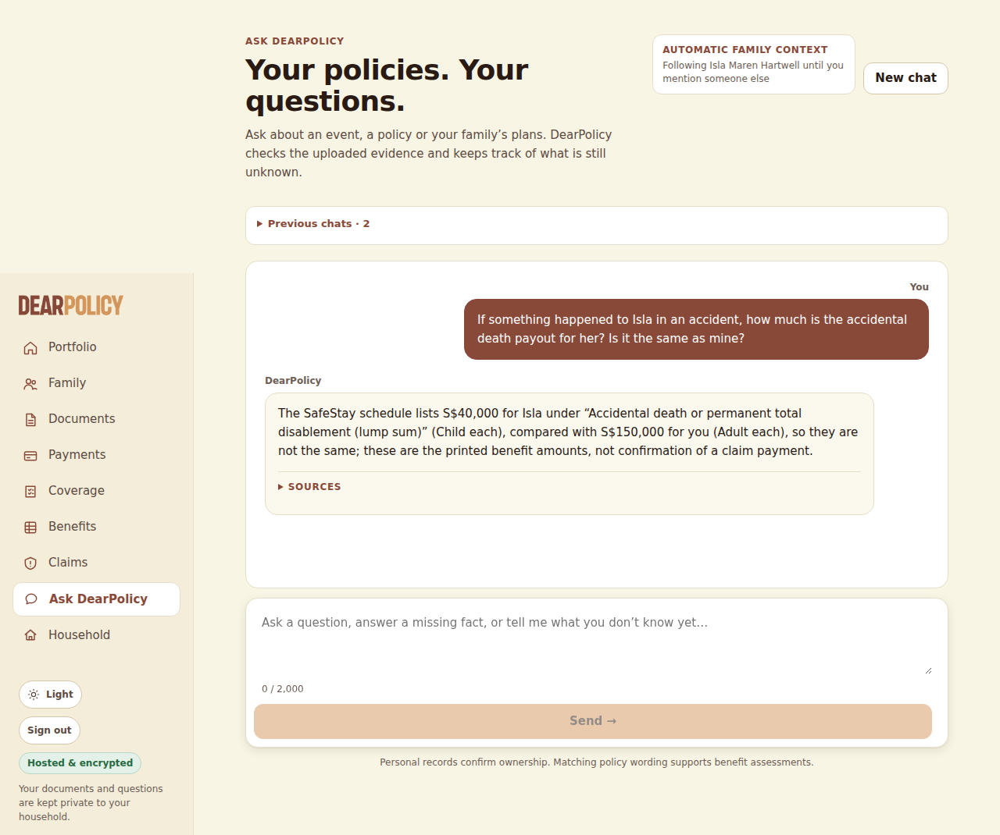
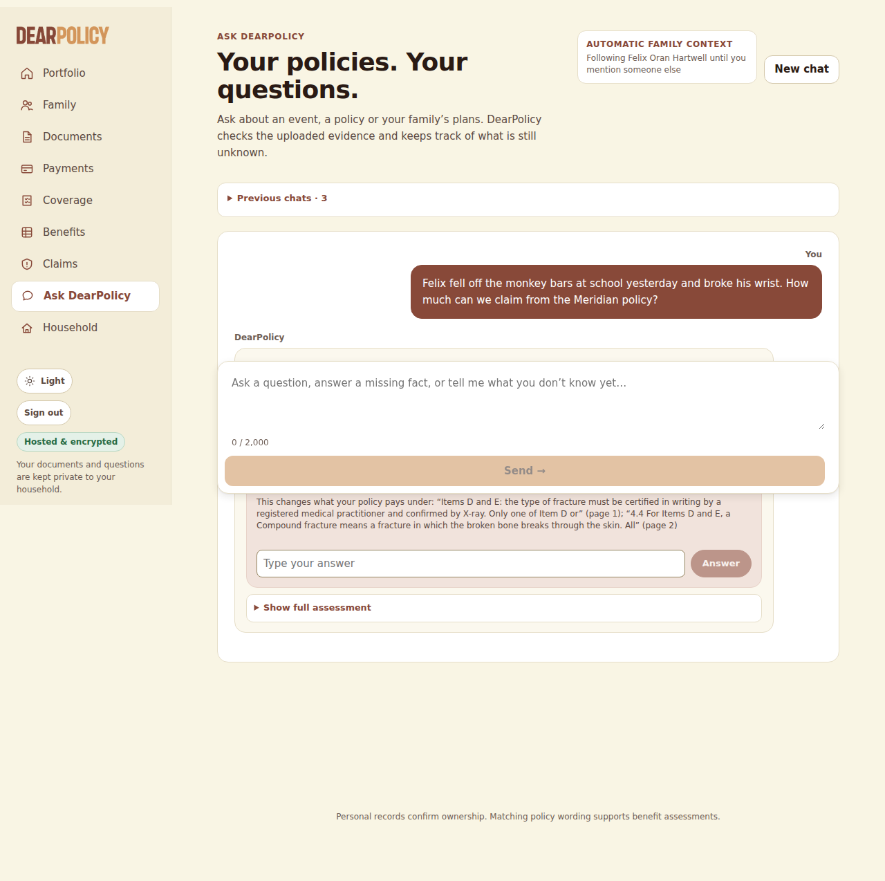
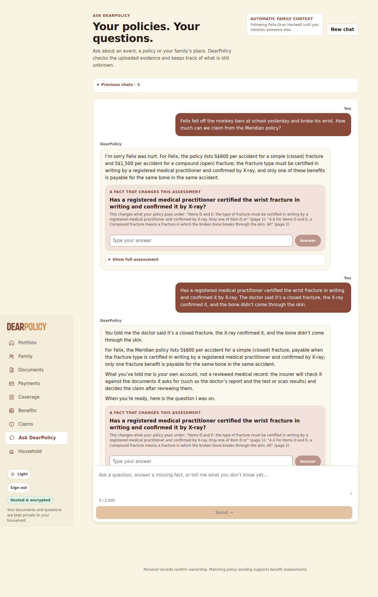
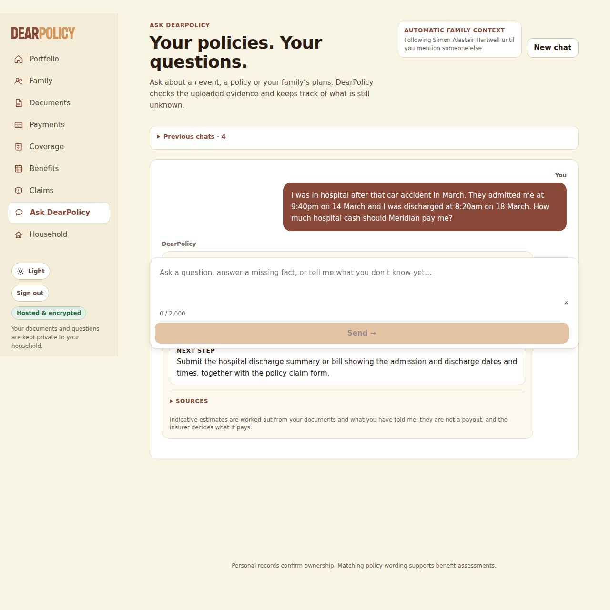
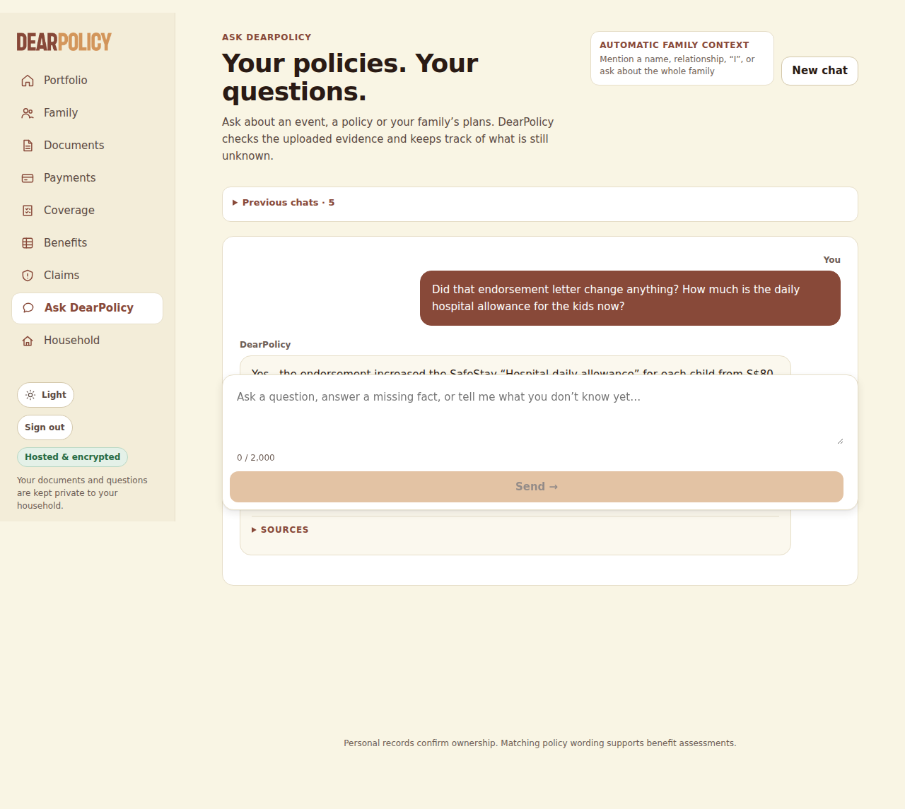
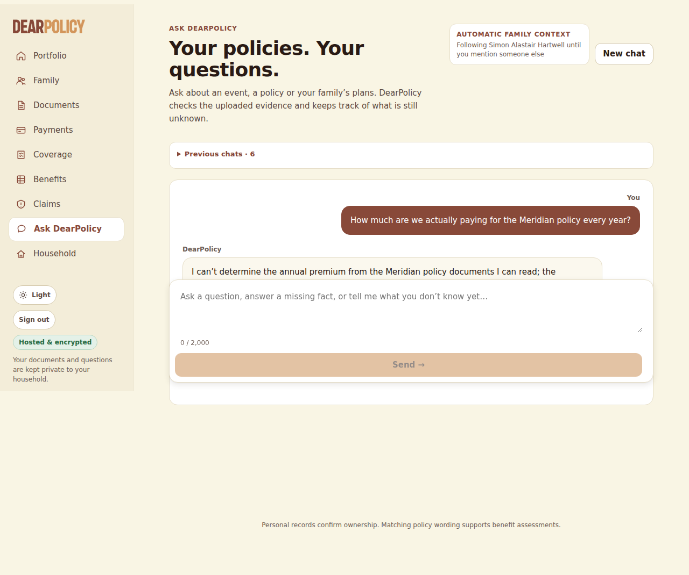
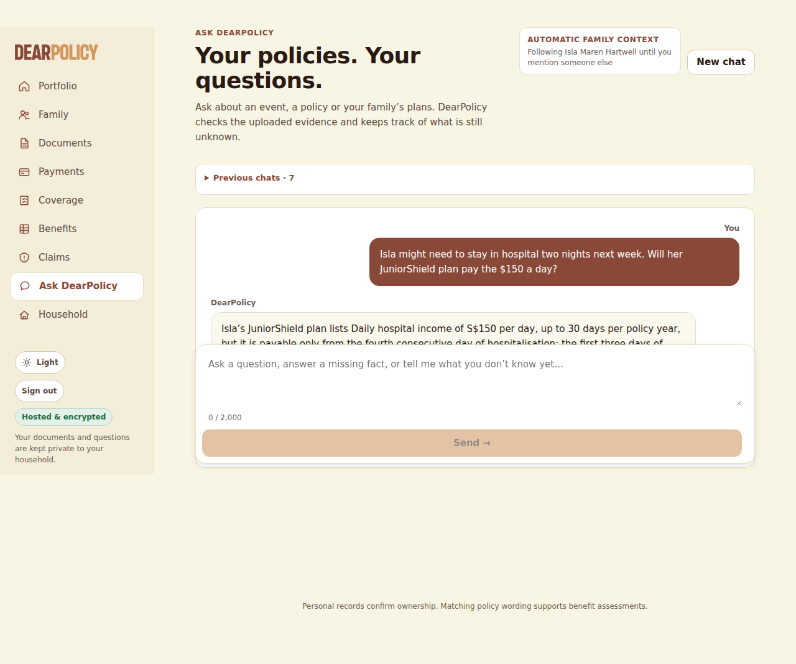
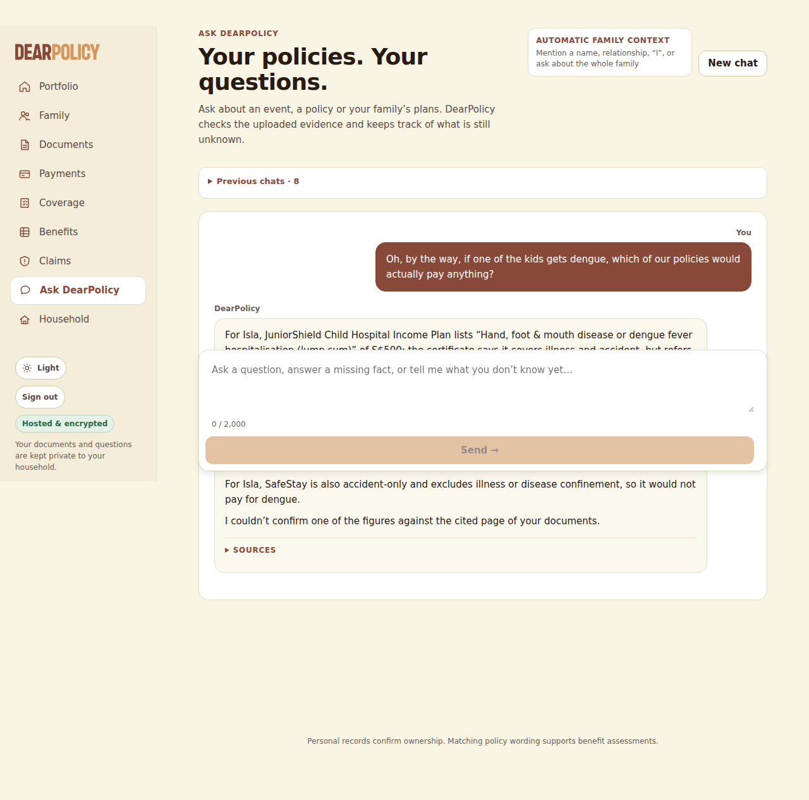
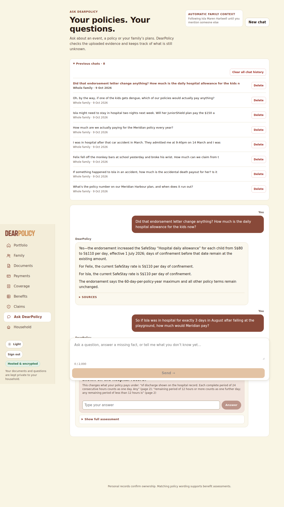
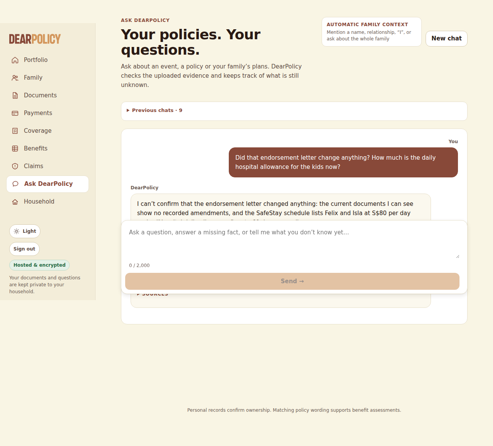

**Exercise spend (LEDGER.json)**: US$0.090845 of US$0.50 -- 8 earlier run(s) US$0.066804 + this run US$0.024041 (not yet in the ledger); US$0.409155 left

# Live ingestion test -- LIVE MODEL RUN

- **Tested code**: `a386b6e73e90e17b6b08e8dd60db02997cbf23a6` (request commit `c395e918ecaf4a1854dc3d8b0911b0ff7741d3f3`), tree `6ade2d919090adec44da16aefe5eeb5c6f0b7bce`, build bWqxCGOvP06lPJUhHAgJe
- **Models requested**: CHAT_MODEL=openai:gpt-6-luna, JUDGEMENT_MODEL=openai:gpt-6-luna, NARRATION_MODEL=openai:gpt-6-luna, READING_MODEL=openai:gpt-6-luna; **provider-reported**: gpt-6-luna
- **Spend**: US$0.024041 of a US$0.150000 run cap; 67 calls sent, 0 refused, 0 failed; reserved-unsettled US$0.000000
- **Verdict**: FAIL (83 checks passed, 3 failed)

## Uploads (through the policies page; processing by request drain)

| file | final | time to final | states | linked automatically | needs review | screenshots |
|---|---|---|---|---|---|---|
| hx-text.pdf | not_scanned_prototype/ready | 34 s | uploaded/queued:queued @1s → not_scanned_prototype/extracting:reading_pdf @8s → not_scanned_prototype/extracting:ai_extraction @10s → not_scanned_prototype/indexing:benefits @23s → not_scanned_prototype/indexing:conditions @28s → not_scanned_prototype/ready:complete @33s | Felix Oran Hartwell, Isla Maren Hartwell, Leonie Brigitte Hartwell, Simon Alastair Hartwell | no | [02-upload-1-received.png](screenshots/02-upload-1-received.png) [03-upload-1-processing.png](screenshots/03-upload-1-processing.png) [04-upload-1-final.png](screenshots/04-upload-1-final.png) |
| hx-endorsement.pdf | not_scanned_prototype/ready | 35 s | uploaded/queued:queued @0s → not_scanned_prototype/extracting:ai_extraction @29s → not_scanned_prototype/indexing:benefits @32s → not_scanned_prototype/ready:complete @34s | Felix Oran Hartwell, Isla Maren Hartwell, Leonie Brigitte Hartwell, Simon Alastair Hartwell | no | [05-upload-2-received.png](screenshots/05-upload-2-received.png) [06-upload-2-processing.png](screenshots/06-upload-2-processing.png) [07-upload-2-final.png](screenshots/07-upload-2-final.png) |
| hx-scanned.pdf | not_scanned_prototype/ready | 21 s | uploaded/queued:queued @1s → not_scanned_prototype/extracting:ocr @4s → not_scanned_prototype/extracting:ai_extraction @12s → not_scanned_prototype/indexing:conditions @17s → not_scanned_prototype/ready:complete @19s | Isla Maren Hartwell | no | [08-upload-3-received.png](screenshots/08-upload-3-received.png) [09-upload-3-processing.png](screenshots/09-upload-3-processing.png) [10-upload-3-final.png](screenshots/10-upload-3-final.png) |

## Library and automatic person links

| file | product | linked | detected names (matched) |
|---|---|---|---|
| hx-scanned.pdf | JuniorShield Child Hospital Income Plan | Isla Maren Hartwell | Isla Maren Hartwell → Isla Maren Hartwell |
| hx-text.pdf | SafeStay Family Hospital Cash & Personal Accident Plan | Felix Oran Hartwell, Isla Maren Hartwell, Leonie Brigitte Hartwell, Simon Alastair Hartwell | Felix Oran Hartwell → Felix Oran Hartwell; Isla Maren Hartwell → Isla Maren Hartwell; Leonie Brigitte Hartwell → Leonie Brigitte Hartwell; Simon Alastair Hartwell → Simon Alastair Hartwell |
| hx-endorsement.pdf | SafeStay Family Hospital Cash & Personal Accident Plan | Felix Oran Hartwell, Isla Maren Hartwell, Leonie Brigitte Hartwell, Simon Alastair Hartwell |  |

Extracted page text per document: `extracted/` (after processing: `dump-processing/extracted/`). Stored records, jobs and provenance: `dump-processing/dump.json`, `dump-final/dump.json`.

## Conversation (in the browser)

### Q1 -- conversation -- 4 s

**User** (composer): What's the policy number on our Meridian Harbour plan, and when does it run out?

**DearPolicy**: DearPolicy Your Meridian Harbour SafeStay Family plan number is MHA-HC-2025-0748213, and its period of cover runs through 31 January 2027, inclusive. SOURCES

Sources shown: Meridian Harbour Assurance Pte. Ltd. · SafeStay Family Hospital Cash & Personal Accident PlanYour uploaded documentPage 1

Loop: final_answer, 2 step(s), 11900 in / 100 out tokens, 2912 ms

| # | tool | ok | error / result | evidence |
|---|---|---|---|---|
| 1 | search_passages | yes | {"hits":8} | 8 |
| 2 | final_answer | yes |  | 0 |

Per call (tokens in/out): 1: 4680/28; 2: 7220/72

### Q2 -- conversation -- 11 s

**User** (composer): If something happened to Isla in an accident, how much is the accidental death payout for her? Is it the same as mine?

**DearPolicy**: DearPolicy The SafeStay schedule lists S$40,000 for Isla under “Accidental death or permanent total disablement (lump sum)” (Child each), compared with S$150,000 for you (Adult each), so they are not the same; these are the printed benefit amounts, not confirmation of a claim payment. SOURCES

Sources shown: Meridian Harbour Assurance Pte. Ltd. · SafeStay Family Hospital Cash & Personal Accident PlanYour uploaded documentPage 1

Loop: final_answer, 5 step(s), 42296 in / 667 out tokens, 9685 ms

| # | tool | ok | error / result | evidence |
|---|---|---|---|---|
| 1 | resolve_person | yes | {"status":"ok"} | 0 |
| 2 | policies_for | yes | {} | 2 |
| 3 | policies_for | yes | {} | 1 |
| 4 | search_passages | yes | {"hits":9} | 9 |
| 5 | search_passages | yes | {"hits":9} | 9 |
| 6 | select_table_value | yes | {"status":"ok","valueId":"v1","value":40000,"column":"Child (each)","row":"Accidental death or permanent total disablement (lump sum)"} | 2 |
| 7 | select_table_value | yes | {"status":"ok","valueId":"v2","value":150000,"column":"Adult (each)","row":"Accidental death or permanent total disablement (lump sum)"} | 2 |
| 8 | final_answer | yes |  | 0 |

Per call (tokens in/out): 1: 4689/18; 2: 4810/106; 3: 6606/186; 4: 12611/192; 5: 13580/165

### Q3 -- conversation -- 11 s

**User** (composer): Felix fell off the monkey bars at school yesterday and broke his wrist. How much can we claim from the Meridian policy?

**DearPolicy**: DearPolicy I’m sorry Felix was hurt. For Felix, the policy lists S$600 per accident for a simple (closed) fracture and S$1,500 per accident for a compound (open) fracture; the fracture type must be certified in writing by a registered medical practitioner and confirmed by X-ray, and only one of these benefits is payable for the same bone in the same accident. A FACT THAT CHANGES THIS ASSESSMENT Has a registered medical practitioner certified the wrist fracture in writing and confirmed it by X-ray? This changes what your policy pays under: “Items D and E: the type of fracture must be certified in writing by a registered medical practitioner and confirmed by X-ray. Only one of Item D or” (page 1); “4.4 For Items D and E, a Compound fracture means a fracture in which the broken bone breaks through the skin. All” (page 2) Answer Show full assessment

Sources shown: Meridian Harbour Assurance Pte. Ltd. · SafeStay Family Hospital Cash & Personal Accident PlanYour uploaded documentPage 1; Meridian Harbour Assurance Pte. Ltd. · SafeStay Family Hospital Cash & Personal Accident PlanYour uploaded documentPage 2; Meridian Harbour Assurance Pte. Ltd. · SafeStay Family Hospital Cash & Personal Accident PlanYour uploaded documentPage 1; Meridian Harbour Assurance Pte. Ltd. · SafeStay Family Hospital Cash & Personal Accident PlanYour uploaded documentPage 1

Asks: Has a registered medical practitioner certified the wrist fracture in writing and confirmed it by X-ray?

Loop: ask_user, 5 step(s), 35820 in / 741 out tokens, 9866 ms

| # | tool | ok | error / result | evidence |
|---|---|---|---|---|
| 1 | resolve_person | yes | {"status":"ok"} | 0 |
| 2 | note_facts | yes | {"facts":[{"key":"how_it_happened","value":"fell off the monkey bars at school","words":"fell off the monkey bars at school"},{"key":"injury","value":"broke his | 0 |
| 3 | policies_for | yes | {} | 1 |
| 4 | search_passages | yes | {"hits":10} | 10 |
| 5 | select_table_value | yes | {"status":"ok","valueId":"v1","value":600,"column":"Child (each)","row":"Fractured bones (per Accident) — Simple (closed) fracture"} | 1 |
| 6 | select_table_value | yes | {"status":"ok","valueId":"v2","value":1500,"column":"Child (each)","row":"Fractured bones (per Accident) — Compound (open) fracture"} | 1 |
| 7 | search_passages | yes | {"hits":5} | 5 |
| 8 | ask_user | yes |  | 0 |

Per call (tokens in/out): 1: 4688/18; 2: 4808/92; 3: 5011/122; 4: 9400/302; 5: 11913/207

### Q4 -- conversation -- 6 s

**User** (inline answer (asked: Has a registered medical practitioner certified the wrist fracture in writing and confirmed it by X-ray?)): The doctor said it's a closed fracture, the X-ray confirmed it, and the bone didn't come through the skin.

**DearPolicy**: DearPolicy You told me the doctor said it’s a closed fracture, the X-ray confirmed it, and the bone didn’t come through the skin. For Felix, the Meridian policy lists S$600 per accident for a simple (closed) fracture, payable when the fracture type is certified in writing by a registered medical practitioner and confirmed by X-ray; only one fracture benefit is payable for the same bone in the same accident. What you’ve told me is your own account, not a reviewed medical record: the insurer will check it against the documents it asks for (such as the doctor’s report and the test or scan results) and decides the claim after reviewing them. When you’re ready, here is the question I was on. A FACT THAT CHANGES THIS ASSESSMENT Has a registered medical practitioner certified the wrist fracture in writing and confirmed it by X-ray? This changes what your policy pays under: “Items D and E: the type of fracture must be certified in writing by a registered medical practitioner and confirmed by X-ray. Only one of Item D or” (page 1); “4.4 For Items D and E, a Compound fracture means a fracture in which the broken bone breaks through the skin. All” (page 2) Answer Show full assessment

Sources shown: Meridian Harbour Assurance Pte. Ltd. · SafeStay Family Hospital Cash & Personal Accident PlanYour uploaded documentPage 1; Meridian Harbour Assurance Pte. Ltd. · SafeStay Family Hospital Cash & Personal Accident PlanYour uploaded documentPage 2; Meridian Harbour Assurance Pte. Ltd. · SafeStay Family Hospital Cash & Personal Accident PlanYour uploaded documentPage 1; Meridian Harbour Assurance Pte. Ltd. · SafeStay Family Hospital Cash & Personal Accident PlanYour uploaded documentPage 1

Asks: Has a registered medical practitioner certified the wrist fracture in writing and confirmed it by X-ray? (no fixture answer)

Loop: final_answer, 2 step(s), 10685 in / 329 out tokens, 3922 ms

| # | tool | ok | error / result | evidence |
|---|---|---|---|---|
| 1 | note_facts | yes | {"facts":[{"key":"fracture_type","value":"closed fracture","words":"The doctor said it's a closed fracture"},{"key":"fracture_xray_confirmation","value":"yes"," | 0 |
| 2 | final_answer | yes |  | 0 |

Per call (tokens in/out): 1: 5156/107; 2: 5529/222

### Q5 -- conversation -- 12 s

**User** (composer): I was in hospital after that car accident in March. They admitted me at 9:40pm on 14 March and I was discharged at 8:20am on 18 March. How much hospital cash should Meridian pay me?

**DearPolicy**: DearPolicy For Simon, Meridian’s “Hospital daily allowance” is S$120 per day, up to 60 days per policy year (page 1), and the policy counts each complete 24 hours as one day and a remaining period of 12 hours or more as another (page 2). Based on the admission and discharge times you gave, the indicative estimate is S$360; this is not a confirmed payment, and Meridian will require supporting claim documents, assuming at least 3 of the 60 days are still available this policy year. NEXT STEP Submit the hospital discharge summary or bill showing the admission and discharge dates and times, together with the policy claim form. SOURCES Indicative estimates are worked out from your documents and what you have told me; they are not a payout, and the insurer decides what it pays.

Sources shown: Meridian Harbour Assurance Pte. Ltd. · SafeStay Family Hospital Cash & Personal Accident PlanYour uploaded documentPage 1; Meridian Harbour Assurance Pte. Ltd. · SafeStay Family Hospital Cash & Personal Accident PlanYour uploaded documentPage 2

Loop: final_answer, 6 step(s), 45860 in / 894 out tokens, 11835 ms

| # | tool | ok | error / result | evidence |
|---|---|---|---|---|
| 1 | note_facts | yes | {"facts":[{"key":"how_it_happened","value":"car accident","words":"that car accident"},{"key":"admission_datetime","value":"14 March at 9:40pm","words":"They ad | 0 |
| 2 | policies_for | yes | {} | 1 |
| 3 | search_passages | yes | {"hits":9} | 9 |
| 4 | select_table_value | yes | {"status":"missing"} | 0 |
| 5 | select_table_value | yes | {"status":"ok","valueId":"v1","value":120,"column":"Adult (each)","row":"Hospital daily allowance (per day of confinement, max 60 days per policy year) — see Cl… | 2 |
| 6 | calculate | yes | {"amount":360,"kind":"indicative_estimate"} | 2 |
| 7 | final_answer | yes |  | 0 |

Per call (tokens in/out): 1: 4711/128; 2: 5007/44; 3: 5760/180; 4: 9560/92; 5: 10048/180; 6: 10774/270

### Q6 -- conversation -- 9 s

**User** (composer): Did that endorsement letter change anything? How much is the daily hospital allowance for the kids now?

**DearPolicy**: DearPolicy Yes—the endorsement increased the SafeStay “Hospital daily allowance” for each child from S$80 to S$110 per day, effective 1 July 2026; days of confinement before that date remain at the existing amount. For Felix, the current SafeStay rate is S$110 per day of confinement. For Isla, the current SafeStay rate is S$110 per day of confinement. The endorsement says the 60-day-per-policy-year maximum and all other policy terms remain unchanged. SOURCES

Sources shown: Meridian Harbour Assurance Pte. Ltd. · SafeStay Family Hospital Cash & Personal Accident PlanYour uploaded documentPage 1; Meridian Harbour Assurance Pte. Ltd. · SafeStay Family Hospital Cash & Personal Accident PlanYour uploaded documentPage 1; Meridian Harbour Assurance Pte. Ltd. · SafeStay Family Hospital Cash & Personal Accident PlanYour uploaded documentPage 1

Loop: final_answer, 4 step(s), 36513 in / 617 out tokens, 7596 ms

| # | tool | ok | error / result | evidence |
|---|---|---|---|---|
| 1 | policies_for | yes | {} | 1 |
| 2 | policies_for | yes | {} | 2 |
| 3 | search_passages | yes | {"hits":10} | 10 |
| 4 | select_table_value | yes | {"status":"ok","valueId":"v1","value":110,"column":"Revised","row":"Hospital daily allowance (per day of confinement)"} | 2 |
| 5 | select_table_value | yes | {"status":"ok","valueId":"v2","value":110,"column":"Revised","row":"Hospital daily allowance (per day of confinement)"} | 2 |
| 6 | final_answer | yes |  | 0 |

Per call (tokens in/out): 1: 4682/134; 2: 9939/90; 3: 10647/91; 4: 11245/302

### Q7 -- conversation -- 7 s

**User** (composer): How much are we actually paying for the Meridian policy every year?

**DearPolicy**: DearPolicy I can’t determine the annual premium from the Meridian policy documents I can read; the schedule gives the cover period and benefits but does not state the premium amount. SOURCES

Sources shown: Meridian Harbour Assurance Pte. Ltd. · SafeStay Family Hospital Cash & Personal Accident PlanYour uploaded documentPage 1

Loop: final_answer, 4 step(s), 32451 in / 241 out tokens, 5968 ms

| # | tool | ok | error / result | evidence |
|---|---|---|---|---|
| 1 | search_passages | yes | {"hits":8} | 8 |
| 2 | search_passages | yes | {"hits":8} | 8 |
| 3 | read_page | yes | {"status":"ok"} | 1 |
| 4 | final_answer | yes |  | 0 |

Per call (tokens in/out): 1: 4676/28; 2: 7228/58; 3: 9832/45; 4: 10715/110

### Q8 -- conversation -- 11 s

**User** (composer): Isla might need to stay in hospital two nights next week. Will her JuniorShield plan pay the $150 a day?

**DearPolicy**: DearPolicy Isla’s JuniorShield plan lists Daily hospital income of S$150 per day, up to 30 days per policy year, but it is payable only from the fourth consecutive day of hospitalisation; the first three days of each hospitalisation are not payable, so a two-night stay would not meet that threshold. SOURCES

Sources shown: Kestrel Bay Insurance (Singapore) Ltd. · JuniorShield Child Hospital Income PlanYour uploaded documentPage 1; Kestrel Bay Insurance (Singapore) Ltd. · JuniorShield Child Hospital Income PlanYour uploaded documentPage 1

Loop: final_answer, 4 step(s), 26088 in / 653 out tokens, 9843 ms

| # | tool | ok | error / result | evidence |
|---|---|---|---|---|
| 1 | note_facts | yes | {"facts":[{"key":"possible_hospital_stay","value":"might need to stay in hospital two nights next week","words":"Isla might need to stay in hospital two nights  | 0 |
| 2 | policies_for | yes | {} | 2 |
| 3 | search_passages | yes | {"hits":3} | 3 |
| 4 | search_passages | yes | {"hits":8} | 8 |
| 5 | select_table_value | yes | {"status":"ok","valueId":"v1","value":150,"column":"Amount payable","row":"Daily hospital income*"} | 1 |
| 6 | select_table_value | yes | {"status":"missing"} | 0 |
| 7 | final_answer | yes |  | 0 |

Per call (tokens in/out): 1: 4688/112; 2: 4931/47; 3: 5750/358; 4: 10719/136

### Q9 -- conversation -- 15 s

**User** (composer): Oh, by the way, if one of the kids gets dengue, which of our policies would actually pay anything?

**DearPolicy**: DearPolicy For Isla, JuniorShield Child Hospital Income Plan lists “Hand, foot & mouth disease or dengue fever hospitalisation (lump sum)” of S$500; the certificate says it covers illness and accident, but refers to full policy conditions for definitions and exclusions, which aren’t in the document extract I can see. For Felix, the SafeStay Family Hospital Cash & Personal Accident Plan is accident-only and says confinement due to illness or disease is not covered, so it would not pay for dengue; its child hospital daily allowance is a set amount per day in the schedule, but an endorsement revises it to a set amount per day from 1 July 2026, and the endorsement’s effective date is not confirmed in the records. For Isla, SafeStay is also accident-only and excludes illness or disease confinement, so it would not pay for dengue. I couldn’t confirm one of the figures against the cited page of your documents. SOURCES

Sources shown: Kestrel Bay Insurance (Singapore) Ltd. · JuniorShield Child Hospital Income PlanYour uploaded documentPage 1; Kestrel Bay Insurance (Singapore) Ltd. · JuniorShield Child Hospital Income PlanYour uploaded documentPage 1; Meridian Harbour Assurance Pte. Ltd. · SafeStay Family Hospital Cash & Personal Accident PlanYour uploaded documentPage 2; Meridian Harbour Assurance Pte. Ltd. · SafeStay Family Hospital Cash & Personal Accident PlanYour uploaded documentPage 2; Meridian Harbour Assurance Pte. Ltd. · SafeStay Family Hospital Cash & Personal Accident PlanYour uploaded documentPage 1; Meridian Harbour Assurance Pte. Ltd. · SafeStay Family Hospital Cash & Personal Accident PlanYour uploaded documentPage 1

Loop: final_answer, 7 step(s), 70020 in / 969 out tokens, 13625 ms

| # | tool | ok | error / result | evidence |
|---|---|---|---|---|
| 1 | resolve_person | yes | {"status":"ambiguous"} | 0 |
| 2 | search_passages | yes | {"hits":8} | 8 |
| 3 | policies_for | yes | {} | 1 |
| 4 | policies_for | yes | {} | 2 |
| 5 | ask_user | **no** | "one of the kids" means whoever it happens to: answer for the policy and the people it covers (each covered person's own column where the rows differ by person); do not ask who | 0 |
| 6 | search_passages | yes | {"hits":2} | 2 |
| 7 | search_passages | yes | {"hits":4} | 4 |
| 8 | select_table_value | yes | {"status":"ok","valueId":"v1","value":500,"column":"Amount payable","row":"Hand, foot & mouth disease or dengue fever hospitalisation (lump sum)"} | 1 |
| 9 | select_table_value | yes | {"status":"missing"} | 0 |
| 10 | final_answer | yes |  | 0 |

Per call (tokens in/out): 1: 4686/155; 2: 9592/97; 3: 9746/90; 4: 10396/92; 5: 11531/91; 6: 11965/90; 7: 12104/354

Gate: [{"where":"details[0]","figure":"S$80","reason":"the figure is the value before the change effective 2026-07-01, and the sentence states it for 2026-10-09, when the amended value applies"}]

### R1 -- reopen -- 17 s

**User** (composer): So if Isla was in hospital for exactly 3 days in August after falling at the playground, how much would Meridian pay?

**DearPolicy**: DearPolicy For Isla, Meridian’s SafeStay “Hospital daily allowance” is S$110 per day of confinement, up to 60 days per policy year, and is payable only when confinement results solely and directly from an Accident and begins within 90 days of it. A FACT THAT CHANGES THIS ASSESSMENT What were Isla’s hospital admission and discharge dates and times, as shown on the hospital record? This changes what your policy pays under: “of discharge shown on the hospital record. Each complete period of 24 consecutive hours counts as one day. Any” (page 2); “remaining period of 12 hours or more counts as one further day; any remaining period of less than 12 hours is” (page 2) Answer Show full assessment

Sources shown: Meridian Harbour Assurance Pte. Ltd. · SafeStay Family Hospital Cash & Personal Accident PlanYour uploaded documentPage 1; Meridian Harbour Assurance Pte. Ltd. · SafeStay Family Hospital Cash & Personal Accident PlanYour uploaded documentPage 1; Meridian Harbour Assurance Pte. Ltd. · SafeStay Family Hospital Cash & Personal Accident PlanYour uploaded documentPage 2; Meridian Harbour Assurance Pte. Ltd. · SafeStay Family Hospital Cash & Personal Accident PlanYour uploaded documentPage 1; Meridian Harbour Assurance Pte. Ltd. · SafeStay Family Hospital Cash & Personal Accident PlanYour uploaded documentPage 2; Meridian Harbour Assurance Pte. Ltd. · SafeStay Family Hospital Cash & Personal Accident PlanYour uploaded documentPage 2

Asks: What were Isla’s hospital admission and discharge dates and times, as shown on the hospital record? (no fixture answer)

Loop: ask_user, 8 step(s), 70189 in / 1034 out tokens, 15329 ms

| # | tool | ok | error / result | evidence |
|---|---|---|---|---|
| 1 | note_facts | yes | {"facts":[{"key":"nights_in_hospital","value":"3","words":"exactly 3 days"},{"key":"how_it_happened","value":"fell at the playground","words":"after falling at  | 0 |
| 2 | note_facts | yes | {"facts":[{"key":"days_in_hospital","value":"3","words":"exactly 3 days"}],"subject_id":"77ce6f52-befb-45b3-ba2f-999e8e86c0fa"} | 0 |
| 3 | resolve_person | yes | {"status":"ok"} | 0 |
| 4 | policies_for | yes | {} | 2 |
| 5 | search_passages | yes | {"hits":10} | 10 |
| 6 | select_table_value | yes | {"status":"ok","valueId":"v3","value":110,"column":"Revised","row":"Hospital daily allowance (per day of confinement)"} | 2 |
| 7 | search_passages | yes | {"hits":5} | 5 |
| 8 | ask_user | **no** | not shown before the question: "I can’t determine Meridian’s amount from “exactly 3 days”: its wording counts co" (states cover or a figure without citing evidence). State only what the cited evidence prints (a benefit with its conditions, cited with evidence_ids / value_ids), or leave it out. | 0 |
| 9 | ask_user | yes |  | 0 |

Per call (tokens in/out): 1: 5048/107; 2: 5346/65; 3: 5547/18; 4: 5668/132; 5: 10648/99; 6: 11373/117; 7: 13100/276; 8: 13459/220

### D1 -- after_delete -- 12 s

**User** (composer): Did that endorsement letter change anything? How much is the daily hospital allowance for the kids now?

**DearPolicy**: DearPolicy I can’t confirm that the endorsement letter changed anything: the current documents I can see show no recorded amendments, and the SafeStay schedule lists Felix and Isla at S$80 per day under “Hospital daily allowance,” up to 60 days per policy year. Isla also has a separate JuniorShield “Daily hospital income” benefit of S$150 per day, up to 30 days per policy year, payable only from the fourth consecutive hospitalisation day; the first three days are not payable. The SafeStay allowance is accident-only, so it applies only when confinement results solely and directly from an accident and begins within 90 days of it. SOURCES

Sources shown: Meridian Harbour Assurance Pte. Ltd. · SafeStay Family Hospital Cash & Personal Accident PlanYour uploaded documentPage 1; Meridian Harbour Assurance Pte. Ltd. · SafeStay Family Hospital Cash & Personal Accident PlanYour uploaded documentPage 1; Meridian Harbour Assurance Pte. Ltd. · SafeStay Family Hospital Cash & Personal Accident PlanYour uploaded documentPage 1; Kestrel Bay Insurance (Singapore) Ltd. · JuniorShield Child Hospital Income PlanYour uploaded documentPage 1; Kestrel Bay Insurance (Singapore) Ltd. · JuniorShield Child Hospital Income PlanYour uploaded documentPage 1; Meridian Harbour Assurance Pte. Ltd. · SafeStay Family Hospital Cash & Personal Accident PlanYour uploaded documentPage 2

Loop: final_answer, 3 step(s), 29412 in / 760 out tokens, 11668 ms

| # | tool | ok | error / result | evidence |
|---|---|---|---|---|
| 1 | policies_for | yes | {} | 1 |
| 2 | policies_for | yes | {} | 2 |
| 3 | search_passages | yes | {"hits":10} | 10 |
| 4 | select_table_value | yes | {"status":"ok","valueId":"v1","value":80,"column":"Child (each)","row":"Hospital daily allowance (per day of confinement, max 60 days per policy year) — see Cla… | 1 |
| 5 | select_table_value | yes | {"status":"ok","valueId":"v2","value":80,"column":"Child (each)","row":"Hospital daily allowance (per day of confinement, max 60 days per policy year) — see Cla… | 1 |
| 6 | select_table_value | yes | {"status":"ok","valueId":"v3","value":150,"column":"Amount payable","row":"Daily hospital income*"} | 1 |
| 7 | search_passages | yes | {"hits":13} | 13 |
| 8 | final_answer | yes |  | 0 |

Per call (tokens in/out): 1: 4682/133; 2: 9837/313; 3: 14893/314

## Deterministic checks (EXPECTED.json, copied in after the conversations)

| scope | check | result | detail |
|---|---|---|---|
| hx-text.pdf | uploaded and processed | PASS | not_scanned_prototype/ready |
| hx-text.pdf | page 1 text extracted | PASS | native, 1842 chars |
| hx-text.pdf | page 1 contains "MHA-HC-2025-0748213" | PASS |  |
| hx-text.pdf | page 1 contains "S$150,000" | PASS |  |
| hx-text.pdf | page 1 contains "S$40,000" | PASS |  |
| hx-text.pdf | page 1 contains "S$120" | PASS |  |
| hx-text.pdf | page 1 contains "S$80" | PASS |  |
| hx-text.pdf | page 1 contains "S$600" | PASS |  |
| hx-text.pdf | page 1 contains "S$1,500" | PASS |  |
| hx-text.pdf | page 2 text extracted | PASS | native, 3002 chars |
| hx-text.pdf | page 2 contains "24 consecutive hours" | PASS |  |
| hx-text.pdf | page 2 contains "Accident-only cover" | PASS |  |
| hx-text.pdf | linked automatically to the right people | PASS | linked: Felix Oran Hartwell, Isla Maren Hartwell, Leonie Brigitte Hartwell, Simon Alastair Hartwell; expected: Simon Alastair Hartwell, Leonie Brigitte Hartwell, Felix Oran Hartwell, Isla Maren Hartwell |
| hx-endorsement.pdf | uploaded and processed | PASS | not_scanned_prototype/ready |
| hx-endorsement.pdf | page 1 text extracted | PASS | native, 1250 chars |
| hx-endorsement.pdf | page 1 contains "ME-26-0412" | PASS |  |
| hx-endorsement.pdf | page 1 contains "MHA-HC-2025-0748213" | PASS |  |
| hx-endorsement.pdf | page 1 contains "S$110" | PASS |  |
| hx-endorsement.pdf | page 1 contains "01 July 2026" | PASS |  |
| hx-scanned.pdf | uploaded and processed | PASS | not_scanned_prototype/ready |
| hx-scanned.pdf | page 1 text extracted | PASS | ocr, 1243 chars |
| hx-scanned.pdf | page 1 contains "KBJ-26-00391" | PASS |  |
| hx-scanned.pdf | page 1 contains "S$150" | PASS |  |
| hx-scanned.pdf | page 1 contains "S$500" | PASS |  |
| hx-scanned.pdf | linked automatically to the right people | PASS | linked: Isla Maren Hartwell; expected: Isla Maren Hartwell |
| delete hx-endorsement.pdf | deleted through the page and confirmed before the next question | PASS | notice: "Deleted SafeStay Family Hospital Cash & Personal Accident Plan. It is no longer used in answers, and your portfolio has been updated. ✕"; listed after: false; lifecycle: pending_deletion |
| Q1 (conversation) "What's the policy number on our Meridian Harbour plan, and w" | useful reply (a cited figure or condition, one material question, or what the documents do not say) | PASS | a cited statement |
| Q2 (conversation) "If something happened to Isla in an accident, how much is th" | useful reply (a cited figure or condition, one material question, or what the documents do not say) | PASS | a cited statement |
| Q3 (conversation) "Felix fell off the monkey bars at school yesterday and broke" | useful reply (a cited figure or condition, one material question, or what the documents do not say) | PASS | one material question |
| Q4 (conversation) "The doctor said it's a closed fracture, the X-ray confirmed " | useful reply (a cited figure or condition, one material question, or what the documents do not say) | PASS | one material question |
| Q5 (conversation) "I was in hospital after that car accident in March. They adm" | useful reply (a cited figure or condition, one material question, or what the documents do not say) | PASS | a cited statement |
| Q6 (conversation) "Did that endorsement letter change anything? How much is the" | useful reply (a cited figure or condition, one material question, or what the documents do not say) | PASS | a cited statement |
| Q7 (conversation) "How much are we actually paying for the Meridian policy ever" | useful reply (a cited figure or condition, one material question, or what the documents do not say) | PASS | says what the documents do not say |
| Q8 (conversation) "Isla might need to stay in hospital two nights next week. Wi" | useful reply (a cited figure or condition, one material question, or what the documents do not say) | PASS | a cited statement |
| Q9 (conversation) "Oh, by the way, if one of the kids gets dengue, which of our" | useful reply (a cited figure or condition, one material question, or what the documents do not say) | PASS | a cited statement (generic note set aside: "I couldn’t confirm one of the figures against the cited page of your documents.") |
| R1 (reopen) "So if Isla was in hospital for exactly 3 days in August afte" | useful reply (a cited figure or condition, one material question, or what the documents do not say) | PASS | one material question |
| D1 (after_delete) "Did that endorsement letter change anything? How much is the" | useful reply (a cited figure or condition, one material question, or what the documents do not say) | PASS | a cited statement |
| D1 (after_delete) "Did that endorsement letter change anything? How much is the" | asked after a confirmed deletion | PASS |  |
| D1 (after_delete) "Did that endorsement letter change anything? How much is the" | does not rely on the deleted hx-endorsement.pdf | PASS | cites: hx-text.pdf, hx-text.pdf, hx-text.pdf, hx-scanned.pdf, hx-scanned.pdf, hx-text.pdf |
| Q1 | states "MHA-HC-2025-0748213" | PASS |  |
| Q1 | states one of ["31 January 2027","31 Jan 2027","31/01/2027","2027-01-31","31 Jan. 2027"] | PASS |  |
| Q1 | never states "MHA-HC-2025-0748218" | PASS |  |
| Q1 | never states "01 Feb 2027" | PASS |  |
| Q1 | never states "1 February 2027" | PASS |  |
| Q1 | never states "14 March 2027" | PASS |  |
| Q1 | cites hx-text.pdf page 1 | PASS | cited: hx-text.pdf p1 |
| Q1 | answers without an unnecessary follow-up | PASS |  |
| Q2 | states "S$40,000" | PASS |  |
| Q2 | states "S$150,000" | PASS |  |
| Q2 | cites hx-text.pdf page 1 | PASS | cited: hx-text.pdf p1 |
| Q2 | answers without an unnecessary follow-up | PASS |  |
| Q3 | never states "S$2,100" | PASS |  |
| Q3 | never states "S$2,500" | PASS |  |
| Q3 | about Felix Oran Hartwell | PASS | resolved to Felix Oran Hartwell |
| Q3 | asks a follow-up before answering | PASS | Has a registered medical practitioner certified the wrist fracture in writing and confirmed it by X-ray? |
| Q4 | states "S$600" | PASS |  |
| Q4 | never states "S$2,100" | PASS |  |
| Q4 | never states "S$2,600" | PASS |  |
| Q4 | cites hx-text.pdf page 1 | PASS | cited: hx-text.pdf p1, hx-text.pdf p2, hx-text.pdf p1, hx-text.pdf p1 |
| Q4 | about Felix Oran Hartwell | PASS | resolved to Felix Oran Hartwell |
| Q4 | follow-up answerable from the fixture | **FAIL** | unanswered: Has a registered medical practitioner certified the wrist fracture in writing and confirmed it by X-ray? |
| Q5 | states "S$360" | PASS |  |
| Q5 | never states "S$480" | PASS |  |
| Q5 | never states "S$330" | PASS |  |
| Q5 | never states "S$440" | PASS |  |
| Q5 | cites hx-text.pdf page 1 | PASS | cited: hx-text.pdf p1, hx-text.pdf p2 |
| Q5 | about Simon Alastair Hartwell | PASS | resolved to Simon Alastair Hartwell |
| Q6 | states "S$110" | PASS |  |
| Q6 | states one of ["01 July 2026","1 July 2026","1 Jul 2026","01 Jul 2026"] | PASS |  |
| Q6 | cites hx-endorsement.pdf page 1 | PASS | cited: hx-endorsement.pdf p1, hx-text.pdf p1, hx-endorsement.pdf p1 |
| Q6 | uses the current version (hx-endorsement.pdf) | PASS | cited: hx-endorsement.pdf, hx-text.pdf |
| Q7 | states one of ["not stated","isn't stated","is not stated","not shown","isn't shown","doesn't show","does not show","not in your","not in the","don't show","do not show","no premium","doesn't state","does not state","doesn't mention","does not mention","couldn't find","could not find"] | PASS |  |
| Q8 | states one of ["4th","fourth"] | PASS |  |
| Q8 | never states "S$300" | PASS |  |
| Q8 | never states "S$450" | PASS |  |
| Q8 | cites hx-scanned.pdf page 1 | PASS | cited: hx-scanned.pdf p1, hx-scanned.pdf p1 |
| Q8 | about Isla Maren Hartwell | PASS | resolved to Isla Maren Hartwell |
| Q9 | states "S$500" | PASS |  |
| Q9 | states one of ["accident only","accident-only","only covers accidents","accidents only","only for accidents","only pays for accidents"] | PASS |  |
| Q9 | cites hx-scanned.pdf page 1 | PASS | cited: hx-scanned.pdf p1, hx-scanned.pdf p1, hx-text.pdf p2, hx-text.pdf p2, hx-endorsement.pdf p1, hx-text.pdf p1 |
| R1 | states "S$330" | **FAIL** |  |
| R1 | never states "S$240" | PASS |  |
| R1 | about Isla Maren Hartwell | PASS | resolved to Isla Maren Hartwell |
| R1 | follow-up answerable from the fixture | **FAIL** | unanswered: What were Isla’s hospital admission and discharge dates and times, as shown on the hospital record? |
| D1 | never states "S$110" | PASS |  |
| D1 | does not cite hx-endorsement.pdf | PASS |  |

## Every provider request (process-wide fetch guard)

| seq | kind | model → reported | provider request id | status / refused | in | cached | out | reasoning | reserved | charged | ms |
|---|---|---|---|---|---|---|---|---|---|---|---|
| 1 | structured | gpt-6-luna → gpt-6-luna | chatcmpl-EX6Gyeb7lAuhUonr5PnwmXgLlKmZk | 200 | 2743 | 0 | 2564 | 0 | US$0.003506 | US$0.001556 | 14591 |
| 2 | structured | gpt-6-luna → gpt-6-luna | chatcmpl-EX6HCdVv2oehhhEzajODjfi85WDFy | 200 | 1336 | 0 | 11 | 0 | US$0.000592 | US$0.000139 | 1851 |
| 2 | structured | gpt-6-luna → gpt-6-luna | chatcmpl-EX6HC4JCkWMgIBaOrXyBpnG8PExzW | 200 | 1201 | 0 | 557 | 0 | US$0.000548 | US$0.000399 | 3959 |
| 4 | structured | gpt-6-luna → gpt-6-luna | chatcmpl-EX6HG6FCsYFpR3rIfigttALRb8NaU | 200 | 1612 | 0 | 900 | 0 | US$0.000746 | US$0.000611 | 5428 |
| 5 | structured | gpt-6-luna → gpt-6-luna | chatcmpl-EX6HLythApPvMRmp4G5WWYXcn7sLf | 200 | 2454 | 0 | 4000 | 0 | US$0.002416 | US$0.002245 | 23096 |
| 6 | structured | gpt-6-luna → gpt-6-luna | chatcmpl-EX6HipCFrG6ACKEmdgNhyjanlyagw | 200 | 3173 | 0 | 871 | 0 | US$0.001256 | US$0.000753 | 7340 |
| 7 | structured | gpt-6-luna → gpt-6-luna | chatcmpl-EX6HqjogeVaXClSsluwHMctbaForP | 200 | 2006 | 1646 | 292 | 0 | US$0.003391 | US$0.000198 | 2264 |
| 8 | structured | gpt-6-luna → gpt-6-luna | chatcmpl-EX6Hs2XOCdYzC3m427tLSrp6CUmG7 | 200 | 958 | 0 | 104 | 0 | US$0.000522 | US$0.000148 | 1809 |
| 9 | structured | gpt-6-luna → gpt-6-luna | chatcmpl-EX6HuK93PLwrsirbbMCAG3l66TAP2 | 200 | 1234 | 0 | 107 | 0 | US$0.000675 | US$0.000177 | 1343 |
| 10 | structured | gpt-6-luna → gpt-6-luna | chatcmpl-EX6HvfeM06ndPPW147B6BNnf0yMBV | 200 | 1490 | 1073 | 287 | 0 | US$0.002265 | US$0.000196 | 2657 |
| 11 | structured | gpt-6-luna → gpt-6-luna | chatcmpl-EX6HyYBJX1O81ukx4MAxUHhteuASD | 200 | 747 | 0 | 64 | 0 | US$0.000884 | US$0.000107 | 2118 |
| 12 | document (pdf 1p) | gpt-6-luna → gpt-6-luna | chatcmpl-EX6I2ByLKuUHBqFcjzN3nmSSPrrwo | 200 | 1351 | 0 | 381 | 0 | US$0.008615 | US$0.000326 | 5516 |
| 13 | structured | gpt-6-luna → gpt-6-luna | chatcmpl-EX6I6KoHqVpXbQT9wZTCKYkHlVxKV | 200 | 2017 | 1646 | 860 | 0 | US$0.003391 | US$0.000484 | 5180 |
| 14 | structured | gpt-6-luna → gpt-6-luna | chatcmpl-EX6IB6e1InWJwiPa1MiGewdCljLPk | 200 | 672 | 0 | 124 | 0 | US$0.000580 | US$0.000129 | 1653 |
| 15 | structured | gpt-6-luna → gpt-6-luna | chatcmpl-EX6ID59fgah1DuIC4eG9Gxio4rjTm | 200 | 1246 | 0 | 190 | 0 | US$0.000675 | US$0.000220 | 1783 |
| 16 | structured | gpt-6-luna → gpt-6-luna | chatcmpl-EX6IF9IlVWWQLIfN6m9CDqSpLernA | 200 | 1479 | 1073 | 644 | 0 | US$0.002261 | US$0.000373 | 5908 |
| 16 | loop | gpt-6-luna → gpt-6-luna | chatcmpl-EX6IKHWWdM4kZ03pJyGLSn524GOx6 | 200 | 4680 | 0 | 28 | 0 | US$0.002000 | US$0.000482 | 1217 |
| 18 | loop | gpt-6-luna → gpt-6-luna | chatcmpl-EX6ILJE2eqU9uelmHdjBptcm1XpEy | 200 | 7220 | 4554 | 72 | 0 | US$0.002361 | US$0.000348 | 1653 |
| 17 | structured | gpt-6-luna → gpt-6-luna | chatcmpl-EX6ILRnLsHF63L3HgZektHg8Egt7K | 200 | 1036 | 0 | 184 | 0 | US$0.000929 | US$0.000196 | 2314 |
| 20 | loop | gpt-6-luna → gpt-6-luna | chatcmpl-EX6IOy6eJkjZzqm0SbuutlpwAfLjl | 200 | 4689 | 4533 | 18 | 0 | US$0.002001 | US$0.000070 | 1341 |
| 21 | loop | gpt-6-luna → gpt-6-luna | chatcmpl-EX6IP4Qt63kA9MsZyMR8GcMf2yRXP | 200 | 4810 | 4563 | 106 | 0 | US$0.002024 | US$0.000123 | 1682 |
| 22 | loop | gpt-6-luna → gpt-6-luna | chatcmpl-EX6IRaXjX5IclNBthHaF23fyvnh2f | 200 | 6606 | 4684 | 186 | 0 | US$0.002249 | US$0.000332 | 2157 |
| 23 | loop | gpt-6-luna → gpt-6-luna | chatcmpl-EX6ITWPQBu51eRLN34zElTsLsFE4U | 200 | 12611 | 6480 | 192 | 0 | US$0.003072 | US$0.000774 | 2077 |
| 24 | loop | gpt-6-luna → gpt-6-luna | chatcmpl-EX6IVPS0BXYQLgdjVbQYBCRdGr93F | 200 | 13580 | 12485 | 165 | 0 | US$0.003202 | US$0.000317 | 2285 |
| 25 | loop | gpt-6-luna → gpt-6-luna | chatcmpl-EX6IaM7VXGUhw9f0zoaeoym766sAu | 200 | 4688 | 4533 | 18 | 0 | US$0.002001 | US$0.000070 | 1258 |
| 26 | loop | gpt-6-luna → gpt-6-luna | chatcmpl-EX6IbVC09ji4NE4VT0RulQcf3C2gV | 200 | 4808 | 4562 | 92 | 0 | US$0.002024 | US$0.000116 | 1510 |
| 27 | loop | gpt-6-luna → gpt-6-luna | chatcmpl-EX6IdqaQm6pgIZmdFsV1lMWxtoU0Q | 200 | 5011 | 4682 | 122 | 0 | US$0.002061 | US$0.000141 | 1665 |
| 28 | loop | gpt-6-luna → gpt-6-luna | chatcmpl-EX6IelV8o4E9ILTaLXojbMpzjBn3r | 200 | 9400 | 4885 | 302 | 0 | US$0.002658 | US$0.000651 | 2846 |
| 29 | loop | gpt-6-luna → gpt-6-luna | chatcmpl-EX6Ih3WGAgjmisy2fbQ2XycHkfCUK | 200 | 11913 | 9274 | 207 | 0 | US$0.003008 | US$0.000460 | 2505 |
| 30 | loop | gpt-6-luna → gpt-6-luna | chatcmpl-EX6IlYQeRwjrfedMMMXemP2coYMwO | 200 | 5156 | 0 | 107 | 0 | US$0.002081 | US$0.000569 | 1473 |
| 31 | loop | gpt-6-luna → gpt-6-luna | chatcmpl-EX6InuogzCqg2XrhotPKAwHLFJNRS | 200 | 5529 | 5030 | 222 | 0 | US$0.002150 | US$0.000211 | 2433 |
| 32 | loop | gpt-6-luna → gpt-6-luna | chatcmpl-EX6Iqzw384i2vnVQjflq6eJ9TnFF6 | 200 | 4711 | 4533 | 128 | 0 | US$0.002004 | US$0.000127 | 1557 |
| 33 | loop | gpt-6-luna → gpt-6-luna | chatcmpl-EX6IsiSAWhHrM9Vg9HAy0LxEGEnGW | 200 | 5007 | 4585 | 44 | 0 | US$0.002053 | US$0.000110 | 1422 |
| 34 | loop | gpt-6-luna → gpt-6-luna | chatcmpl-EX6ItMups0wEnZUwXCI9vfAE4kQd3 | 200 | 5760 | 4881 | 180 | 0 | US$0.002164 | US$0.000227 | 2047 |
| 35 | loop | gpt-6-luna → gpt-6-luna | chatcmpl-EX6IvzRp7sNtuBwoOM4SkwYTBZQkH | 200 | 9560 | 5634 | 92 | 0 | US$0.002700 | US$0.000495 | 1798 |
| 36 | loop | gpt-6-luna → gpt-6-luna | chatcmpl-EX6IxdWQjD5edkVEkxuES21h47FPl | 200 | 10048 | 9434 | 180 | 0 | US$0.002776 | US$0.000246 | 2034 |
| 37 | loop | gpt-6-luna → gpt-6-luna | chatcmpl-EX6IzqogBHvhbfB3FYElEQ6bn2nGy | 200 | 10774 | 9922 | 270 | 0 | US$0.002894 | US$0.000319 | 2858 |
| 38 | loop | gpt-6-luna → gpt-6-luna | chatcmpl-EX6J4HuNrL0LdvEeVxCJLS98mcQsL | 200 | 4682 | 4533 | 134 | 0 | US$0.002001 | US$0.000127 | 1827 |
| 39 | loop | gpt-6-luna → gpt-6-luna | chatcmpl-EX6J6fkPFEIGZqXAQfa3uPPOE1BxG | 200 | 9939 | 4556 | 90 | 0 | US$0.002704 | US$0.000629 | 1378 |
| 40 | loop | gpt-6-luna → gpt-6-luna | chatcmpl-EX6J7MmNwmeuJRPjMKUFTjQXANU9V | 200 | 10647 | 9813 | 91 | 0 | US$0.002810 | US$0.000227 | 1232 |
| 41 | loop | gpt-6-luna → gpt-6-luna | chatcmpl-EX6J8GRO0p11PR9q3lbxjrHOBUL4g | 200 | 11245 | 10521 | 302 | 0 | US$0.002903 | US$0.000329 | 3094 |
| 42 | loop | gpt-6-luna → gpt-6-luna | chatcmpl-EX6JD2YxEjulv0OyY7kbTXfAwmzoj | 200 | 4676 | 4533 | 28 | 0 | US$0.001999 | US$0.000074 | 1346 |
| 43 | loop | gpt-6-luna → gpt-6-luna | chatcmpl-EX6JFYm9h6kyuesfBFdmDUyrASXSp | 200 | 7228 | 4550 | 58 | 0 | US$0.002365 | US$0.000342 | 1590 |
| 44 | loop | gpt-6-luna → gpt-6-luna | chatcmpl-EX6JGweKwGiPYqpmUqe2HP8P8opYU | 200 | 9832 | 7102 | 45 | 0 | US$0.002748 | US$0.000367 | 1345 |
| 45 | loop | gpt-6-luna → gpt-6-luna | chatcmpl-EX6JIZYe4GHB8k1VgpqQcIzwwXXoM | 200 | 10715 | 9706 | 110 | 0 | US$0.002873 | US$0.000253 | 1645 |
| 46 | loop | gpt-6-luna → gpt-6-luna | chatcmpl-EX6JMvulJbTqxdyViHlWKzEGHj1DQ | 200 | 4688 | 4533 | 112 | 0 | US$0.002001 | US$0.000117 | 3206 |
| 47 | loop | gpt-6-luna → gpt-6-luna | chatcmpl-EX6JOGzhuhsFX7gQr5ALcdGBncnF1 | 200 | 4931 | 4562 | 47 | 0 | US$0.002046 | US$0.000106 | 1346 |
| 48 | loop | gpt-6-luna → gpt-6-luna | chatcmpl-EX6JQCrpbPkYR5DC3mMPQW6td0yCS | 200 | 5750 | 4805 | 358 | 0 | US$0.002162 | US$0.000322 | 3331 |
| 49 | loop | gpt-6-luna → gpt-6-luna | chatcmpl-EX6JTyH4khIOVPdkrY4EoGZer5lQ3 | 200 | 10719 | 5624 | 136 | 0 | US$0.002867 | US$0.000634 | 1910 |
| 50 | loop | gpt-6-luna → gpt-6-luna | chatcmpl-EX6JXop7sQJo27Qbd8AGE34Md7ELi | 200 | 4686 | 4533 | 155 | 0 | US$0.002000 | US$0.000138 | 1936 |
| 51 | loop | gpt-6-luna → gpt-6-luna | chatcmpl-EX6JYhSwu1jnDZTl0m2qpMJZCEajb | 200 | 9592 | 4560 | 97 | 0 | US$0.002671 | US$0.000597 | 1775 |
| 52 | loop | gpt-6-luna → gpt-6-luna | chatcmpl-EX6Ja0uaMERYXwPDZ30OpPIKRJUNC | 200 | 9746 | 9466 | 90 | 0 | US$0.002698 | US$0.000168 | 1879 |
| 53 | loop | gpt-6-luna → gpt-6-luna | chatcmpl-EX6JcPlCve2oiwO5VhQV3YIWAZ6Eq | 200 | 10396 | 9620 | 92 | 0 | US$0.002800 | US$0.000220 | 1664 |
| 54 | loop | gpt-6-luna → gpt-6-luna | chatcmpl-EX6Je54BWiw5mKuTbJnzWoWbHZROH | 200 | 11531 | 10270 | 91 | 0 | US$0.002978 | US$0.000274 | 1490 |
| 55 | loop | gpt-6-luna → gpt-6-luna | chatcmpl-EX6Jfook3ZPg5re9Wn73kajIpYr6K | 200 | 11965 | 11405 | 90 | 0 | US$0.003051 | US$0.000215 | 1326 |
| 56 | loop | gpt-6-luna → gpt-6-luna | chatcmpl-EX6Jhi4PDHJQSwPczorNoh0caHF79 | 200 | 12104 | 11839 | 354 | 0 | US$0.003076 | US$0.000322 | 3457 |
| 57 | loop | gpt-6-luna → gpt-6-luna | chatcmpl-EX6JnMW7tvIq6VU76yCfiH0GLDWF8 | 200 | 5048 | 0 | 107 | 0 | US$0.002065 | US$0.000558 | 1806 |
| 58 | loop | gpt-6-luna → gpt-6-luna | chatcmpl-EX6JpToGEfgFK8EGsxcortQGg46v2 | 200 | 5346 | 4922 | 65 | 0 | US$0.002118 | US$0.000124 | 1422 |
| 59 | loop | gpt-6-luna → gpt-6-luna | chatcmpl-EX6JqmQztggzqDj08gSLeXqiQyMGx | 200 | 5547 | 5220 | 18 | 0 | US$0.002153 | US$0.000094 | 1132 |
| 60 | loop | gpt-6-luna → gpt-6-luna | chatcmpl-EX6Jr7oCqWLqCkxMfss6842rAEen1 | 200 | 5668 | 5421 | 132 | 0 | US$0.002176 | US$0.000145 | 1910 |
| 61 | loop | gpt-6-luna → gpt-6-luna | chatcmpl-EX6JtQzY6rHe6HuevSR6IkqjpbZsY | 200 | 10648 | 5542 | 99 | 0 | US$0.002866 | US$0.000616 | 1774 |
| 62 | loop | gpt-6-luna → gpt-6-luna | chatcmpl-EX6Jv5LbxaFFug04GXCM2S0mOK7IH | 200 | 11373 | 10522 | 117 | 0 | US$0.002974 | US$0.000249 | 2039 |
| 63 | loop | gpt-6-luna → gpt-6-luna | chatcmpl-EX6JxuuKNIj3uRPk3RGWbfrLCkc5S | 200 | 13100 | 11247 | 276 | 0 | US$0.003240 | US$0.000436 | 2938 |
| 64 | loop | gpt-6-luna → gpt-6-luna | chatcmpl-EX6K0aKW9NlJruwVsL0OtV4nFf7tp | 200 | 13459 | 12974 | 220 | 0 | US$0.003304 | US$0.000288 | 2222 |
| 65 | loop | gpt-6-luna → gpt-6-luna | chatcmpl-EX6K6Q7ZRLeKEQheoxb6e5l9XboAD | 200 | 4682 | 4556 | 133 | 0 | US$0.002001 | US$0.000125 | 2937 |
| 66 | loop | gpt-6-luna → gpt-6-luna | chatcmpl-EX6K9Jc7PF3xccJ7xp4o61bXkGuMN | 200 | 9837 | 4556 | 313 | 0 | US$0.002700 | US$0.000730 | 3507 |
| 67 | loop | gpt-6-luna → gpt-6-luna | chatcmpl-EX6KCyLFX5jxlsEX0EfXiYI32HAlb | 200 | 14893 | 9711 | 314 | 0 | US$0.003384 | US$0.000772 | 5147 |

## App provenance (model_executions) joined to the guard's calls

| operation | attempt | requested | resolved provider / model | provider request id | status | in | cached | out | cost | guard seq |
|---|---|---|---|---|---|---|---|---|---|---|
| policy_extraction | 0 | openai:gpt-6-luna | openai:gpt-6-luna | chatcmpl-EX6Gyeb7lAuhUonr5PnwmXgLlKmZk | succeeded | 2743 | 0 | 2564 | US$0.001556 | 1 |
| catalog_building | 0 | openai:gpt-6-luna | openai:gpt-6-luna | chatcmpl-EX6HC4JCkWMgIBaOrXyBpnG8PExzW | succeeded | 1201 | 0 | 557 | US$0.000399 | 2 |
| catalog_building | 0 | openai:gpt-6-luna | openai:gpt-6-luna | chatcmpl-EX6HCdVv2oehhhEzajODjfi85WDFy | succeeded | 1336 | 0 | 11 | US$0.000139 | - |
| condition_catalog_extraction | 0 | openai:gpt-6-luna | openai:gpt-6-luna | chatcmpl-EX6HG6FCsYFpR3rIfigttALRb8NaU | succeeded | 1612 | 0 | 900 | US$0.000611 | 4 |
| benefit_extraction | 0 | openai:gpt-6-luna | openai:gpt-6-luna | chatcmpl-EX6HLythApPvMRmp4G5WWYXcn7sLf | succeeded | 2454 | 0 | 4000 | US$0.002245 | 5 |
| benefit_extraction | 0 | openai:gpt-6-luna | openai:gpt-6-luna | chatcmpl-EX6HipCFrG6ACKEmdgNhyjanlyagw | succeeded | 3173 | 0 | 871 | US$0.000753 | 6 |
| policy_extraction | 0 | openai:gpt-6-luna | openai:gpt-6-luna | chatcmpl-EX6HqjogeVaXClSsluwHMctbaForP | succeeded | 2006 | 1646 | 292 | US$0.000198 | 7 |
| catalog_building | 0 | openai:gpt-6-luna | openai:gpt-6-luna | chatcmpl-EX6Hs2XOCdYzC3m427tLSrp6CUmG7 | succeeded | 958 | 0 | 104 | US$0.000148 | 8 |
| condition_catalog_extraction | 0 | openai:gpt-6-luna | openai:gpt-6-luna | chatcmpl-EX6HuK93PLwrsirbbMCAG3l66TAP2 | succeeded | 1234 | 0 | 107 | US$0.000177 | 9 |
| benefit_extraction | 0 | openai:gpt-6-luna | openai:gpt-6-luna | chatcmpl-EX6HvfeM06ndPPW147B6BNnf0yMBV | succeeded | 1490 | 1073 | 287 | US$0.000196 | 10 |
| benefit_extraction | 0 | openai:gpt-6-luna | openai:gpt-6-luna | chatcmpl-EX6HyYBJX1O81ukx4MAxUHhteuASD | succeeded | 747 | 0 | 64 | US$0.000107 | 11 |
| hosted_ocr | 0 | openai:gpt-6-luna | openai:gpt-6-luna | chatcmpl-EX6I2ByLKuUHBqFcjzN3nmSSPrrwo | succeeded | 1351 | 0 | 381 | US$0.000326 | 12 |
| policy_extraction | 0 | openai:gpt-6-luna | openai:gpt-6-luna | chatcmpl-EX6I6KoHqVpXbQT9wZTCKYkHlVxKV | succeeded | 2017 | 1646 | 860 | US$0.000484 | 13 |
| catalog_building | 0 | openai:gpt-6-luna | openai:gpt-6-luna | chatcmpl-EX6IB6e1InWJwiPa1MiGewdCljLPk | succeeded | 672 | 0 | 124 | US$0.000129 | 14 |
| condition_catalog_extraction | 0 | openai:gpt-6-luna | openai:gpt-6-luna | chatcmpl-EX6ID59fgah1DuIC4eG9Gxio4rjTm | succeeded | 1246 | 0 | 190 | US$0.000220 | 15 |
| benefit_extraction | 0 | openai:gpt-6-luna | openai:gpt-6-luna | chatcmpl-EX6IF9IlVWWQLIfN6m9CDqSpLernA | succeeded | 1479 | 1073 | 644 | US$0.000373 | 16 |
| rag_answer | 0 | openai:gpt-6-luna | openai:gpt-6-luna | chatcmpl-EX6IKHWWdM4kZ03pJyGLSn524GOx6 | succeeded | 4680 | 0 | 28 | US$0.000482 | - |
| benefit_extraction | 0 | openai:gpt-6-luna | openai:gpt-6-luna | chatcmpl-EX6ILRnLsHF63L3HgZektHg8Egt7K | succeeded | 1036 | 0 | 184 | US$0.000196 | 17 |
| rag_answer | 1 | openai:gpt-6-luna | openai:gpt-6-luna | chatcmpl-EX6ILJE2eqU9uelmHdjBptcm1XpEy | succeeded | 7220 | 4554 | 72 | US$0.000348 | 18 |
| rag_answer | 0 | openai:gpt-6-luna | openai:gpt-6-luna | chatcmpl-EX6IOy6eJkjZzqm0SbuutlpwAfLjl | succeeded | 4689 | 4533 | 18 | US$0.000070 | 20 |
| rag_answer | 1 | openai:gpt-6-luna | openai:gpt-6-luna | chatcmpl-EX6IP4Qt63kA9MsZyMR8GcMf2yRXP | succeeded | 4810 | 4563 | 106 | US$0.000123 | 21 |
| rag_answer | 2 | openai:gpt-6-luna | openai:gpt-6-luna | chatcmpl-EX6IRaXjX5IclNBthHaF23fyvnh2f | succeeded | 6606 | 4684 | 186 | US$0.000332 | 22 |
| rag_answer | 3 | openai:gpt-6-luna | openai:gpt-6-luna | chatcmpl-EX6ITWPQBu51eRLN34zElTsLsFE4U | succeeded | 12611 | 6480 | 192 | US$0.000774 | 23 |
| rag_answer | 4 | openai:gpt-6-luna | openai:gpt-6-luna | chatcmpl-EX6IVPS0BXYQLgdjVbQYBCRdGr93F | succeeded | 13580 | 12485 | 165 | US$0.000317 | 24 |
| rag_answer | 0 | openai:gpt-6-luna | openai:gpt-6-luna | chatcmpl-EX6IaM7VXGUhw9f0zoaeoym766sAu | succeeded | 4688 | 4533 | 18 | US$0.000070 | 25 |
| rag_answer | 1 | openai:gpt-6-luna | openai:gpt-6-luna | chatcmpl-EX6IbVC09ji4NE4VT0RulQcf3C2gV | succeeded | 4808 | 4562 | 92 | US$0.000116 | 26 |
| rag_answer | 2 | openai:gpt-6-luna | openai:gpt-6-luna | chatcmpl-EX6IdqaQm6pgIZmdFsV1lMWxtoU0Q | succeeded | 5011 | 4682 | 122 | US$0.000141 | 27 |
| rag_answer | 3 | openai:gpt-6-luna | openai:gpt-6-luna | chatcmpl-EX6IelV8o4E9ILTaLXojbMpzjBn3r | succeeded | 9400 | 4885 | 302 | US$0.000651 | 28 |
| rag_answer | 4 | openai:gpt-6-luna | openai:gpt-6-luna | chatcmpl-EX6Ih3WGAgjmisy2fbQ2XycHkfCUK | succeeded | 11913 | 9274 | 207 | US$0.000460 | 29 |
| rag_answer | 0 | openai:gpt-6-luna | openai:gpt-6-luna | chatcmpl-EX6IlYQeRwjrfedMMMXemP2coYMwO | succeeded | 5156 | 0 | 107 | US$0.000569 | 30 |
| rag_answer | 1 | openai:gpt-6-luna | openai:gpt-6-luna | chatcmpl-EX6InuogzCqg2XrhotPKAwHLFJNRS | succeeded | 5529 | 5030 | 222 | US$0.000211 | 31 |
| rag_answer | 0 | openai:gpt-6-luna | openai:gpt-6-luna | chatcmpl-EX6Iqzw384i2vnVQjflq6eJ9TnFF6 | succeeded | 4711 | 4533 | 128 | US$0.000127 | 32 |
| rag_answer | 1 | openai:gpt-6-luna | openai:gpt-6-luna | chatcmpl-EX6IsiSAWhHrM9Vg9HAy0LxEGEnGW | succeeded | 5007 | 4585 | 44 | US$0.000110 | 33 |
| rag_answer | 2 | openai:gpt-6-luna | openai:gpt-6-luna | chatcmpl-EX6ItMups0wEnZUwXCI9vfAE4kQd3 | succeeded | 5760 | 4881 | 180 | US$0.000227 | 34 |
| rag_answer | 3 | openai:gpt-6-luna | openai:gpt-6-luna | chatcmpl-EX6IvzRp7sNtuBwoOM4SkwYTBZQkH | succeeded | 9560 | 5634 | 92 | US$0.000495 | 35 |
| rag_answer | 4 | openai:gpt-6-luna | openai:gpt-6-luna | chatcmpl-EX6IxdWQjD5edkVEkxuES21h47FPl | succeeded | 10048 | 9434 | 180 | US$0.000246 | 36 |
| rag_answer | 5 | openai:gpt-6-luna | openai:gpt-6-luna | chatcmpl-EX6IzqogBHvhbfB3FYElEQ6bn2nGy | succeeded | 10774 | 9922 | 270 | US$0.000319 | 37 |
| rag_answer | 0 | openai:gpt-6-luna | openai:gpt-6-luna | chatcmpl-EX6J4HuNrL0LdvEeVxCJLS98mcQsL | succeeded | 4682 | 4533 | 134 | US$0.000127 | 38 |
| rag_answer | 1 | openai:gpt-6-luna | openai:gpt-6-luna | chatcmpl-EX6J6fkPFEIGZqXAQfa3uPPOE1BxG | succeeded | 9939 | 4556 | 90 | US$0.000629 | 39 |
| rag_answer | 2 | openai:gpt-6-luna | openai:gpt-6-luna | chatcmpl-EX6J7MmNwmeuJRPjMKUFTjQXANU9V | succeeded | 10647 | 9813 | 91 | US$0.000227 | 40 |
| rag_answer | 3 | openai:gpt-6-luna | openai:gpt-6-luna | chatcmpl-EX6J8GRO0p11PR9q3lbxjrHOBUL4g | succeeded | 11245 | 10521 | 302 | US$0.000329 | 41 |
| rag_answer | 0 | openai:gpt-6-luna | openai:gpt-6-luna | chatcmpl-EX6JD2YxEjulv0OyY7kbTXfAwmzoj | succeeded | 4676 | 4533 | 28 | US$0.000074 | 42 |
| rag_answer | 1 | openai:gpt-6-luna | openai:gpt-6-luna | chatcmpl-EX6JFYm9h6kyuesfBFdmDUyrASXSp | succeeded | 7228 | 4550 | 58 | US$0.000342 | 43 |
| rag_answer | 2 | openai:gpt-6-luna | openai:gpt-6-luna | chatcmpl-EX6JGweKwGiPYqpmUqe2HP8P8opYU | succeeded | 9832 | 7102 | 45 | US$0.000367 | 44 |
| rag_answer | 3 | openai:gpt-6-luna | openai:gpt-6-luna | chatcmpl-EX6JIZYe4GHB8k1VgpqQcIzwwXXoM | succeeded | 10715 | 9706 | 110 | US$0.000253 | 45 |
| rag_answer | 0 | openai:gpt-6-luna | openai:gpt-6-luna | chatcmpl-EX6JMvulJbTqxdyViHlWKzEGHj1DQ | succeeded | 4688 | 4533 | 112 | US$0.000117 | 46 |
| rag_answer | 1 | openai:gpt-6-luna | openai:gpt-6-luna | chatcmpl-EX6JOGzhuhsFX7gQr5ALcdGBncnF1 | succeeded | 4931 | 4562 | 47 | US$0.000106 | 47 |
| rag_answer | 2 | openai:gpt-6-luna | openai:gpt-6-luna | chatcmpl-EX6JQCrpbPkYR5DC3mMPQW6td0yCS | succeeded | 5750 | 4805 | 358 | US$0.000322 | 48 |
| rag_answer | 3 | openai:gpt-6-luna | openai:gpt-6-luna | chatcmpl-EX6JTyH4khIOVPdkrY4EoGZer5lQ3 | succeeded | 10719 | 5624 | 136 | US$0.000634 | 49 |
| rag_answer | 0 | openai:gpt-6-luna | openai:gpt-6-luna | chatcmpl-EX6JXop7sQJo27Qbd8AGE34Md7ELi | succeeded | 4686 | 4533 | 155 | US$0.000138 | 50 |
| rag_answer | 1 | openai:gpt-6-luna | openai:gpt-6-luna | chatcmpl-EX6JYhSwu1jnDZTl0m2qpMJZCEajb | succeeded | 9592 | 4560 | 97 | US$0.000597 | 51 |
| rag_answer | 2 | openai:gpt-6-luna | openai:gpt-6-luna | chatcmpl-EX6Ja0uaMERYXwPDZ30OpPIKRJUNC | succeeded | 9746 | 9466 | 90 | US$0.000168 | 52 |
| rag_answer | 3 | openai:gpt-6-luna | openai:gpt-6-luna | chatcmpl-EX6JcPlCve2oiwO5VhQV3YIWAZ6Eq | succeeded | 10396 | 9620 | 92 | US$0.000220 | 53 |
| rag_answer | 4 | openai:gpt-6-luna | openai:gpt-6-luna | chatcmpl-EX6Je54BWiw5mKuTbJnzWoWbHZROH | succeeded | 11531 | 10270 | 91 | US$0.000274 | 54 |
| rag_answer | 5 | openai:gpt-6-luna | openai:gpt-6-luna | chatcmpl-EX6Jfook3ZPg5re9Wn73kajIpYr6K | succeeded | 11965 | 11405 | 90 | US$0.000215 | 55 |
| rag_answer | 6 | openai:gpt-6-luna | openai:gpt-6-luna | chatcmpl-EX6Jhi4PDHJQSwPczorNoh0caHF79 | succeeded | 12104 | 11839 | 354 | US$0.000322 | 56 |
| rag_answer | 0 | openai:gpt-6-luna | openai:gpt-6-luna | chatcmpl-EX6JnMW7tvIq6VU76yCfiH0GLDWF8 | succeeded | 5048 | 0 | 107 | US$0.000558 | 57 |
| rag_answer | 1 | openai:gpt-6-luna | openai:gpt-6-luna | chatcmpl-EX6JpToGEfgFK8EGsxcortQGg46v2 | succeeded | 5346 | 4922 | 65 | US$0.000124 | 58 |
| rag_answer | 2 | openai:gpt-6-luna | openai:gpt-6-luna | chatcmpl-EX6JqmQztggzqDj08gSLeXqiQyMGx | succeeded | 5547 | 5220 | 18 | US$0.000094 | 59 |
| rag_answer | 3 | openai:gpt-6-luna | openai:gpt-6-luna | chatcmpl-EX6Jr7oCqWLqCkxMfss6842rAEen1 | succeeded | 5668 | 5421 | 132 | US$0.000145 | 60 |
| rag_answer | 4 | openai:gpt-6-luna | openai:gpt-6-luna | chatcmpl-EX6JtQzY6rHe6HuevSR6IkqjpbZsY | succeeded | 10648 | 5542 | 99 | US$0.000616 | 61 |
| rag_answer | 5 | openai:gpt-6-luna | openai:gpt-6-luna | chatcmpl-EX6Jv5LbxaFFug04GXCM2S0mOK7IH | succeeded | 11373 | 10522 | 117 | US$0.000249 | 62 |
| rag_answer | 6 | openai:gpt-6-luna | openai:gpt-6-luna | chatcmpl-EX6JxuuKNIj3uRPk3RGWbfrLCkc5S | succeeded | 13100 | 11247 | 276 | US$0.000436 | 63 |
| rag_answer | 7 | openai:gpt-6-luna | openai:gpt-6-luna | chatcmpl-EX6K0aKW9NlJruwVsL0OtV4nFf7tp | succeeded | 13459 | 12974 | 220 | US$0.000288 | 64 |
| rag_answer | 0 | openai:gpt-6-luna | openai:gpt-6-luna | chatcmpl-EX6K6Q7ZRLeKEQheoxb6e5l9XboAD | succeeded | 4682 | 4556 | 133 | US$0.000125 | 65 |
| rag_answer | 1 | openai:gpt-6-luna | openai:gpt-6-luna | chatcmpl-EX6K9Jc7PF3xccJ7xp4o61bXkGuMN | succeeded | 9837 | 4556 | 313 | US$0.000730 | 66 |
| rag_answer | 2 | openai:gpt-6-luna | openai:gpt-6-luna | chatcmpl-EX6KCyLFX5jxlsEX0EfXiYI32HAlb | succeeded | 14893 | 9711 | 314 | US$0.000772 | 67 |
