**Exercise spend (LEDGER.json)**: US$0.113878 of US$0.50 -- 9 earlier run(s) US$0.090845 + this run US$0.023033 (not yet in the ledger); US$0.386122 left

# Live ingestion test -- LIVE MODEL RUN

- **Tested code**: `42e1fb20f394be4ae08a1f5229210a8136a67550` (request commit `7d57f71b0089e17f11a37bf3390d5ee1982eef7c`), tree `d5086135640c61ff8ce6201b0c11f27b44c1745f`, build FTOk0jy6IPIdqVBY08sTZ
- **Models requested**: CHAT_MODEL=openai:gpt-6-luna, JUDGEMENT_MODEL=openai:gpt-6-luna, NARRATION_MODEL=openai:gpt-6-luna, READING_MODEL=openai:gpt-6-luna; **provider-reported**: gpt-6-luna
- **Spend**: US$0.023033 of a US$0.080000 run cap; 60 calls sent, 0 refused, 0 failed; reserved-unsettled US$0.000000
- **Verdict**: FAIL (135 checks passed, 8 failed)

## Uploads (through the policies page; processing by request drain)

| file | final | time to final | states | linked automatically | needs review | screenshots |
|---|---|---|---|---|---|---|
| hx-text.pdf | not_scanned_prototype/ready | 33 s | uploaded/queued:queued @0s → not_scanned_prototype/extracting:reading_pdf @7s → not_scanned_prototype/extracting:ai_extraction @9s → not_scanned_prototype/indexing:benefits @24s → not_scanned_prototype/indexing:conditions @27s → not_scanned_prototype/ready:complete @32s | Felix Oran Hartwell, Isla Maren Hartwell, Leonie Brigitte Hartwell, Simon Alastair Hartwell | no | [02-upload-1-received.png](screenshots/02-upload-1-received.png) [03-upload-1-processing.png](screenshots/03-upload-1-processing.png) [04-upload-1-final.png](screenshots/04-upload-1-final.png) |
| hx-endorsement.pdf | not_scanned_prototype/ready | 40 s | uploaded/queued:queued @1s → not_scanned_prototype/extracting:ai_extraction @32s → not_scanned_prototype/indexing:benefits @34s → not_scanned_prototype/indexing:conditions @37s → not_scanned_prototype/ready:complete @39s | Felix Oran Hartwell, Isla Maren Hartwell, Leonie Brigitte Hartwell, Simon Alastair Hartwell | no | [05-upload-2-received.png](screenshots/05-upload-2-received.png) [06-upload-2-processing.png](screenshots/06-upload-2-processing.png) [07-upload-2-final.png](screenshots/07-upload-2-final.png) |
| hx-scanned.pdf | not_scanned_prototype/ready | 20 s | uploaded/queued:queued @0s → not_scanned_prototype/extracting:ocr @4s → not_scanned_prototype/extracting:ai_extraction @9s → not_scanned_prototype/indexing:benefits @14s → not_scanned_prototype/indexing:conditions @16s → not_scanned_prototype/ready:complete @19s | Isla Maren Hartwell | no | [08-upload-3-received.png](screenshots/08-upload-3-received.png) [09-upload-3-processing.png](screenshots/09-upload-3-processing.png) [10-upload-3-final.png](screenshots/10-upload-3-final.png) |

## Library and automatic person links

| file | product | linked | detected names (matched) |
|---|---|---|---|
| hx-scanned.pdf | JuniorShield Child Hospital Income Plan | Isla Maren Hartwell | Isla Maren Hartwell → Isla Maren Hartwell |
| hx-text.pdf | SafeStay Family Hospital Cash & Personal Accident Plan | Felix Oran Hartwell, Isla Maren Hartwell, Leonie Brigitte Hartwell, Simon Alastair Hartwell | Felix Oran Hartwell → Felix Oran Hartwell; Isla Maren Hartwell → Isla Maren Hartwell; Leonie Brigitte Hartwell → Leonie Brigitte Hartwell; Simon Alastair Hartwell → Simon Alastair Hartwell |
| hx-endorsement.pdf | SafeStay Family Hospital Cash & Personal Accident Plan | Felix Oran Hartwell, Isla Maren Hartwell, Leonie Brigitte Hartwell, Simon Alastair Hartwell |  |

Extracted page text per document: `extracted/` (after processing: `dump-processing/extracted/`). Stored records, jobs and provenance: `dump-processing/dump.json`, `dump-final/dump.json`.

## Conversation (in the browser)

### Q1 -- conversation -- 5 s

**User** (composer): What's the policy number on our Meridian Harbour plan, and when does it run out?

**DearPolicy**: DearPolicy The Meridian Harbour SafeStay Family Hospital Cash & Personal Accident Plan policy number is MHA-HC-2025-0748213, and its cover runs through 31 January 2027 (inclusive). SOURCES

Sources shown: Meridian Harbour Assurance Pte. Ltd. · SafeStay Family Hospital Cash & Personal Accident PlanYour uploaded documentPage 1

_No loop trace stored for this turn._

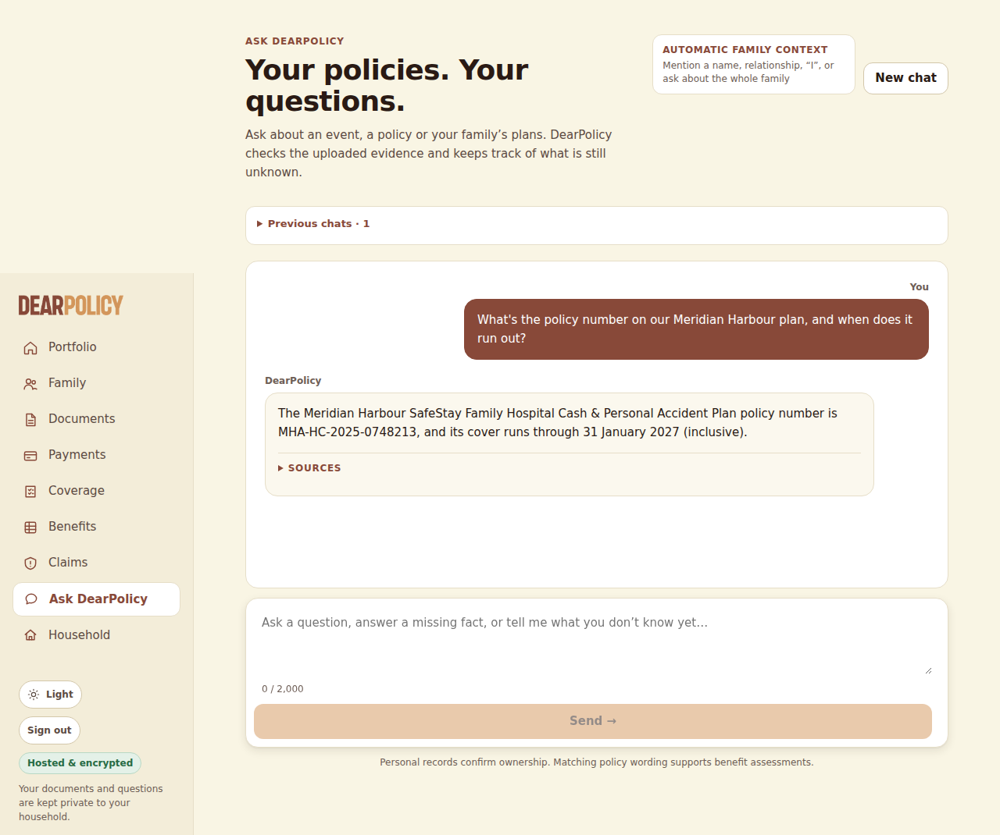

### Q2 -- conversation -- 11 s

**User** (composer): If something happened to Isla in an accident, how much is the accidental death payout for her? Is it the same as mine?

**DearPolicy**: DearPolicy Under the SafeStay Family Hospital Cash & Personal Accident Plan, Isla’s “Accidental death or permanent total disablement (lump sum)” benefit is S$40,000; the same benefit for you is S$150,000, so it is not the same amount (the schedule lists Child and Adult amounts respectively). Isla’s JuniorShield certificate also lists “Child accidental death” at S$20,000. SOURCES

Sources shown: Meridian Harbour Assurance Pte. Ltd. · SafeStay Family Hospital Cash & Personal Accident PlanYour uploaded documentPage 1; Meridian Harbour Assurance Pte. Ltd. · SafeStay Family Hospital Cash & Personal Accident PlanYour uploaded documentPage 1; Kestrel Bay Insurance (Singapore) Ltd. · JuniorShield Child Hospital Income PlanYour uploaded documentPage 1

Loop: final_answer, 4 step(s), 40988 in / 767 out tokens, 9455 ms

| # | tool | ok | error / result | evidence |
|---|---|---|---|---|
| 1 | policies_for | yes | {} | 2 |
| 2 | policies_for | yes | {} | 1 |
| 3 | search_passages | yes | {"hits":10} | 10 |
| 4 | search_passages | yes | {"hits":9} | 9 |
| 5 | select_table_value | yes | {"status":"ok","valueId":"v1","value":40000,"column":"Child (each)","row":"Accidental death or permanent total disablement (lump sum)"} | 1 |
| 6 | select_table_value | yes | {"status":"ok","valueId":"v2","value":150000,"column":"Adult (each)","row":"Accidental death or permanent total disablement (lump sum)"} | 1 |
| 7 | search_passages | yes | {"hits":5} | 5 |
| 8 | final_answer | yes |  | 0 |

Per call (tokens in/out): 1: 4902/105; 2: 6703/215; 3: 13468/281; 4: 15915/166

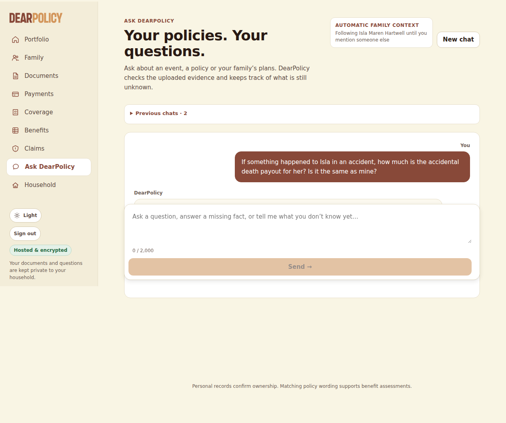

### Q3 -- conversation -- 13 s

**User** (composer): Felix fell off the monkey bars at school yesterday and broke his wrist. How much can we claim from the Meridian policy?

**DearPolicy**: DearPolicy Sorry Felix got hurt. For Felix, the policy lists S$600 for “Fractured bones (per Accident) — Simple (closed) fracture” and S$1,500 for “Fractured bones (per Accident) — Compound (open) fracture”; the type must be certified in writing by a registered medical practitioner and confirmed by X-ray, and only one of these benefits is payable for the same bone in the same accident. A FACT THAT CHANGES THIS ASSESSMENT Did the broken bone break through the skin, and has the fracture been confirmed by X-ray and certified in writing by a registered medical practitioner? This changes what your policy pays under: “Items D and E: the type of fracture must be certified in writing by a registered medical practitioner and confirmed by X-ray. Only one of Item D or” (page 1); “4.4 For Items D and E, a Compound fracture means a fracture in which the broken bone breaks through the skin. All” (page 2) Answer Show full assessment

Sources shown: Meridian Harbour Assurance Pte. Ltd. · SafeStay Family Hospital Cash & Personal Accident PlanYour uploaded documentPage 1; Meridian Harbour Assurance Pte. Ltd. · SafeStay Family Hospital Cash & Personal Accident PlanYour uploaded documentPage 2; Meridian Harbour Assurance Pte. Ltd. · SafeStay Family Hospital Cash & Personal Accident PlanYour uploaded documentPage 1; Meridian Harbour Assurance Pte. Ltd. · SafeStay Family Hospital Cash & Personal Accident PlanYour uploaded documentPage 1

Asks: Did the broken bone break through the skin, and has the fracture been confirmed by X-ray and certified in writing by a registered medical practitioner?

Loop: ask_user, 5 step(s), 36753 in / 792 out tokens, 10629 ms

| # | tool | ok | error / result | evidence |
|---|---|---|---|---|
| 1 | resolve_person | yes | {"status":"ok"} | 0 |
| 2 | note_facts | yes | {"facts":[{"key":"how_it_happened","value":"fell off the monkey bars at school","words":"fell off the monkey bars at school yesterday"},{"key":"injury","value": | 0 |
| 3 | policies_for | yes | {} | 1 |
| 4 | search_passages | yes | {"hits":10} | 10 |
| 5 | select_table_value | yes | {"status":"ok","valueId":"v1","value":600,"column":"Child (each)","row":"Fractured bones (per Accident) — Simple (closed) fracture"} | 1 |
| 6 | select_table_value | yes | {"status":"ok","valueId":"v2","value":1500,"column":"Child (each)","row":"Fractured bones (per Accident) — Compound (open) fracture"} | 1 |
| 7 | search_passages | yes | {"hits":5} | 5 |
| 8 | ask_user | yes |  | 0 |

Per call (tokens in/out): 1: 4901/18; 2: 5019/91; 3: 5222/119; 4: 9582/291; 5: 12029/273

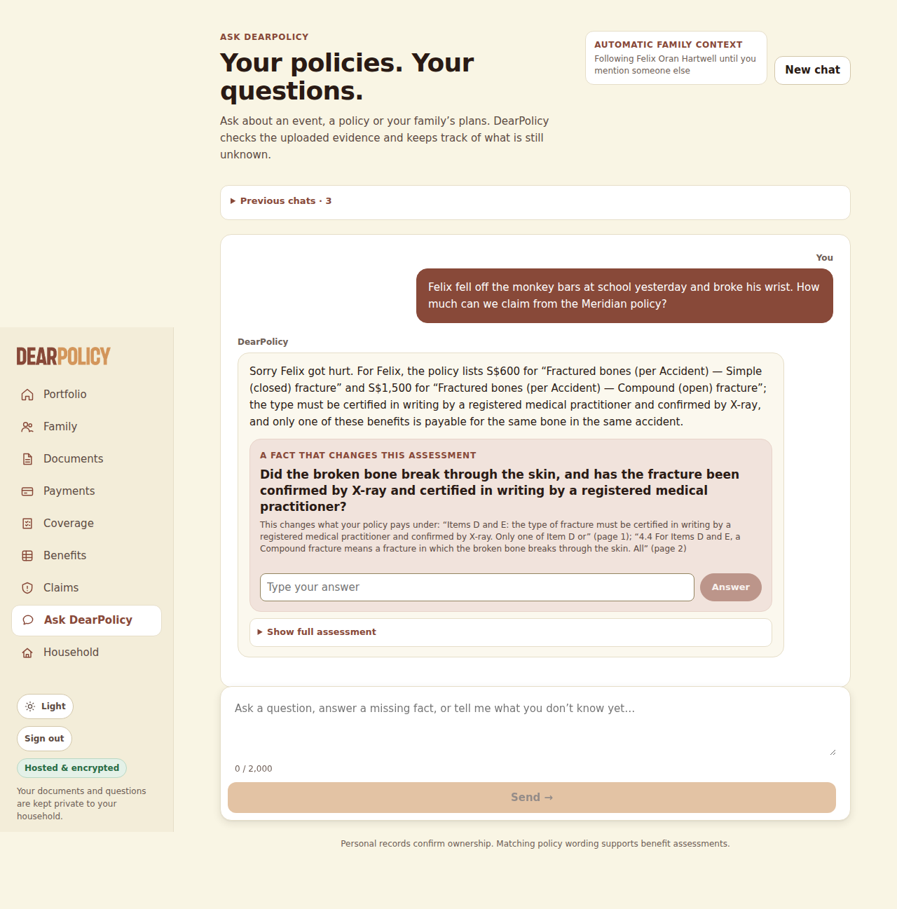

### Q4 -- conversation -- 6 s

**User** (inline answer (asked: Did the broken bone break through the skin, and has the fracture been confirmed by X-ray and certified in writing by a registered medical practitioner?)): The doctor said it's a closed fracture, the X-ray confirmed it, and the bone didn't come through the skin.

**DearPolicy**: DearPolicy You told me, “The doctor said it's a closed fracture, the X-ray confirmed it, and the bone didn't come through the skin.” For Felix, the policy lists S$600 for “Fractured bones (per Accident) — Simple (closed) fracture” and S$1,500 for “Fractured bones (per Accident) — Compound (open) fracture”; the type must be certified in writing by a registered medical practitioner and confirmed by X-ray, and only one of these benefits is payable for the same bone in the same accident. Based on what you reported, Felix’s fracture matches the closed-fracture description, but the documents do not establish that the doctor certified the fracture type in writing, so I can’t determine a claim amount from this information. What you’ve told me is your own account, not a reviewed medical record: the insurer will check it against the documents it asks for (such as the doctor’s report and the test or scan results) and decides the claim after reviewing them. NEXT STEP When you make the claim, include the doctor’s report and the test or scan results that show the policy’s condition is met, with the insurer’s claim form. SOURCES

Sources shown: Meridian Harbour Assurance Pte. Ltd. · SafeStay Family Hospital Cash & Personal Accident PlanYour uploaded documentPage 1; Meridian Harbour Assurance Pte. Ltd. · SafeStay Family Hospital Cash & Personal Accident PlanYour uploaded documentPage 2; Meridian Harbour Assurance Pte. Ltd. · SafeStay Family Hospital Cash & Personal Accident PlanYour uploaded documentPage 1; Meridian Harbour Assurance Pte. Ltd. · SafeStay Family Hospital Cash & Personal Accident PlanYour uploaded documentPage 1

Loop: final_answer, 2 step(s), 11188 in / 487 out tokens, 4496 ms

| # | tool | ok | error / result | evidence |
|---|---|---|---|---|
| 1 | note_facts | yes | {"facts":[{"key":"fracture_confirmation_and_open_closed","value":"The doctor said it's a closed fracture, the X-ray confirmed it, and the bone didn't come throu | 0 |
| 2 | final_answer | yes |  | 0 |

Per call (tokens in/out): 1: 5451/103; 2: 5737/384

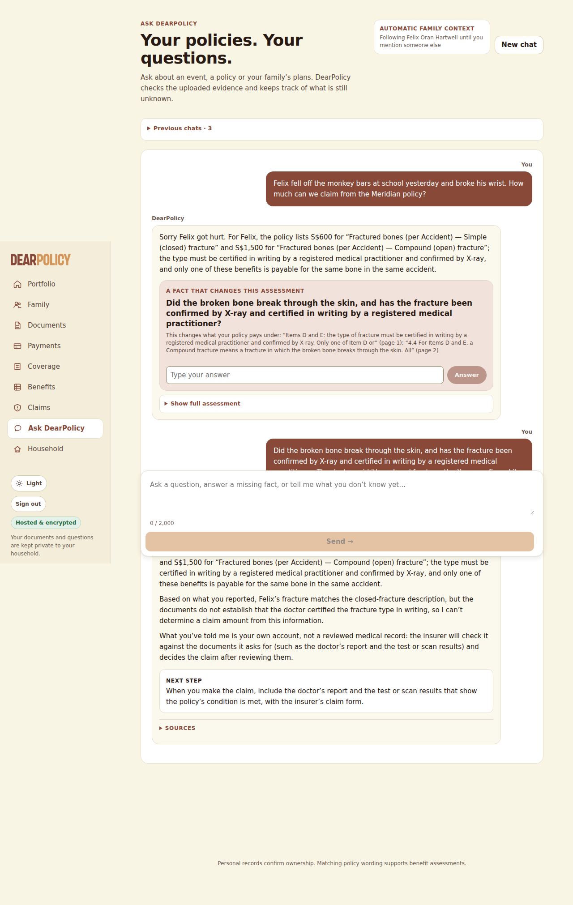

### Q5 -- conversation -- 19 s

**User** (composer): I was in hospital after that car accident in March. They admitted me at 9:40pm on 14 March and I was discharged at 8:20am on 18 March. How much hospital cash should Meridian pay me?

**DearPolicy**: DearPolicy For you, Meridian’s “Hospital daily allowance” is S$120 per day, up to 60 days per policy year, and its wording counts each complete 24-hour period plus a remaining period of 12 hours or more as another day (page 1; page 2). Only the insurer decides whether an amount is paid, owed or claimable, after it reviews the claim. NEXT STEP Meridian’s claim wording asks for written notice within 30 days of the accident and supporting documents including the hospital discharge summary showing admission and discharge times; check the policy’s claims requirements. SOURCES

Sources shown: Meridian Harbour Assurance Pte. Ltd. · SafeStay Family Hospital Cash & Personal Accident PlanYour uploaded documentPage 1; Meridian Harbour Assurance Pte. Ltd. · SafeStay Family Hospital Cash & Personal Accident PlanYour uploaded documentPage 2

Loop: final_answer, 7 step(s), 56777 in / 995 out tokens, 16402 ms

| # | tool | ok | error / result | evidence |
|---|---|---|---|---|
| 1 | resolve_person | yes | {"status":"ok"} | 0 |
| 2 | note_facts | yes | {"facts":[{"key":"how_it_happened","value":"car accident","words":"car accident"},{"key":"admission_datetime","value":"14 March at 9:40pm","words":"They admitte | 0 |
| 3 | policies_for | yes | {} | 1 |
| 4 | search_passages | yes | {"hits":9} | 9 |
| 5 | search_passages | yes | {"hits":4} | 4 |
| 6 | select_table_value | yes | {"status":"ok","valueId":"v1","value":120,"column":"Adult (each)","row":"Hospital daily allowance (per day of confinement, max 60 days per policy year) — see Cl… | 1 |
| 7 | calculate | yes | {"amount":360,"kind":"indicative_estimate"} | 2 |
| 8 | final_answer | yes |  | 0 |

Per call (tokens in/out): 1: 4924/17; 2: 5043/129; 3: 5339/46; 4: 6097/195; 5: 11236/97; 6: 11680/176; 7: 12458/335

Composer dropped: [{"reason":"calls a calculated benefit a payout","sentence":"Based on the admission and discharge times you gave, the indicative estimate is S$360 for three payable days; this is not a confirmed payout."},{"reason":"S$80 is printed in none of the evidence the sentence cites","sentence":"The endorsement changed the Child amount from S$80 to S$110 per day effective 1 July 2026, while the Adult amount remained unchanged; your March stay is before that effective date, so the Adult rate above applies (page 1)."}]

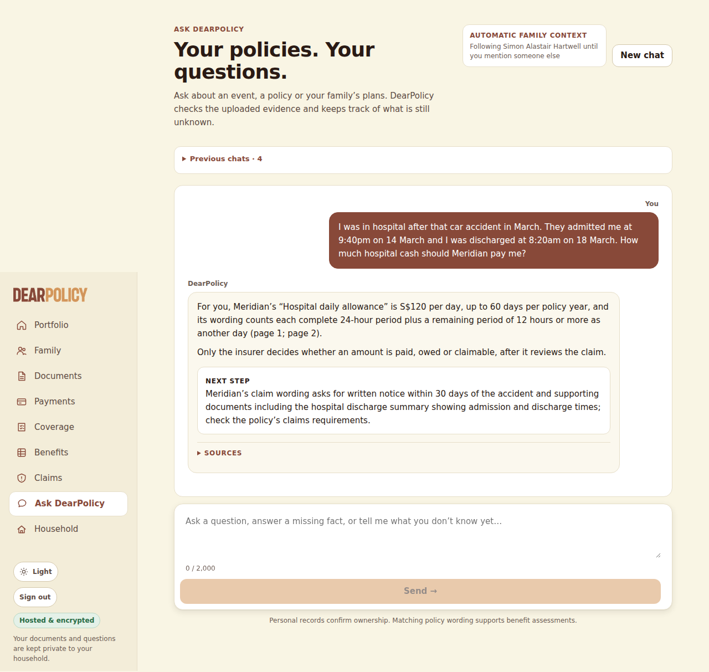

### Q6 -- conversation -- 8 s

**User** (composer): Did that endorsement letter change anything? How much is the daily hospital allowance for the kids now?

**DearPolicy**: DearPolicy I couldn’t confirm an answer to that from your documents.

Loop: final_answer, 2 step(s), 15059 in / 493 out tokens, 5266 ms

| # | tool | ok | error / result | evidence |
|---|---|---|---|---|
| 1 | policies_for | yes | {} | 1 |
| 2 | policies_for | yes | {} | 2 |
| 3 | search_passages | yes | {"hits":10} | 10 |
| 4 | final_answer | yes |  | 0 |

Per call (tokens in/out): 1: 4895/129; 2: 10164/364

Composer dropped: [{"reason":"shows an internal id (e8)","sentence":"Yes—the endorsement changed the SafeStay Family Hospital Cash & Personal Accident Plan’s “Hospital daily allowance (per day of confinement)” for each child from S$80 to S$110 per day, effective 1 July 2026; confinement days before that date remain at the earlier rate. citee8"},{"reason":"shows an internal id (e8, e6, e13)","sentence":"So Felix and Isla each have a current SafeStay allowance of S$110 per day for confinement days on or after 1 July 2026, subject to the policy’s accident-only condition and 60-day-per-policy-year maximum. cite

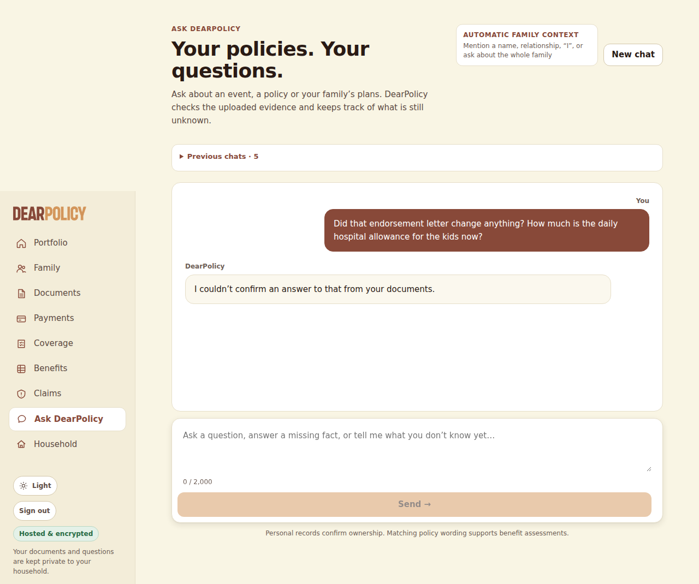

### Q7 -- conversation -- 9 s

**User** (composer): How much are we actually paying for the Meridian policy every year?

**DearPolicy**: DearPolicy I can’t tell from the Meridian documents available here how much the annual premium is; the policy schedule lists the family plan and cover period but no premium amount. The endorsement refers to a revised premium but does not state its amount. SOURCES

Sources shown: Meridian Harbour Assurance Pte. Ltd. · SafeStay Family Hospital Cash & Personal Accident PlanYour uploaded documentPage 1; Meridian Harbour Assurance Pte. Ltd. · SafeStay Family Hospital Cash & Personal Accident PlanYour uploaded documentPage 1

_No loop trace stored for this turn._

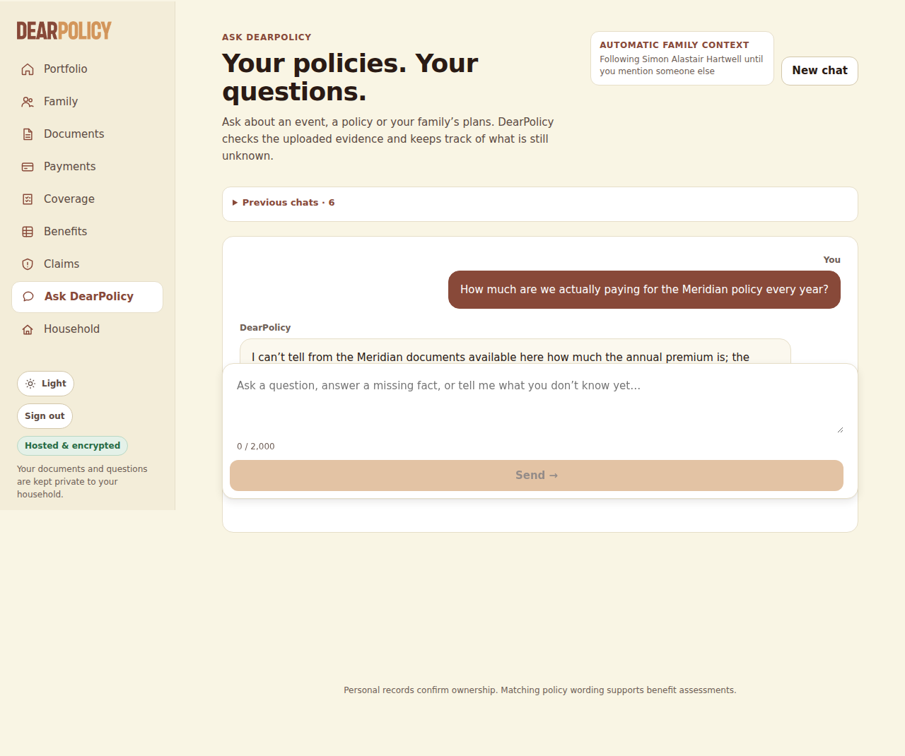

### Q8 -- conversation -- 17 s

**User** (composer): Isla might need to stay in hospital two nights next week. Will her JuniorShield plan pay the $150 a day?

**DearPolicy**: DearPolicy Isla’s JuniorShield plan lists “Daily hospital income” at S$150 per day, up to 30 days per policy year, but it is payable only from the fourth consecutive day of hospitalisation, with the first three days not payable; a two-night stay would not reach that threshold, so it would not pay this benefit for that stay. SOURCES

Sources shown: Kestrel Bay Insurance (Singapore) Ltd. · JuniorShield Child Hospital Income PlanYour uploaded documentPage 1; Kestrel Bay Insurance (Singapore) Ltd. · JuniorShield Child Hospital Income PlanYour uploaded documentPage 1

Loop: final_answer, 4 step(s), 26435 in / 470 out tokens, 14839 ms

| # | tool | ok | error / result | evidence |
|---|---|---|---|---|
| 1 | resolve_person | yes | {"status":"ok"} | 0 |
| 2 | policies_for | yes | {} | 2 |
| 3 | search_passages | yes | {"hits":3} | 3 |
| 4 | select_table_value | yes | {"status":"ok","valueId":"v1","value":150,"column":"Amount payable","row":"Daily hospital income*"} | 1 |
| 5 | search_passages | yes | {"hits":8} | 8 |
| 6 | final_answer | yes |  | 0 |

Per call (tokens in/out): 1: 4901/18; 2: 5019/44; 3: 5836/267; 4: 10679/141

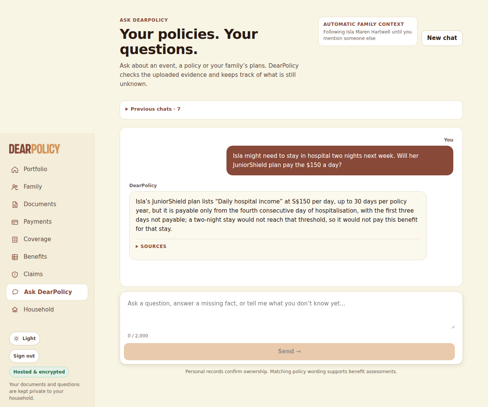

### Q9 -- conversation -- 10 s

**User** (composer): Oh, by the way, if one of the kids gets dengue, which of our policies would actually pay anything?

**DearPolicy**: DearPolicy For Felix, the SafeStay Family Hospital Cash & Personal Accident Plan is accident-only, so its hospital and medical-expense benefits would not pay for dengue illness (the child hospital daily allowance is currently S$110 per day from 1 July 2026, but only for eligible accident-related confinement). For Isla, JuniorShield Child Hospital Income Plan lists “Hand, foot & mouth disease or dengue fever hospitalisation (lump sum)” of S$500, so that is the policy benefit specifically relevant to dengue hospitalisation. I found no dengue-specific benefit for Felix in the policies listed for him; the documents available here may not include every policy the household has. SOURCES

Sources shown: Meridian Harbour Assurance Pte. Ltd. · SafeStay Family Hospital Cash & Personal Accident PlanYour uploaded documentPage 2; Meridian Harbour Assurance Pte. Ltd. · SafeStay Family Hospital Cash & Personal Accident PlanYour uploaded documentPage 1; Kestrel Bay Insurance (Singapore) Ltd. · JuniorShield Child Hospital Income PlanYour uploaded documentPage 1; Meridian Harbour Assurance Pte. Ltd. · SafeStay Family Hospital Cash & Personal Accident PlanYour uploaded documentPage 1

Loop: final_answer, 3 step(s), 28378 in / 711 out tokens, 8435 ms

| # | tool | ok | error / result | evidence |
|---|---|---|---|---|
| 1 | policies_for | yes | {} | 1 |
| 2 | policies_for | yes | {} | 2 |
| 3 | search_passages | yes | {"hits":10} | 10 |
| 4 | search_passages | yes | {"hits":10} | 10 |
| 5 | search_passages | yes | {"hits":6} | 6 |
| 6 | search_passages | yes | {"hits":8} | 8 |
| 7 | final_answer | yes |  | 0 |

Per call (tokens in/out): 1: 4899/117; 2: 6431/239; 3: 17048/355

Composer dropped: [{"reason":"not supported by its evidence: it is about Isla Maren Hartwell but its evidence was read for someone else","sentence":"Isla also has the SafeStay plan, but its benefits are accident-only and therefore would not pay for dengue illness."}]

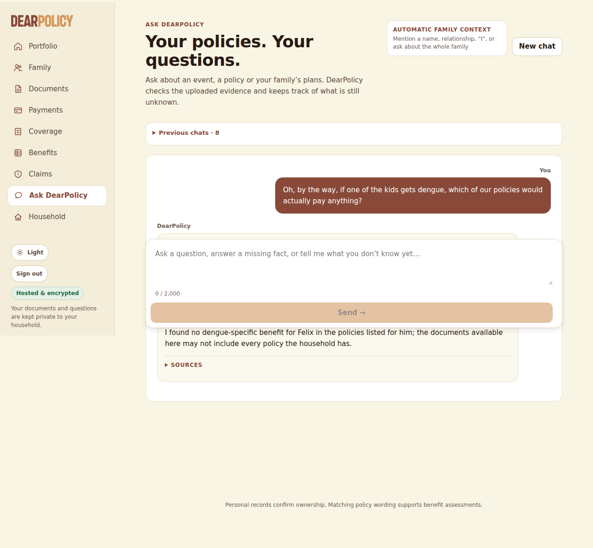

### R1 -- reopen -- 13 s

**User** (composer): So if Isla was in hospital for exactly 3 days in August after falling at the playground, how much would Meridian pay?

**DearPolicy**: DearPolicy For Isla, Meridian’s amended “Hospital daily allowance (per day of confinement)” is S$110 per day from 1 July 2026, replacing the earlier S$80 per day; the policy counts complete 24-hour periods, then a remaining period of 12 hours or more as another day, and disregards less than 12 hours. A FACT THAT CHANGES THIS ASSESSMENT What were Isla’s actual hospital admission and discharge dates and times? This changes what your policy pays under: “of discharge shown on the hospital record. Each complete period of 24 consecutive hours counts as one day. Any” (page 2); “remaining period of 12 hours or more counts as one further day; any remaining period of less than 12 hours is” (page 2) Answer Show full assessment

Sources shown: Meridian Harbour Assurance Pte. Ltd. · SafeStay Family Hospital Cash & Personal Accident PlanYour uploaded documentPage 2; Meridian Harbour Assurance Pte. Ltd. · SafeStay Family Hospital Cash & Personal Accident PlanYour uploaded documentPage 2; Meridian Harbour Assurance Pte. Ltd. · SafeStay Family Hospital Cash & Personal Accident PlanYour uploaded documentPage 1; Meridian Harbour Assurance Pte. Ltd. · SafeStay Family Hospital Cash & Personal Accident PlanYour uploaded documentPage 1

Asks: What were Isla’s actual hospital admission and discharge dates and times? (no fixture answer)

_No loop trace stored for this turn._

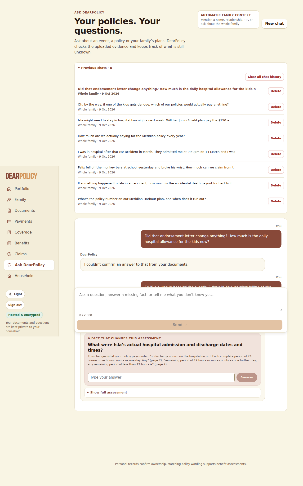

### D1 -- after_delete -- 11 s

**User** (composer): Did that endorsement letter change anything? How much is the daily hospital allowance for the kids now?

**DearPolicy**: DearPolicy I can’t confirm what the endorsement changed because its document was removed from the library; it took effect on 1 July 2026, so the current amount may differ from the remaining schedule. The remaining schedule lists “Hospital daily allowance” at S$80 per day for each child, up to 60 days per policy year, but this is the issued schedule amount rather than confirmed current cover. For Isla, the separate “Daily hospital income” benefit is S$150 per day, up to 30 days per policy year, payable only from the fourth consecutive hospitalisation day; the first three days are not payable. SOURCES

Sources shown: Meridian Harbour Assurance Pte. Ltd. · SafeStay Family Hospital Cash & Personal Accident PlanYour uploaded documentPage 1; Kestrel Bay Insurance (Singapore) Ltd. · JuniorShield Child Hospital Income PlanYour uploaded documentPage 1; Kestrel Bay Insurance (Singapore) Ltd. · JuniorShield Child Hospital Income PlanYour uploaded documentPage 1

Loop: final_answer, 4 step(s), 43088 in / 815 out tokens, 9683 ms

| # | tool | ok | error / result | evidence |
|---|---|---|---|---|
| 1 | policies_for | yes | {} | 1 |
| 2 | policies_for | yes | {} | 2 |
| 3 | search_passages | yes | {"hits":10} | 10 |
| 4 | select_table_value | yes | {"status":"ok","valueId":"v1","value":80,"column":"Child (each)","row":"Hospital daily allowance (per day of confinement, max 60 days per policy year) — see Cla… | 1 |
| 5 | select_table_value | yes | {"status":"ok","valueId":"v2","value":80,"column":"Child (each)","row":"Hospital daily allowance (per day of confinement, max 60 days per policy year) — see Cla… | 1 |
| 6 | select_table_value | yes | {"status":"ok","valueId":"v3","value":150,"column":"Amount payable","row":"Daily hospital income*"} | 1 |
| 7 | search_passages | yes | {"hits":5} | 5 |
| 8 | final_answer | yes |  | 0 |

Per call (tokens in/out): 1: 4895/130; 2: 10875/278; 3: 12690/74; 4: 14628/333

Composer dropped: [{"reason":"S$150 is printed in none of the evidence the sentence cites","sentence":"The removed endorsement relates to the SafeStay policy, not Isla’s separate JuniorShield certificate, so the documents show no endorsement change to that S$150 daily hospital income figure."}]

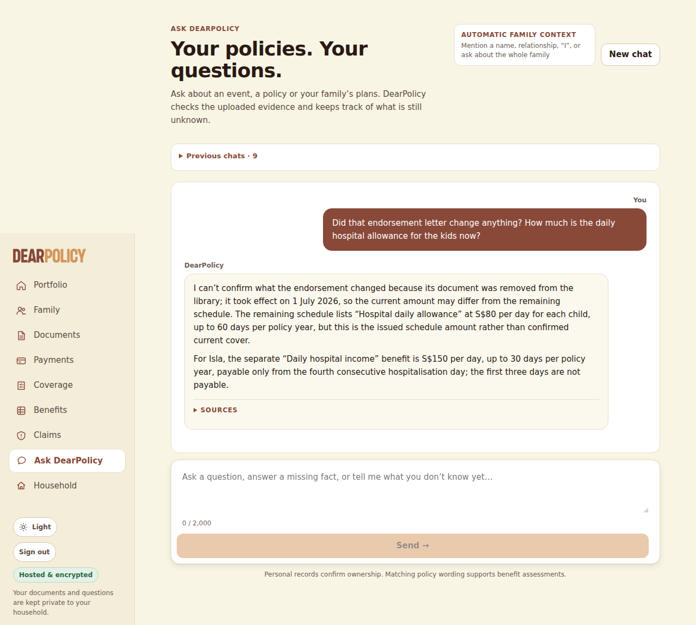

## Deterministic checks (EXPECTED.json, copied in after the conversations)

| scope | check | result | detail |
|---|---|---|---|
| hx-text.pdf | uploaded and processed | PASS | not_scanned_prototype/ready |
| hx-text.pdf | page 1 text extracted | PASS | native, 1842 chars |
| hx-text.pdf | page 1 contains "MHA-HC-2025-0748213" | PASS |  |
| hx-text.pdf | page 1 contains "S$150,000" | PASS |  |
| hx-text.pdf | page 1 contains "S$40,000" | PASS |  |
| hx-text.pdf | page 1 contains "S$120" | PASS |  |
| hx-text.pdf | page 1 contains "S$80" | PASS |  |
| hx-text.pdf | page 1 contains "S$600" | PASS |  |
| hx-text.pdf | page 1 contains "S$1,500" | PASS |  |
| hx-text.pdf | page 2 text extracted | PASS | native, 3002 chars |
| hx-text.pdf | page 2 contains "24 consecutive hours" | PASS |  |
| hx-text.pdf | page 2 contains "Accident-only cover" | PASS |  |
| hx-text.pdf | linked automatically to the right people | PASS | linked: Felix Oran Hartwell, Isla Maren Hartwell, Leonie Brigitte Hartwell, Simon Alastair Hartwell; expected: Simon Alastair Hartwell, Leonie Brigitte Hartwell, Felix Oran Hartwell, Isla Maren Hartwell |
| hx-endorsement.pdf | uploaded and processed | PASS | not_scanned_prototype/ready |
| hx-endorsement.pdf | page 1 text extracted | PASS | native, 1250 chars |
| hx-endorsement.pdf | page 1 contains "ME-26-0412" | PASS |  |
| hx-endorsement.pdf | page 1 contains "MHA-HC-2025-0748213" | PASS |  |
| hx-endorsement.pdf | page 1 contains "S$110" | PASS |  |
| hx-endorsement.pdf | page 1 contains "01 July 2026" | PASS |  |
| hx-scanned.pdf | uploaded and processed | PASS | not_scanned_prototype/ready |
| hx-scanned.pdf | page 1 text extracted | PASS | ocr, 1243 chars |
| hx-scanned.pdf | page 1 contains "KBJ-26-00391" | PASS |  |
| hx-scanned.pdf | page 1 contains "S$150" | PASS |  |
| hx-scanned.pdf | page 1 contains "S$500" | PASS |  |
| hx-scanned.pdf | linked automatically to the right people | PASS | linked: Isla Maren Hartwell; expected: Isla Maren Hartwell |
| delete hx-endorsement.pdf | deleted through the page and confirmed before the next question | PASS | notice: "Deleted SafeStay Family Hospital Cash & Personal Accident Plan. It is no longer used in answers, and your portfolio has been updated. ✕"; listed after: false; lifecycle: pending_deletion |
| Q1 (conversation) "What's the policy number on our Meridian Harbour plan, and w" | useful reply (a cited figure or condition, one material question, or what the documents do not say) | **FAIL** | no stored answer |
| Q1 (conversation) "What's the policy number on our Meridian Harbour plan, and w" | every figure stated is one the expected facts give | PASS |  |
| Q1 (conversation) "What's the policy number on our Meridian Harbour plan, and w" | every date stated is one the expected facts give | PASS |  |
| Q1 (conversation) "What's the policy number on our Meridian Harbour plan, and w" | no placeholder where the documents give a figure | PASS |  |
| Q1 (conversation) "What's the policy number on our Meridian Harbour plan, and w" | no uncertainty the expected facts contradict | PASS |  |
| Q1 (conversation) "What's the policy number on our Meridian Harbour plan, and w" | no superseded figure presented as current | PASS |  |
| Q2 (conversation) "If something happened to Isla in an accident, how much is th" | useful reply (a cited figure or condition, one material question, or what the documents do not say) | PASS | a cited statement |
| Q2 (conversation) "If something happened to Isla in an accident, how much is th" | every figure stated is one the expected facts give | **FAIL** | S$20,000 in "Isla’s JuniorShield certificate also lists “Child accidental death” at S$20,000." |
| Q2 (conversation) "If something happened to Isla in an accident, how much is th" | every date stated is one the expected facts give | PASS |  |
| Q2 (conversation) "If something happened to Isla in an accident, how much is th" | no placeholder where the documents give a figure | PASS |  |
| Q2 (conversation) "If something happened to Isla in an accident, how much is th" | no uncertainty the expected facts contradict | PASS |  |
| Q2 (conversation) "If something happened to Isla in an accident, how much is th" | no superseded figure presented as current | PASS |  |
| Q3 (conversation) "Felix fell off the monkey bars at school yesterday and broke" | useful reply (a cited figure or condition, one material question, or what the documents do not say) | PASS | one material question |
| Q3 (conversation) "Felix fell off the monkey bars at school yesterday and broke" | every figure stated is one the expected facts give | PASS |  |
| Q3 (conversation) "Felix fell off the monkey bars at school yesterday and broke" | every date stated is one the expected facts give | PASS |  |
| Q3 (conversation) "Felix fell off the monkey bars at school yesterday and broke" | no placeholder where the documents give a figure | PASS |  |
| Q3 (conversation) "Felix fell off the monkey bars at school yesterday and broke" | no uncertainty the expected facts contradict | PASS |  |
| Q3 (conversation) "Felix fell off the monkey bars at school yesterday and broke" | no superseded figure presented as current | PASS |  |
| Q4 (conversation) "The doctor said it's a closed fracture, the X-ray confirmed " | useful reply (a cited figure or condition, one material question, or what the documents do not say) | PASS | a cited statement |
| Q4 (conversation) "The doctor said it's a closed fracture, the X-ray confirmed " | every figure stated is one the expected facts give | PASS |  |
| Q4 (conversation) "The doctor said it's a closed fracture, the X-ray confirmed " | every date stated is one the expected facts give | PASS |  |
| Q4 (conversation) "The doctor said it's a closed fracture, the X-ray confirmed " | no placeholder where the documents give a figure | PASS |  |
| Q4 (conversation) "The doctor said it's a closed fracture, the X-ray confirmed " | no uncertainty the expected facts contradict | PASS |  |
| Q4 (conversation) "The doctor said it's a closed fracture, the X-ray confirmed " | no superseded figure presented as current | PASS |  |
| Q5 (conversation) "I was in hospital after that car accident in March. They adm" | useful reply (a cited figure or condition, one material question, or what the documents do not say) | PASS | a cited statement |
| Q5 (conversation) "I was in hospital after that car accident in March. They adm" | every figure stated is one the expected facts give | PASS |  |
| Q5 (conversation) "I was in hospital after that car accident in March. They adm" | every date stated is one the expected facts give | PASS |  |
| Q5 (conversation) "I was in hospital after that car accident in March. They adm" | no placeholder where the documents give a figure | PASS |  |
| Q5 (conversation) "I was in hospital after that car accident in March. They adm" | no uncertainty the expected facts contradict | PASS |  |
| Q5 (conversation) "I was in hospital after that car accident in March. They adm" | no superseded figure presented as current | PASS |  |
| Q6 (conversation) "Did that endorsement letter change anything? How much is the" | useful reply (a cited figure or condition, one material question, or what the documents do not say) | PASS | one material question |
| Q6 (conversation) "Did that endorsement letter change anything? How much is the" | every figure stated is one the expected facts give | PASS |  |
| Q6 (conversation) "Did that endorsement letter change anything? How much is the" | every date stated is one the expected facts give | PASS |  |
| Q6 (conversation) "Did that endorsement letter change anything? How much is the" | no placeholder where the documents give a figure | PASS |  |
| Q6 (conversation) "Did that endorsement letter change anything? How much is the" | no uncertainty the expected facts contradict | PASS |  |
| Q6 (conversation) "Did that endorsement letter change anything? How much is the" | no superseded figure presented as current | PASS |  |
| Q7 (conversation) "How much are we actually paying for the Meridian policy ever" | useful reply (a cited figure or condition, one material question, or what the documents do not say) | **FAIL** | no stored answer |
| Q7 (conversation) "How much are we actually paying for the Meridian policy ever" | every figure stated is one the expected facts give | PASS |  |
| Q7 (conversation) "How much are we actually paying for the Meridian policy ever" | every date stated is one the expected facts give | PASS |  |
| Q7 (conversation) "How much are we actually paying for the Meridian policy ever" | no placeholder where the documents give a figure | PASS |  |
| Q7 (conversation) "How much are we actually paying for the Meridian policy ever" | no uncertainty the expected facts contradict | PASS |  |
| Q7 (conversation) "How much are we actually paying for the Meridian policy ever" | no superseded figure presented as current | PASS |  |
| Q8 (conversation) "Isla might need to stay in hospital two nights next week. Wi" | useful reply (a cited figure or condition, one material question, or what the documents do not say) | PASS | a cited statement |
| Q8 (conversation) "Isla might need to stay in hospital two nights next week. Wi" | every figure stated is one the expected facts give | PASS |  |
| Q8 (conversation) "Isla might need to stay in hospital two nights next week. Wi" | every date stated is one the expected facts give | PASS |  |
| Q8 (conversation) "Isla might need to stay in hospital two nights next week. Wi" | no placeholder where the documents give a figure | PASS |  |
| Q8 (conversation) "Isla might need to stay in hospital two nights next week. Wi" | no uncertainty the expected facts contradict | PASS |  |
| Q8 (conversation) "Isla might need to stay in hospital two nights next week. Wi" | no superseded figure presented as current | PASS |  |
| Q9 (conversation) "Oh, by the way, if one of the kids gets dengue, which of our" | useful reply (a cited figure or condition, one material question, or what the documents do not say) | PASS | a cited statement |
| Q9 (conversation) "Oh, by the way, if one of the kids gets dengue, which of our" | every figure stated is one the expected facts give | PASS |  |
| Q9 (conversation) "Oh, by the way, if one of the kids gets dengue, which of our" | every date stated is one the expected facts give | PASS |  |
| Q9 (conversation) "Oh, by the way, if one of the kids gets dengue, which of our" | no placeholder where the documents give a figure | PASS |  |
| Q9 (conversation) "Oh, by the way, if one of the kids gets dengue, which of our" | no uncertainty the expected facts contradict | PASS |  |
| Q9 (conversation) "Oh, by the way, if one of the kids gets dengue, which of our" | no superseded figure presented as current | PASS |  |
| R1 (reopen) "So if Isla was in hospital for exactly 3 days in August afte" | useful reply (a cited figure or condition, one material question, or what the documents do not say) | **FAIL** | no stored answer |
| R1 (reopen) "So if Isla was in hospital for exactly 3 days in August afte" | every figure stated is one the expected facts give | PASS |  |
| R1 (reopen) "So if Isla was in hospital for exactly 3 days in August afte" | every date stated is one the expected facts give | PASS |  |
| R1 (reopen) "So if Isla was in hospital for exactly 3 days in August afte" | no placeholder where the documents give a figure | PASS |  |
| R1 (reopen) "So if Isla was in hospital for exactly 3 days in August afte" | no uncertainty the expected facts contradict | PASS |  |
| R1 (reopen) "So if Isla was in hospital for exactly 3 days in August afte" | no superseded figure presented as current | PASS |  |
| D1 (after_delete) "Did that endorsement letter change anything? How much is the" | useful reply (a cited figure or condition, one material question, or what the documents do not say) | PASS | a cited statement |
| D1 (after_delete) "Did that endorsement letter change anything? How much is the" | every figure stated is one the expected facts give | PASS |  |
| D1 (after_delete) "Did that endorsement letter change anything? How much is the" | every date stated is one the expected facts give | PASS |  |
| D1 (after_delete) "Did that endorsement letter change anything? How much is the" | no placeholder where the documents give a figure | PASS |  |
| D1 (after_delete) "Did that endorsement letter change anything? How much is the" | no uncertainty the expected facts contradict | PASS |  |
| D1 (after_delete) "Did that endorsement letter change anything? How much is the" | no superseded figure presented as current | PASS |  |
| D1 (after_delete) "Did that endorsement letter change anything? How much is the" | asked after a confirmed deletion | PASS |  |
| D1 (after_delete) "Did that endorsement letter change anything? How much is the" | does not rely on the deleted hx-endorsement.pdf | PASS | cites: hx-text.pdf, hx-scanned.pdf, hx-scanned.pdf |
| Q1 | states "MHA-HC-2025-0748213" | PASS |  |
| Q1 | states one of ["31 January 2027","31 Jan 2027","31/01/2027","2027-01-31","31 Jan. 2027"] | PASS |  |
| Q1 | never states "MHA-HC-2025-0748218" | PASS |  |
| Q1 | never states "01 Feb 2027" | PASS |  |
| Q1 | never states "1 February 2027" | PASS |  |
| Q1 | never states "14 March 2027" | PASS |  |
| Q1 | cites hx-text.pdf page 1 | **FAIL** | cited: nothing |
| Q1 | answers without an unnecessary follow-up | PASS |  |
| Q2 | states "S$40,000" | PASS |  |
| Q2 | states "S$150,000" | PASS |  |
| Q2 | cites hx-text.pdf page 1 | PASS | cited: hx-text.pdf p1, hx-text.pdf p1, hx-scanned.pdf p1 |
| Q2 | answers without an unnecessary follow-up | PASS |  |
| Q3 | never states "S$2,100" | PASS |  |
| Q3 | never states "S$2,500" | PASS |  |
| Q3 | about Felix Oran Hartwell | PASS | resolved to Felix Oran Hartwell |
| Q3 | asks a follow-up before answering | PASS | Did the broken bone break through the skin, and has the fracture been confirmed by X-ray and certified in writing by a registered medical practitioner? |
| Q4 | states "S$600" | PASS |  |
| Q4 | never states "S$2,100" | PASS |  |
| Q4 | never states "S$2,600" | PASS |  |
| Q4 | cites hx-text.pdf page 1 | PASS | cited: hx-text.pdf p1, hx-text.pdf p2, hx-text.pdf p1, hx-text.pdf p1 |
| Q4 | about Felix Oran Hartwell | PASS | resolved to Felix Oran Hartwell |
| Q4 | the answered question is not asked again | PASS | answered: "Did the broken bone break through the skin, and has the fracture been confirmed by X-ray and certified in writing by a registered medical practitioner?" |
| Q5 | states "S$360" | **FAIL** |  |
| Q5 | never states "S$480" | PASS |  |
| Q5 | never states "S$330" | PASS |  |
| Q5 | never states "S$440" | PASS |  |
| Q5 | cites hx-text.pdf page 1 | PASS | cited: hx-text.pdf p1, hx-text.pdf p2 |
| Q5 | about Simon Alastair Hartwell | PASS | resolved to Simon Alastair Hartwell |
| Q6 | states "S$110" | **FAIL** |  |
| Q6 | states one of ["01 July 2026","1 July 2026","1 Jul 2026","01 Jul 2026"] | **FAIL** |  |
| Q6 | cites hx-endorsement.pdf page 1 | PASS | cited: hx-text.pdf p2, hx-text.pdf p2, hx-endorsement.pdf p1, hx-text.pdf p1 |
| Q6 | uses the current version (hx-endorsement.pdf) | PASS | cited: hx-text.pdf, hx-endorsement.pdf |
| Q7 | states one of ["not stated","isn't stated","is not stated","not shown","isn't shown","doesn't show","does not show","not in your","not in the","don't show","do not show","no premium","doesn't state","does not state","doesn't mention","does not mention","couldn't find","could not find"] | PASS |  |
| Q8 | states one of ["4th","fourth"] | PASS |  |
| Q8 | never states "S$300" | PASS |  |
| Q8 | never states "S$450" | PASS |  |
| Q8 | cites hx-scanned.pdf page 1 | PASS | cited: hx-scanned.pdf p1, hx-scanned.pdf p1 |
| Q8 | about Isla Maren Hartwell | PASS | resolved to Isla Maren Hartwell |
| Q9 | states "S$500" | PASS |  |
| Q9 | states one of ["accident only","accident-only","only covers accidents","accidents only","only for accidents","only pays for accidents"] | PASS |  |
| Q9 | cites hx-scanned.pdf page 1 | PASS | cited: hx-text.pdf p2, hx-endorsement.pdf p1, hx-scanned.pdf p1, hx-text.pdf p1 |
| Q9 | never: Meridian's daily allowance presented as paying for dengue (source Q9 forbidden 1) | PASS |  |
| Q9 | never: JuniorShield presented as covering Felix or the adults (source Q9 forbidden 2) | PASS |  |
| R1 | never states "S$240" | PASS |  |
| R1 | about Isla Maren Hartwell | PASS | no stored subject; answer names Isla |
| R1 | one accepted answer: asks for the admission and discharge times \| S$330 conditioned on exactly 72 hours | PASS | asks: "What were Isla’s actual hospital admission and discharge dates and times?" |
| R1 | S$330 only with its condition | PASS |  |
| D1 | never states "S$110" | PASS |  |
| D1 | does not cite hx-endorsement.pdf | PASS |  |

## Every provider request (process-wide fetch guard)

| seq | kind | model → reported | provider request id | status / refused | in | cached | out | reasoning | reserved | charged | ms |
|---|---|---|---|---|---|---|---|---|---|---|---|
| 1 | structured | gpt-6-luna → gpt-6-luna | chatcmpl-EX9vMaXZLjrRr8PE6AXGh87D5Qzap | 200 | 2743 | 0 | 2563 | 0 | US$0.003506 | US$0.001556 | 16405 |
| 2 | structured | gpt-6-luna → gpt-6-luna | chatcmpl-EX9vbtHwXnuUktMfYbNo55Sye71WG | 200 | 1201 | 0 | 11 | 0 | US$0.000548 | US$0.000126 | 1337 |
| 2 | structured | gpt-6-luna → gpt-6-luna | chatcmpl-EX9vbI2osclUg6ZLtCqY0VaxDppi7 | 200 | 1336 | 0 | 11 | 0 | US$0.000592 | US$0.000139 | 1503 |
| 4 | structured | gpt-6-luna → gpt-6-luna | chatcmpl-EX9vdfmBIxI31FiNgtWbRQzFTeoAM | 200 | 1612 | 0 | 900 | 0 | US$0.000746 | US$0.000611 | 6456 |
| 5 | structured | gpt-6-luna → gpt-6-luna | chatcmpl-EX9vjQCmKC9qE6PZfXR2CxTPVG7qZ | 200 | 2454 | 0 | 4000 | 0 | US$0.002416 | US$0.002245 | 24358 |
| 6 | structured | gpt-6-luna → gpt-6-luna | chatcmpl-EX9w7tX5SotntPdQPS1oVb1eh4AZI | 200 | 3064 | 0 | 882 | 0 | US$0.001239 | US$0.000747 | 7984 |
| 7 | structured | gpt-6-luna → gpt-6-luna | chatcmpl-EX9wGNqTUWhHfyDvED7RITc3usLgk | 200 | 2006 | 1646 | 308 | 0 | US$0.003391 | US$0.000206 | 2729 |
| 8 | structured | gpt-6-luna → gpt-6-luna | chatcmpl-EX9wJ3fQr88BZgW3O40XghqDm9dQM | 200 | 958 | 0 | 104 | 0 | US$0.000522 | US$0.000148 | 1617 |
| 9 | structured | gpt-6-luna → gpt-6-luna | chatcmpl-EX9wKWpq9W5LjI8S2hv4bN8kV3Yt3 | 200 | 1234 | 0 | 83 | 0 | US$0.000675 | US$0.000165 | 1626 |
| 10 | structured | gpt-6-luna → gpt-6-luna | chatcmpl-EX9wM3U6NeU9qbGEbpmTE6iWFAq4Z | 200 | 1490 | 1073 | 322 | 0 | US$0.002265 | US$0.000213 | 2971 |
| 11 | structured | gpt-6-luna → gpt-6-luna | chatcmpl-EX9wPpTiMrEA4bcX7FUagR9rzHl0k | 200 | 847 | 0 | 117 | 0 | US$0.000900 | US$0.000143 | 2707 |
| 12 | document (pdf 1p) | gpt-6-luna → gpt-6-luna | chatcmpl-EX9wT7pbOg3uRzEbTBBBgGFiA4zPf | 200 | 1351 | 0 | 381 | 0 | US$0.008615 | US$0.000326 | 5018 |
| 13 | structured | gpt-6-luna → gpt-6-luna | chatcmpl-EX9wXG85FohTlLxpbdhqJ8BkisCX1 | 200 | 2017 | 1646 | 860 | 0 | US$0.003391 | US$0.000484 | 5099 |
| 14 | structured | gpt-6-luna → gpt-6-luna | chatcmpl-EX9wc28H4W15A99GB1pSJxe2kq7In | 200 | 672 | 0 | 120 | 0 | US$0.000580 | US$0.000127 | 2301 |
| 15 | structured | gpt-6-luna → gpt-6-luna | chatcmpl-EX9weUODkMNqIz29S8FmKhlAx5iaM | 200 | 1246 | 0 | 176 | 0 | US$0.000675 | US$0.000213 | 1961 |
| 16 | structured | gpt-6-luna → gpt-6-luna | chatcmpl-EX9wgZizbVoTxqsZNHBVILvaiOGlb | 200 | 1479 | 1073 | 614 | 0 | US$0.002261 | US$0.000358 | 4974 |
| 16 | loop | gpt-6-luna → gpt-6-luna | chatcmpl-EX9wlhVtKWY4fkuzWdO6smyNlBali | 200 | 4893 | 0 | 29 | 0 | US$0.002040 | US$0.000504 | 1767 |
| 17 | structured | gpt-6-luna → gpt-6-luna | chatcmpl-EX9wl5w7RJgrHEhN65gbgSMhkpzx9 | 200 | 1033 | 0 | 192 | 0 | US$0.000929 | US$0.000199 | 2559 |
| 18 | loop | gpt-6-luna → gpt-6-luna | chatcmpl-EX9wnvmuMr2sOzk1rsC9H7rQw760j | 200 | 7442 | 4767 | 77 | 0 | US$0.002402 | US$0.000354 | 1685 |
| 20 | loop | gpt-6-luna → gpt-6-luna | chatcmpl-EX9wrLe4vZoathCIjeU12MxXingRN | 200 | 4902 | 4746 | 105 | 0 | US$0.002041 | US$0.000116 | 1821 |
| 21 | loop | gpt-6-luna → gpt-6-luna | chatcmpl-EX9wtCEnMx2A6tonIGZAhyUlRKWaf | 200 | 6703 | 4776 | 215 | 0 | US$0.002262 | US$0.000348 | 2715 |
| 22 | loop | gpt-6-luna → gpt-6-luna | chatcmpl-EX9wwhBpSk14tNKzQjFrrKIx6oDv8 | 200 | 13468 | 6577 | 281 | 0 | US$0.003187 | US$0.000895 | 2717 |
| 23 | loop | gpt-6-luna → gpt-6-luna | chatcmpl-EX9wymnWz9g2stfArdO9yDSYfTiAe | 200 | 15915 | 13342 | 166 | 0 | US$0.003528 | US$0.000474 | 2092 |
| 24 | loop | gpt-6-luna → gpt-6-luna | chatcmpl-EX9x2iqW03fP4UAwblvGxROjajAtj | 200 | 4901 | 4746 | 18 | 0 | US$0.002041 | US$0.000072 | 1111 |
| 25 | loop | gpt-6-luna → gpt-6-luna | chatcmpl-EX9x467d7cW6e3p8bcYZFJMVmV2Yh | 200 | 5019 | 4775 | 91 | 0 | US$0.002064 | US$0.000118 | 1835 |
| 26 | loop | gpt-6-luna → gpt-6-luna | chatcmpl-EX9x5QO5hrHyW1wHzel77lue08oq9 | 200 | 5222 | 4893 | 119 | 0 | US$0.002102 | US$0.000141 | 1951 |
| 27 | loop | gpt-6-luna → gpt-6-luna | chatcmpl-EX9x7uVJQp1oKGa6w5idSvyZZ1BkK | 200 | 9582 | 5096 | 291 | 0 | US$0.002688 | US$0.000645 | 2933 |
| 28 | loop | gpt-6-luna → gpt-6-luna | chatcmpl-EX9xAJZPc4BgLRsGzlasZ7tJPNtck | 200 | 12029 | 9456 | 273 | 0 | US$0.003033 | US$0.000488 | 2739 |
| 29 | loop | gpt-6-luna → gpt-6-luna | chatcmpl-EX9xFqIIQkYAsNEOFuQWr4JZXGLqe | 200 | 5451 | 0 | 103 | 0 | US$0.002134 | US$0.000597 | 1614 |
| 30 | loop | gpt-6-luna → gpt-6-luna | chatcmpl-EX9xHlehc27Us7ahHbTxj0BRddppW | 200 | 5737 | 5325 | 384 | 0 | US$0.002188 | US$0.000286 | 2866 |
| 31 | loop | gpt-6-luna → gpt-6-luna | chatcmpl-EX9xMckJNjULcz7GpGpp9CvfLuM4U | 200 | 4924 | 4746 | 17 | 0 | US$0.002044 | US$0.000074 | 1675 |
| 32 | loop | gpt-6-luna → gpt-6-luna | chatcmpl-EX9xNxKgFarbQ6Oy5BCN15gKiYPAQ | 200 | 5043 | 4798 | 129 | 0 | US$0.002067 | US$0.000137 | 1832 |
| 33 | loop | gpt-6-luna → gpt-6-luna | chatcmpl-EX9xPtzi6HDsz3eUNN4OnpRDWxBXx | 200 | 5339 | 4917 | 46 | 0 | US$0.002116 | US$0.000114 | 1673 |
| 34 | loop | gpt-6-luna → gpt-6-luna | chatcmpl-EX9xRFobTVNXhiVmWXQeGKBRxziSq | 200 | 6097 | 5213 | 195 | 0 | US$0.002224 | US$0.000238 | 2554 |
| 35 | loop | gpt-6-luna → gpt-6-luna | chatcmpl-EX9xTOIKQiYzRlWysBtPKH4Gqk716 | 200 | 11236 | 5971 | 97 | 0 | US$0.002939 | US$0.000635 | 1679 |
| 36 | loop | gpt-6-luna → gpt-6-luna | chatcmpl-EX9xVtYX7RqNhEMsGt2AWDh0rDpu4 | 200 | 11680 | 11110 | 176 | 0 | US$0.003009 | US$0.000256 | 1956 |
| 37 | loop | gpt-6-luna → gpt-6-luna | chatcmpl-EX9xXuGcEKLvdicHWJPnKAR8JyHQc | 200 | 12458 | 11554 | 335 | 0 | US$0.003138 | US$0.000373 | 4942 |
| 38 | loop | gpt-6-luna → gpt-6-luna | chatcmpl-EX9xfm7yqy3RLFY8bSaWSMCZL10zG | 200 | 4895 | 4746 | 129 | 0 | US$0.002041 | US$0.000127 | 1834 |
| 39 | loop | gpt-6-luna → gpt-6-luna | chatcmpl-EX9xgdFzHoQFI45rFcFcSSjhZazOe | 200 | 10164 | 4769 | 364 | 0 | US$0.002740 | US$0.000769 | 3409 |
| 40 | loop | gpt-6-luna → gpt-6-luna | chatcmpl-EX9xmzg4W72lL07BSaH85pLCPIBvQ | 200 | 4889 | 4746 | 26 | 0 | US$0.002039 | US$0.000075 | 1410 |
| 41 | loop | gpt-6-luna → gpt-6-luna | chatcmpl-EX9xoXL6rIzWp7Y42b8qQeiaF7Wvk | 200 | 7448 | 4763 | 44 | 0 | US$0.002403 | US$0.000338 | 1884 |
| 42 | loop | gpt-6-luna → gpt-6-luna | chatcmpl-EX9xqi2ves2gynDNLvpJWZal1Ped7 | 200 | 8328 | 7322 | 59 | 0 | US$0.002528 | US$0.000203 | 1430 |
| 43 | loop | gpt-6-luna → gpt-6-luna | chatcmpl-EX9xr4UIKSWNiUCIuL6TLRP50n7Dc | 200 | 10921 | 8202 | 165 | 0 | US$0.002913 | US$0.000436 | 2349 |
| 44 | loop | gpt-6-luna → gpt-6-luna | chatcmpl-EX9xwoIguG0CrC1D53SAulkRatVel | 200 | 4901 | 4746 | 18 | 0 | US$0.002041 | US$0.000072 | 1219 |
| 45 | loop | gpt-6-luna → gpt-6-luna | chatcmpl-EX9xx0HGzVVinTT838pTrrsFIaEcN | 200 | 5019 | 4775 | 44 | 0 | US$0.002063 | US$0.000094 | 8692 |
| 46 | loop | gpt-6-luna → gpt-6-luna | chatcmpl-EX9y6eL90fvAhMK4q5dzxOZ1VY7lZ | 200 | 5836 | 4893 | 267 | 0 | US$0.002178 | US$0.000277 | 2845 |
| 47 | loop | gpt-6-luna → gpt-6-luna | chatcmpl-EX9y9CmWBX78oAwlC921s0mSDPXMJ | 200 | 10679 | 5710 | 141 | 0 | US$0.002860 | US$0.000624 | 2048 |
| 48 | loop | gpt-6-luna → gpt-6-luna | chatcmpl-EX9yD9hWsemYue8VS76I0bNiOSjoq | 200 | 4899 | 4746 | 117 | 0 | US$0.002040 | US$0.000121 | 2582 |
| 49 | loop | gpt-6-luna → gpt-6-luna | chatcmpl-EX9yFbIRgHNOEkfOECUP9O2dwp7oc | 200 | 6431 | 4773 | 239 | 0 | US$0.002229 | US$0.000333 | 2216 |
| 50 | loop | gpt-6-luna → gpt-6-luna | chatcmpl-EX9yIJ16PK95x4BSERMJAN4pcuknH | 200 | 17048 | 6305 | 355 | 0 | US$0.003722 | US$0.001315 | 3591 |
| 51 | loop | gpt-6-luna → gpt-6-luna | chatcmpl-EX9yOTxgr3BKY4tHYzmsJNXXPPpxA | 200 | 4942 | 4769 | 86 | 0 | US$0.002050 | US$0.000108 | 1496 |
| 52 | loop | gpt-6-luna → gpt-6-luna | chatcmpl-EX9yPTZSAxLHJoPlVUsb3TbAUIpAq | 200 | 5181 | 4816 | 44 | 0 | US$0.002094 | US$0.000107 | 1449 |
| 53 | loop | gpt-6-luna → gpt-6-luna | chatcmpl-EX9yRxj8lqJJFjzYoEcFYjhTDrwVA | 200 | 5998 | 5055 | 195 | 0 | US$0.002208 | US$0.000242 | 2203 |
| 54 | loop | gpt-6-luna → gpt-6-luna | chatcmpl-EX9yThAap6LeFDS3SQ7f2FDmnkOVc | 200 | 10602 | 5872 | 95 | 0 | US$0.002851 | US$0.000579 | 1459 |
| 55 | loop | gpt-6-luna → gpt-6-luna | chatcmpl-EX9yUG8z4GtJ95OSPOIYvQnVXgzMA | 200 | 11323 | 10476 | 248 | 0 | US$0.002959 | US$0.000313 | 2625 |
| 56 | loop | gpt-6-luna → gpt-6-luna | chatcmpl-EX9yX6QUomEELBnT14wI8tUeBTgUX | 200 | 11647 | 11197 | 219 | 0 | US$0.003018 | US$0.000266 | 2237 |
| 57 | loop | gpt-6-luna → gpt-6-luna | chatcmpl-EX9ycrgP1QXwJFHRWU1QbVtCkYxUG | 200 | 4895 | 4769 | 130 | 0 | US$0.002041 | US$0.000125 | 1780 |
| 58 | loop | gpt-6-luna → gpt-6-luna | chatcmpl-EX9yepN9MgqKSnXtcXvOoOnpQI2fj | 200 | 10875 | 4769 | 278 | 0 | US$0.002857 | US$0.000797 | 2472 |
| 59 | loop | gpt-6-luna → gpt-6-luna | chatcmpl-EX9yhsB9K7VY8b8tffIXHfc3Cs72L | 200 | 12690 | 10749 | 74 | 0 | US$0.003117 | US$0.000339 | 1544 |
| 60 | loop | gpt-6-luna → gpt-6-luna | chatcmpl-EX9yiw9XaBmLsDhE4c2MqQWZwqqDc | 200 | 14628 | 12564 | 333 | 0 | US$0.003409 | US$0.000499 | 3829 |

## App provenance (model_executions) joined to the guard's calls

| operation | attempt | requested | resolved provider / model | provider request id | status | in | cached | out | cost | guard seq |
|---|---|---|---|---|---|---|---|---|---|---|
| policy_extraction | 0 | openai:gpt-6-luna | openai:gpt-6-luna | chatcmpl-EX9vMaXZLjrRr8PE6AXGh87D5Qzap | succeeded | 2743 | 0 | 2563 | US$0.001556 | 1 |
| catalog_building | 0 | openai:gpt-6-luna | openai:gpt-6-luna | chatcmpl-EX9vbtHwXnuUktMfYbNo55Sye71WG | succeeded | 1201 | 0 | 11 | US$0.000126 | 2 |
| catalog_building | 0 | openai:gpt-6-luna | openai:gpt-6-luna | chatcmpl-EX9vbI2osclUg6ZLtCqY0VaxDppi7 | succeeded | 1336 | 0 | 11 | US$0.000139 | - |
| condition_catalog_extraction | 0 | openai:gpt-6-luna | openai:gpt-6-luna | chatcmpl-EX9vdfmBIxI31FiNgtWbRQzFTeoAM | succeeded | 1612 | 0 | 900 | US$0.000611 | 4 |
| benefit_extraction | 0 | openai:gpt-6-luna | openai:gpt-6-luna | chatcmpl-EX9vjQCmKC9qE6PZfXR2CxTPVG7qZ | succeeded | 2454 | 0 | 4000 | US$0.002245 | 5 |
| benefit_extraction | 0 | openai:gpt-6-luna | openai:gpt-6-luna | chatcmpl-EX9w7tX5SotntPdQPS1oVb1eh4AZI | succeeded | 3064 | 0 | 882 | US$0.000747 | 6 |
| policy_extraction | 0 | openai:gpt-6-luna | openai:gpt-6-luna | chatcmpl-EX9wGNqTUWhHfyDvED7RITc3usLgk | succeeded | 2006 | 1646 | 308 | US$0.000206 | 7 |
| catalog_building | 0 | openai:gpt-6-luna | openai:gpt-6-luna | chatcmpl-EX9wJ3fQr88BZgW3O40XghqDm9dQM | succeeded | 958 | 0 | 104 | US$0.000148 | 8 |
| condition_catalog_extraction | 0 | openai:gpt-6-luna | openai:gpt-6-luna | chatcmpl-EX9wKWpq9W5LjI8S2hv4bN8kV3Yt3 | succeeded | 1234 | 0 | 83 | US$0.000165 | 9 |
| benefit_extraction | 0 | openai:gpt-6-luna | openai:gpt-6-luna | chatcmpl-EX9wM3U6NeU9qbGEbpmTE6iWFAq4Z | succeeded | 1490 | 1073 | 322 | US$0.000213 | 10 |
| benefit_extraction | 0 | openai:gpt-6-luna | openai:gpt-6-luna | chatcmpl-EX9wPpTiMrEA4bcX7FUagR9rzHl0k | succeeded | 847 | 0 | 117 | US$0.000143 | 11 |
| hosted_ocr | 0 | openai:gpt-6-luna | openai:gpt-6-luna | chatcmpl-EX9wT7pbOg3uRzEbTBBBgGFiA4zPf | succeeded | 1351 | 0 | 381 | US$0.000326 | 12 |
| policy_extraction | 0 | openai:gpt-6-luna | openai:gpt-6-luna | chatcmpl-EX9wXG85FohTlLxpbdhqJ8BkisCX1 | succeeded | 2017 | 1646 | 860 | US$0.000484 | 13 |
| catalog_building | 0 | openai:gpt-6-luna | openai:gpt-6-luna | chatcmpl-EX9wc28H4W15A99GB1pSJxe2kq7In | succeeded | 672 | 0 | 120 | US$0.000127 | 14 |
| condition_catalog_extraction | 0 | openai:gpt-6-luna | openai:gpt-6-luna | chatcmpl-EX9weUODkMNqIz29S8FmKhlAx5iaM | succeeded | 1246 | 0 | 176 | US$0.000213 | 15 |
| benefit_extraction | 0 | openai:gpt-6-luna | openai:gpt-6-luna | chatcmpl-EX9wgZizbVoTxqsZNHBVILvaiOGlb | succeeded | 1479 | 1073 | 614 | US$0.000358 | 16 |
| rag_answer | 0 | openai:gpt-6-luna | openai:gpt-6-luna | chatcmpl-EX9wlhVtKWY4fkuzWdO6smyNlBali | succeeded | 4893 | 0 | 29 | US$0.000504 | - |
| benefit_extraction | 0 | openai:gpt-6-luna | openai:gpt-6-luna | chatcmpl-EX9wl5w7RJgrHEhN65gbgSMhkpzx9 | succeeded | 1033 | 0 | 192 | US$0.000199 | 17 |
| rag_answer | 1 | openai:gpt-6-luna | openai:gpt-6-luna | chatcmpl-EX9wnvmuMr2sOzk1rsC9H7rQw760j | succeeded | 7442 | 4767 | 77 | US$0.000354 | 18 |
| rag_answer | 0 | openai:gpt-6-luna | openai:gpt-6-luna | chatcmpl-EX9wrLe4vZoathCIjeU12MxXingRN | succeeded | 4902 | 4746 | 105 | US$0.000116 | 20 |
| rag_answer | 1 | openai:gpt-6-luna | openai:gpt-6-luna | chatcmpl-EX9wtCEnMx2A6tonIGZAhyUlRKWaf | succeeded | 6703 | 4776 | 215 | US$0.000348 | 21 |
| rag_answer | 2 | openai:gpt-6-luna | openai:gpt-6-luna | chatcmpl-EX9wwhBpSk14tNKzQjFrrKIx6oDv8 | succeeded | 13468 | 6577 | 281 | US$0.000895 | 22 |
| rag_answer | 3 | openai:gpt-6-luna | openai:gpt-6-luna | chatcmpl-EX9wymnWz9g2stfArdO9yDSYfTiAe | succeeded | 15915 | 13342 | 166 | US$0.000474 | 23 |
| rag_answer | 0 | openai:gpt-6-luna | openai:gpt-6-luna | chatcmpl-EX9x2iqW03fP4UAwblvGxROjajAtj | succeeded | 4901 | 4746 | 18 | US$0.000072 | 24 |
| rag_answer | 1 | openai:gpt-6-luna | openai:gpt-6-luna | chatcmpl-EX9x467d7cW6e3p8bcYZFJMVmV2Yh | succeeded | 5019 | 4775 | 91 | US$0.000118 | 25 |
| rag_answer | 2 | openai:gpt-6-luna | openai:gpt-6-luna | chatcmpl-EX9x5QO5hrHyW1wHzel77lue08oq9 | succeeded | 5222 | 4893 | 119 | US$0.000141 | 26 |
| rag_answer | 3 | openai:gpt-6-luna | openai:gpt-6-luna | chatcmpl-EX9x7uVJQp1oKGa6w5idSvyZZ1BkK | succeeded | 9582 | 5096 | 291 | US$0.000645 | 27 |
| rag_answer | 4 | openai:gpt-6-luna | openai:gpt-6-luna | chatcmpl-EX9xAJZPc4BgLRsGzlasZ7tJPNtck | succeeded | 12029 | 9456 | 273 | US$0.000488 | 28 |
| rag_answer | 0 | openai:gpt-6-luna | openai:gpt-6-luna | chatcmpl-EX9xFqIIQkYAsNEOFuQWr4JZXGLqe | succeeded | 5451 | 0 | 103 | US$0.000597 | 29 |
| rag_answer | 1 | openai:gpt-6-luna | openai:gpt-6-luna | chatcmpl-EX9xHlehc27Us7ahHbTxj0BRddppW | succeeded | 5737 | 5325 | 384 | US$0.000286 | 30 |
| rag_answer | 0 | openai:gpt-6-luna | openai:gpt-6-luna | chatcmpl-EX9xMckJNjULcz7GpGpp9CvfLuM4U | succeeded | 4924 | 4746 | 17 | US$0.000074 | 31 |
| rag_answer | 1 | openai:gpt-6-luna | openai:gpt-6-luna | chatcmpl-EX9xNxKgFarbQ6Oy5BCN15gKiYPAQ | succeeded | 5043 | 4798 | 129 | US$0.000137 | 32 |
| rag_answer | 2 | openai:gpt-6-luna | openai:gpt-6-luna | chatcmpl-EX9xPtzi6HDsz3eUNN4OnpRDWxBXx | succeeded | 5339 | 4917 | 46 | US$0.000114 | 33 |
| rag_answer | 3 | openai:gpt-6-luna | openai:gpt-6-luna | chatcmpl-EX9xRFobTVNXhiVmWXQeGKBRxziSq | succeeded | 6097 | 5213 | 195 | US$0.000238 | 34 |
| rag_answer | 4 | openai:gpt-6-luna | openai:gpt-6-luna | chatcmpl-EX9xTOIKQiYzRlWysBtPKH4Gqk716 | succeeded | 11236 | 5971 | 97 | US$0.000635 | 35 |
| rag_answer | 5 | openai:gpt-6-luna | openai:gpt-6-luna | chatcmpl-EX9xVtYX7RqNhEMsGt2AWDh0rDpu4 | succeeded | 11680 | 11110 | 176 | US$0.000256 | 36 |
| rag_answer | 6 | openai:gpt-6-luna | openai:gpt-6-luna | chatcmpl-EX9xXuGcEKLvdicHWJPnKAR8JyHQc | succeeded | 12458 | 11554 | 335 | US$0.000373 | 37 |
| rag_answer | 0 | openai:gpt-6-luna | openai:gpt-6-luna | chatcmpl-EX9xfm7yqy3RLFY8bSaWSMCZL10zG | succeeded | 4895 | 4746 | 129 | US$0.000127 | 38 |
| rag_answer | 1 | openai:gpt-6-luna | openai:gpt-6-luna | chatcmpl-EX9xgdFzHoQFI45rFcFcSSjhZazOe | succeeded | 10164 | 4769 | 364 | US$0.000769 | 39 |
| rag_answer | 0 | openai:gpt-6-luna | openai:gpt-6-luna | chatcmpl-EX9xmzg4W72lL07BSaH85pLCPIBvQ | succeeded | 4889 | 4746 | 26 | US$0.000075 | 40 |
| rag_answer | 1 | openai:gpt-6-luna | openai:gpt-6-luna | chatcmpl-EX9xoXL6rIzWp7Y42b8qQeiaF7Wvk | succeeded | 7448 | 4763 | 44 | US$0.000338 | 41 |
| rag_answer | 2 | openai:gpt-6-luna | openai:gpt-6-luna | chatcmpl-EX9xqi2ves2gynDNLvpJWZal1Ped7 | succeeded | 8328 | 7322 | 59 | US$0.000203 | 42 |
| rag_answer | 3 | openai:gpt-6-luna | openai:gpt-6-luna | chatcmpl-EX9xr4UIKSWNiUCIuL6TLRP50n7Dc | succeeded | 10921 | 8202 | 165 | US$0.000436 | 43 |
| rag_answer | 0 | openai:gpt-6-luna | openai:gpt-6-luna | chatcmpl-EX9xwoIguG0CrC1D53SAulkRatVel | succeeded | 4901 | 4746 | 18 | US$0.000072 | 44 |
| rag_answer | 1 | openai:gpt-6-luna | openai:gpt-6-luna | chatcmpl-EX9xx0HGzVVinTT838pTrrsFIaEcN | succeeded | 5019 | 4775 | 44 | US$0.000094 | 45 |
| rag_answer | 2 | openai:gpt-6-luna | openai:gpt-6-luna | chatcmpl-EX9y6eL90fvAhMK4q5dzxOZ1VY7lZ | succeeded | 5836 | 4893 | 267 | US$0.000277 | 46 |
| rag_answer | 3 | openai:gpt-6-luna | openai:gpt-6-luna | chatcmpl-EX9y9CmWBX78oAwlC921s0mSDPXMJ | succeeded | 10679 | 5710 | 141 | US$0.000625 | 47 |
| rag_answer | 0 | openai:gpt-6-luna | openai:gpt-6-luna | chatcmpl-EX9yD9hWsemYue8VS76I0bNiOSjoq | succeeded | 4899 | 4746 | 117 | US$0.000121 | 48 |
| rag_answer | 1 | openai:gpt-6-luna | openai:gpt-6-luna | chatcmpl-EX9yFbIRgHNOEkfOECUP9O2dwp7oc | succeeded | 6431 | 4773 | 239 | US$0.000333 | 49 |
| rag_answer | 2 | openai:gpt-6-luna | openai:gpt-6-luna | chatcmpl-EX9yIJ16PK95x4BSERMJAN4pcuknH | succeeded | 17048 | 6305 | 355 | US$0.001315 | 50 |
| rag_answer | 0 | openai:gpt-6-luna | openai:gpt-6-luna | chatcmpl-EX9yOTxgr3BKY4tHYzmsJNXXPPpxA | succeeded | 4942 | 4769 | 86 | US$0.000108 | 51 |
| rag_answer | 1 | openai:gpt-6-luna | openai:gpt-6-luna | chatcmpl-EX9yPTZSAxLHJoPlVUsb3TbAUIpAq | succeeded | 5181 | 4816 | 44 | US$0.000107 | 52 |
| rag_answer | 2 | openai:gpt-6-luna | openai:gpt-6-luna | chatcmpl-EX9yRxj8lqJJFjzYoEcFYjhTDrwVA | succeeded | 5998 | 5055 | 195 | US$0.000242 | 53 |
| rag_answer | 3 | openai:gpt-6-luna | openai:gpt-6-luna | chatcmpl-EX9yThAap6LeFDS3SQ7f2FDmnkOVc | succeeded | 10602 | 5872 | 95 | US$0.000579 | 54 |
| rag_answer | 4 | openai:gpt-6-luna | openai:gpt-6-luna | chatcmpl-EX9yUG8z4GtJ95OSPOIYvQnVXgzMA | succeeded | 11323 | 10476 | 248 | US$0.000313 | 55 |
| rag_answer | 5 | openai:gpt-6-luna | openai:gpt-6-luna | chatcmpl-EX9yX6QUomEELBnT14wI8tUeBTgUX | succeeded | 11647 | 11197 | 219 | US$0.000266 | 56 |
| rag_answer | 0 | openai:gpt-6-luna | openai:gpt-6-luna | chatcmpl-EX9ycrgP1QXwJFHRWU1QbVtCkYxUG | succeeded | 4895 | 4769 | 130 | US$0.000125 | 57 |
| rag_answer | 1 | openai:gpt-6-luna | openai:gpt-6-luna | chatcmpl-EX9yepN9MgqKSnXtcXvOoOnpQI2fj | succeeded | 10875 | 4769 | 278 | US$0.000797 | 58 |
| rag_answer | 2 | openai:gpt-6-luna | openai:gpt-6-luna | chatcmpl-EX9yhsB9K7VY8b8tffIXHfc3Cs72L | succeeded | 12690 | 10749 | 74 | US$0.000339 | 59 |
| rag_answer | 3 | openai:gpt-6-luna | openai:gpt-6-luna | chatcmpl-EX9yiw9XaBmLsDhE4c2MqQWZwqqDc | succeeded | 14628 | 12564 | 333 | US$0.000499 | 60 |
