**Exercise spend (LEDGER.json)**: US$0.161222 of US$0.50 -- 11 earlier run(s) US$0.138250 + this run US$0.022972 (not yet in the ledger); US$0.338778 left

# Live ingestion test -- LIVE MODEL RUN

- **Tested code**: `6c2dae8ba2a931b375f8c78719e8742a92418f18` (request commit `342c81171f7549e4a561faf4196c253e307c6e84`), tree `009f9a7abae1640a606847e3f44091ddb9174c73`, build AREVtTOVbBXZoYzErntKz
- **Models requested**: CHAT_MODEL=openai:gpt-6-luna, JUDGEMENT_MODEL=openai:gpt-6-luna, NARRATION_MODEL=openai:gpt-6-luna, READING_MODEL=openai:gpt-6-luna; **provider-reported**: gpt-6-luna
- **Spend**: US$0.022972 of a US$0.080000 run cap; 62 calls sent, 0 refused, 0 failed; reserved-unsettled US$0.000000
- **Verdict**: FAIL (141 checks passed, 3 failed)

## Uploads (through the policies page; processing by request drain)

| file | final | time to final | states | linked automatically | needs review | screenshots |
|---|---|---|---|---|---|---|
| hx-text.pdf | not_scanned_prototype/ready | 31 s | uploaded/queued:queued @1s → not_scanned_prototype/extracting:reading_pdf @7s → not_scanned_prototype/extracting:ai_extraction @10s → not_scanned_prototype/indexing:benefits @22s → not_scanned_prototype/indexing:conditions @25s → not_scanned_prototype/ready:complete @30s | Felix Oran Hartwell, Isla Maren Hartwell, Leonie Brigitte Hartwell, Simon Alastair Hartwell | no | [02-upload-1-received.png](screenshots/02-upload-1-received.png) [03-upload-1-processing.png](screenshots/03-upload-1-processing.png) [04-upload-1-final.png](screenshots/04-upload-1-final.png) |
| hx-endorsement.pdf | not_scanned_prototype/ready | 35 s | uploaded/queued:queued @0s → not_scanned_prototype/extracting:ai_extraction @27s → not_scanned_prototype/indexing:benefits @29s → not_scanned_prototype/indexing:conditions @32s → not_scanned_prototype/ready:complete @34s | Felix Oran Hartwell, Isla Maren Hartwell, Leonie Brigitte Hartwell, Simon Alastair Hartwell | no | [05-upload-2-received.png](screenshots/05-upload-2-received.png) [06-upload-2-processing.png](screenshots/06-upload-2-processing.png) [07-upload-2-final.png](screenshots/07-upload-2-final.png) |
| hx-scanned.pdf | not_scanned_prototype/ready | 21 s | uploaded/queued:queued @1s → not_scanned_prototype/extracting:ocr @5s → not_scanned_prototype/extracting:ai_extraction @10s → not_scanned_prototype/indexing:benefits @15s → not_scanned_prototype/indexing:conditions @17s → not_scanned_prototype/ready:complete @20s | Isla Maren Hartwell | no | [08-upload-3-received.png](screenshots/08-upload-3-received.png) [09-upload-3-processing.png](screenshots/09-upload-3-processing.png) [10-upload-3-final.png](screenshots/10-upload-3-final.png) |

## Library and automatic person links

| file | product | linked | detected names (matched) |
|---|---|---|---|
| hx-scanned.pdf | JuniorShield Child Hospital Income Plan | Isla Maren Hartwell | Isla Maren Hartwell → Isla Maren Hartwell |
| hx-text.pdf | SafeStay Family Hospital Cash & Personal Accident Plan | Felix Oran Hartwell, Isla Maren Hartwell, Leonie Brigitte Hartwell, Simon Alastair Hartwell | Felix Oran Hartwell → Felix Oran Hartwell; Isla Maren Hartwell → Isla Maren Hartwell; Leonie Brigitte Hartwell → Leonie Brigitte Hartwell; Simon Alastair Hartwell → Simon Alastair Hartwell |
| hx-endorsement.pdf | SafeStay Family Hospital Cash & Personal Accident Plan | Felix Oran Hartwell, Isla Maren Hartwell, Leonie Brigitte Hartwell, Simon Alastair Hartwell |  |

Extracted page text per document: `extracted/` (after processing: `dump-processing/extracted/`). Stored records, jobs and provenance: `dump-processing/dump.json`, `dump-final/dump.json`.

## Conversation (in the browser)

### Q1 -- conversation -- 5 s

**User** (composer): What's the policy number on our Meridian Harbour plan, and when does it run out?

**DearPolicy**: DearPolicy Your Meridian Harbour SafeStay Family plan number is MHA-HC-2025-0748213, and its cover runs through 31 January 2027 (both dates inclusive). SOURCES

Sources shown: Meridian Harbour Assurance Pte. Ltd. · SafeStay Family Hospital Cash & Personal Accident PlanYour uploaded documentPage 1

Loop: final_answer, 2 step(s), 12335 in / 122 out tokens, 3419 ms

| # | tool | ok | error / result | evidence |
|---|---|---|---|---|
| 1 | search_passages | yes | {"hits":8} | 8 |
| 2 | final_answer | yes |  | 0 |

Per call (tokens in/out): 1: 4903/29; 2: 7432/93

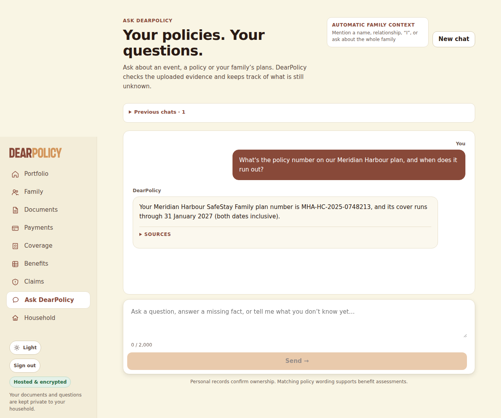

### Q2 -- conversation -- 13 s

**User** (composer): If something happened to Isla in an accident, how much is the accidental death payout for her? Is it the same as mine?

**DearPolicy**: DearPolicy Isla’s JuniorShield certificate also lists S$20,000 for “Child accidental death” (page 1), so the documents show a separate accidental-death benefit as well. I couldn’t confirm one of the figures against the cited page of your documents. The figure I left out is for “Accidental death or permanent total disablement (lump sum)” in SafeStay Family Hospital Cash & Personal Accident Plan (page 1). SOURCES

Sources shown: Meridian Harbour Assurance Pte. Ltd. · SafeStay Family Hospital Cash & Personal Accident PlanYour uploaded documentPage 1; Meridian Harbour Assurance Pte. Ltd. · SafeStay Family Hospital Cash & Personal Accident PlanYour uploaded documentPage 1; Kestrel Bay Insurance (Singapore) Ltd. · JuniorShield Child Hospital Income PlanYour uploaded documentPage 1

Loop: final_answer, 5 step(s), 45465 in / 1074 out tokens, 11760 ms

| # | tool | ok | error / result | evidence |
|---|---|---|---|---|
| 1 | resolve_person | yes | {"status":"ok"} | 0 |
| 2 | resolve_person | yes | {"status":"ok"} | 0 |
| 3 | policies_for | yes | {} | 2 |
| 4 | policies_for | yes | {} | 1 |
| 5 | search_passages | yes | {"hits":9} | 9 |
| 6 | search_passages | yes | {"hits":9} | 9 |
| 7 | search_passages | yes | {"hits":2} | 2 |
| 8 | final_answer | **no** | the save-time check would not show these sentences: "For Isla, the SafeStay Family Hospital Cash & Personal Accident Plan lists S$40,000 for “Accidental death or permanent total disablement (lump sum)” in the Child column (page 1)." -- S$40,000: the row prints one column per person or tier, and the figure is not bound to a column (it cites e4); "It is not the same as yours: the same benefit lists S$150,000 in the Adult column, so Isla’s listed amount is lower than yours (page 1)." -- S$150,000: the sentence does not name the benefit the figure is printed for (it cites e4, e6). Call final_answer again with the same sentences, rewriting only these so that what the check says is missing or wrong is fixed: if it names a limitation that is not stated, keep the figure and state exactly that limitation in the same sentence (never a limitation the check did not name); state each figure exactly as its cited evidence prints it, and an earlier value only as the earlier value (e.g. "previously X, and Y from <date>"); or leave the sentence out. Keep every other sentence as it was and add no claim the evidence does not print. | 0 |
| 9 | final_answer | yes |  | 0 |

Per call (tokens in/out): 1: 4912/48; 2: 5198/109; 3: 6999/269; 4: 13872/324; 5: 14484/324

Gate: [{"where":"summary","figure":"S$40,000","reason":"the row prints one column per person or tier, and the figure is not bound to a column"},{"where":"details[0]","figure":"S$150,000","reason":"the sentence does not name the benefit the figure is printed for"}]

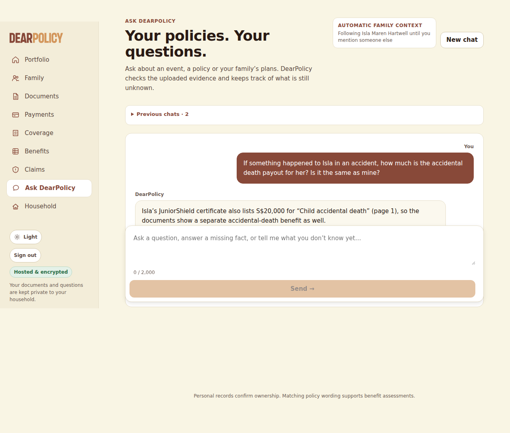

### Q3 -- conversation -- 9 s

**User** (composer): Felix fell off the monkey bars at school yesterday and broke his wrist. How much can we claim from the Meridian policy?

**DearPolicy**: DearPolicy I’m sorry Felix was hurt. For Felix, the policy lists S$600 for “Fractured bones (per Accident) — Simple (closed) fracture,” payable only if the fracture type is certified in writing by a registered medical practitioner and confirmed by X-ray; only one of the simple- or compound-fracture benefits is payable for the same bone in the same accident. A FACT THAT CHANGES THIS ASSESSMENT Has a registered medical practitioner certified the fracture type in writing and confirmed it by X-ray? This changes what your policy pays under: “Items D and E: the type of fracture must be certified in writing by a registered medical practitioner and confirmed by X-ray. Only one of Item D or” (page 1); “4.4 For Items D and E, a Compound fracture means a fracture in which the broken bone breaks through the skin. All” (page 2) Answer Show full assessment

Sources shown: Meridian Harbour Assurance Pte. Ltd. · SafeStay Family Hospital Cash & Personal Accident PlanYour uploaded documentPage 1; Meridian Harbour Assurance Pte. Ltd. · SafeStay Family Hospital Cash & Personal Accident PlanYour uploaded documentPage 2; Meridian Harbour Assurance Pte. Ltd. · SafeStay Family Hospital Cash & Personal Accident PlanYour uploaded documentPage 1

Asks: Has a registered medical practitioner certified the fracture type in writing and confirmed it by X-ray?

Loop: ask_user, 4 step(s), 29813 in / 556 out tokens, 7743 ms

| # | tool | ok | error / result | evidence |
|---|---|---|---|---|
| 1 | note_facts | yes | {"facts":[{"key":"how_it_happened","value":"fell off the monkey bars at school","words":"fell off the monkey bars at school"},{"key":"injury","value":"broke his | 0 |
| 2 | policies_for | yes | {} | 1 |
| 3 | search_passages | yes | {"hits":10} | 10 |
| 4 | select_table_value | yes | {"status":"ok","valueId":"v1","value":600,"column":"Child (each)","row":"Fractured bones (per Accident) — Simple (closed) fracture"} | 1 |
| 5 | ask_user | yes |  | 0 |

Per call (tokens in/out): 1: 4911/108; 2: 5166/121; 3: 9675/92; 4: 10061/235

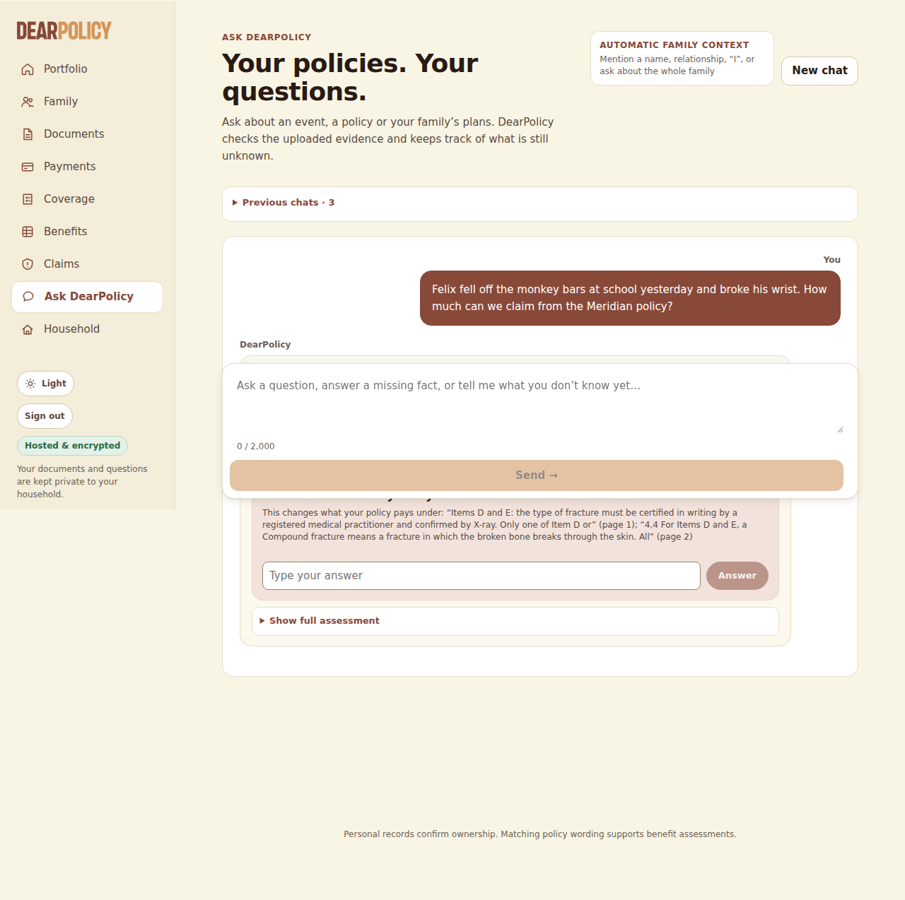

### Q4 -- conversation -- 6 s

**User** (inline answer (asked: Has a registered medical practitioner certified the fracture type in writing and confirmed it by X-ray?)): The doctor said it's a closed fracture, the X-ray confirmed it, and the bone didn't come through the skin.

**DearPolicy**: DearPolicy You told me, “The doctor said it's a closed fracture, the X-ray confirmed it, and the bone didn't come through the skin.” For Felix, the policy lists S$600 for “Fractured bones (per Accident) — Simple (closed) fracture,” payable only if the fracture type is certified in writing by a registered medical practitioner and confirmed by X-ray; only one of the simple- or compound-fracture benefits is payable for the same bone in the same accident. The documents do not establish that the doctor certified the fracture type in writing, so I can’t work out an indicative estimate yet. What you’ve told me is your own account, not a reviewed medical record: the insurer will check it against the documents it asks for (such as the doctor’s report and the test or scan results) and decides the claim after reviewing them. NEXT STEP When you make the claim, include the doctor’s report and the test or scan results that show the policy’s condition is met, with the insurer’s claim form. SOURCES

Sources shown: Meridian Harbour Assurance Pte. Ltd. · SafeStay Family Hospital Cash & Personal Accident PlanYour uploaded documentPage 1; Meridian Harbour Assurance Pte. Ltd. · SafeStay Family Hospital Cash & Personal Accident PlanYour uploaded documentPage 2; Meridian Harbour Assurance Pte. Ltd. · SafeStay Family Hospital Cash & Personal Accident PlanYour uploaded documentPage 1

Loop: final_answer, 2 step(s), 11083 in / 396 out tokens, 4217 ms

| # | tool | ok | error / result | evidence |
|---|---|---|---|---|
| 1 | note_facts | yes | {"facts":[{"key":"fracture_xray_certification","value":"The doctor said it's a closed fracture, the X-ray confirmed it, and the bone didn't come through the ski | 0 |
| 2 | final_answer | yes |  | 0 |

Per call (tokens in/out): 1: 5383/104; 2: 5700/292

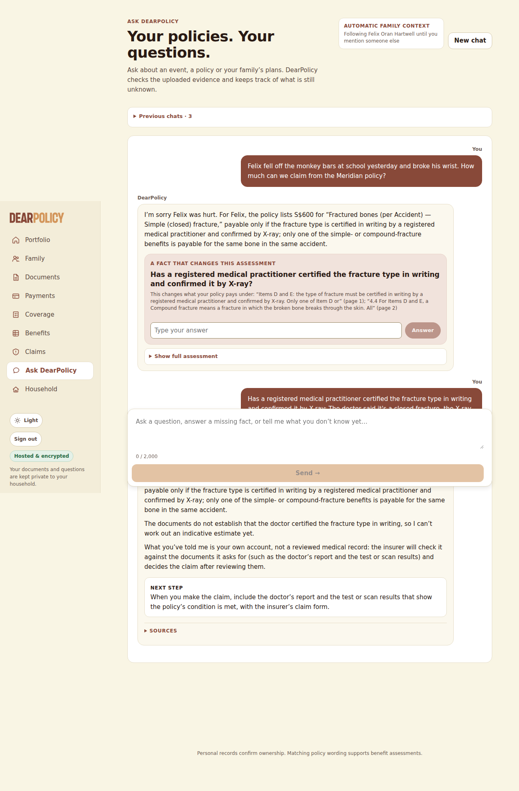

### Q5 -- conversation -- 16 s

**User** (composer): I was in hospital after that car accident in March. They admitted me at 9:40pm on 14 March and I was discharged at 8:20am on 18 March. How much hospital cash should Meridian pay me?

**DearPolicy**: DearPolicy For Simon, Meridian’s Hospital daily allowance is S$120 per day for an adult, up to 60 days per policy year, and its wording counts each complete 24-hour period plus a further day for a remaining period of at least 12 hours (page 1; page 2). Based on the admission and discharge times you gave, the indicative estimate is S$360 for three payable days; this is not a confirmed payout, assuming at least 3 of the 60 days are still available this policy year. The policy is accident-only, and the hospital cash benefit is payable only when the confinement results solely and directly from an Accident and begins within 90 days of it (page 2). SOURCES Indicative estimates are worked out from your documents and what you have told me; they are not a payout, and the insurer decides what it pays.

Sources shown: Meridian Harbour Assurance Pte. Ltd. · SafeStay Family Hospital Cash & Personal Accident PlanYour uploaded documentPage 2; Meridian Harbour Assurance Pte. Ltd. · SafeStay Family Hospital Cash & Personal Accident PlanYour uploaded documentPage 1; Meridian Harbour Assurance Pte. Ltd. · SafeStay Family Hospital Cash & Personal Accident PlanYour uploaded documentPage 2

Loop: final_answer, 7 step(s), 56795 in / 1008 out tokens, 14928 ms

| # | tool | ok | error / result | evidence |
|---|---|---|---|---|
| 1 | resolve_person | yes | {"status":"ok"} | 0 |
| 2 | note_facts | yes | {"facts":[{"key":"how_it_happened","value":"car accident","words":"that car accident"},{"key":"admission_datetime","value":"14 March at 9:40pm","words":"They ad | 0 |
| 3 | policies_for | yes | {} | 1 |
| 4 | search_passages | yes | {"hits":9} | 9 |
| 5 | search_passages | yes | {"hits":4} | 4 |
| 6 | select_table_value | yes | {"status":"ok","valueId":"v1","value":120,"column":"Adult (each)","row":"Hospital daily allowance (per day of confinement, max 60 days per policy year) — see Cl… | 1 |
| 7 | calculate | yes | {"amount":360,"kind":"indicative_estimate"} | 2 |
| 8 | final_answer | yes |  | 0 |

Per call (tokens in/out): 1: 4934/17; 2: 5053/130; 3: 5351/46; 4: 6106/196; 5: 11230/96; 6: 11672/175; 7: 12449/348

Composer dropped: [{"reason":"S$80 is printed in none of the evidence the sentence cites","sentence":"The endorsement increased the child rate from S$80 to S$110 per day from 1 July 2026, but it does not change the adult rate (page 1)."}]

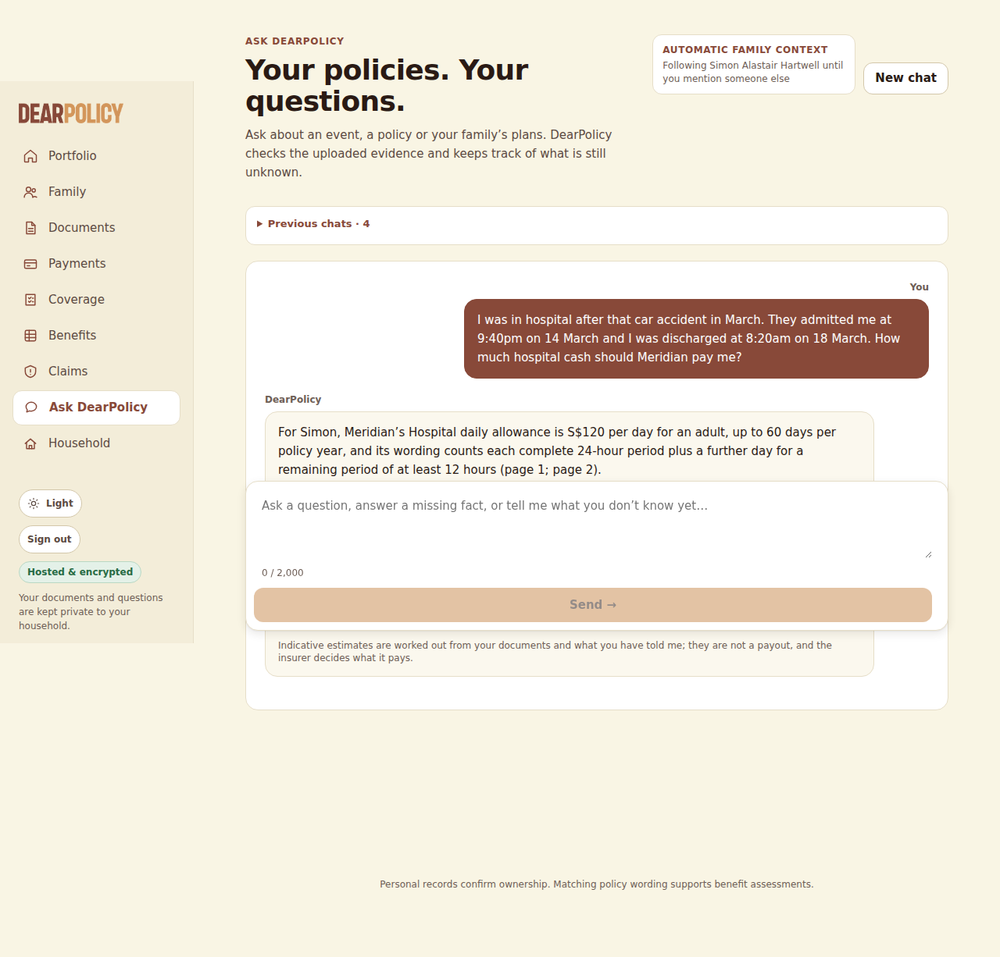

### Q6 -- conversation -- 7 s

**User** (composer): Did that endorsement letter change anything? How much is the daily hospital allowance for the kids now?

**DearPolicy**: DearPolicy Yes—the endorsement raised the SafeStay “Hospital daily allowance” for each child from S$80 to S$110 per day, effective 1 July 2026; days of confinement before that date remain at the earlier rate. So Felix’s current SafeStay daily allowance is S$110 per day for confinement days on or after 1 July 2026. Isla’s SafeStay daily allowance is likewise S$110 per day for confinement days on or after 1 July 2026. The endorsement did not change the 60-day-per-policy-year maximum or the other policy terms. Isla also has a separate JuniorShield “Daily hospital income” benefit of S$150 per day, up to 30 days per policy year, payable only from the fourth consecutive hospitalisation day; the first three days are not payable. SOURCES

Sources shown: Meridian Harbour Assurance · SafeStay Family Hospital Cash & Personal Accident PlanYour uploaded documentPage 1; Meridian Harbour Assurance · SafeStay Family Hospital Cash & Personal Accident PlanYour uploaded documentPage 1; Kestrel Bay Insurance (Singapore) Ltd. · JuniorShield Child Hospital Income PlanYour uploaded documentPage 1; Kestrel Bay Insurance (Singapore) Ltd. · JuniorShield Child Hospital Income PlanYour uploaded documentPage 1

Loop: final_answer, 2 step(s), 15059 in / 569 out tokens, 5401 ms

| # | tool | ok | error / result | evidence |
|---|---|---|---|---|
| 1 | policies_for | yes | {} | 1 |
| 2 | policies_for | yes | {} | 2 |
| 3 | search_passages | yes | {"hits":10} | 10 |
| 4 | final_answer | yes |  | 0 |

Per call (tokens in/out): 1: 4905/136; 2: 10154/433

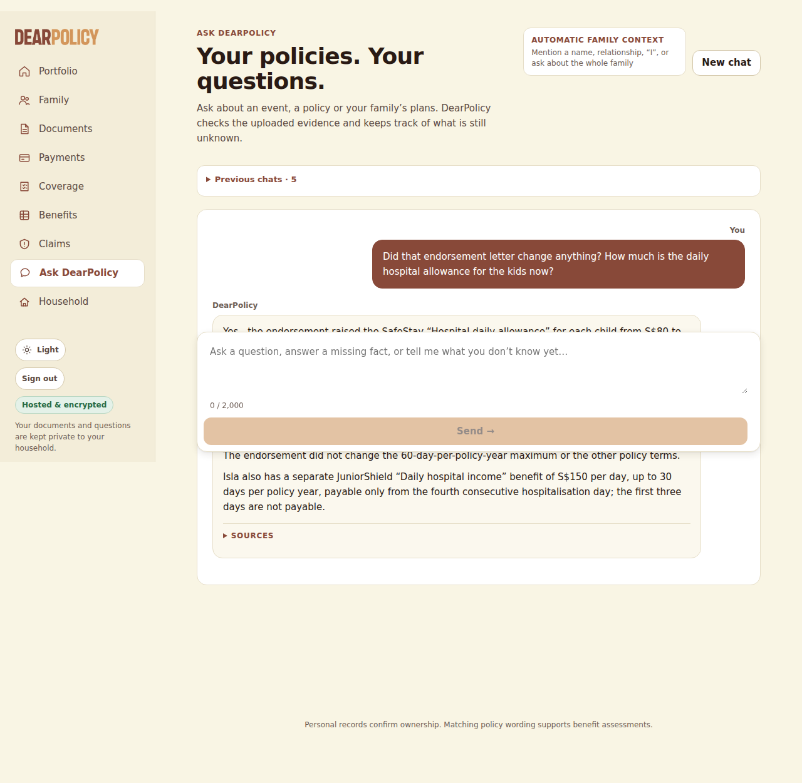

### Q7 -- conversation -- 7 s

**User** (composer): How much are we actually paying for the Meridian policy every year?

**DearPolicy**: DearPolicy I can’t tell from the Meridian policy documents available here how much the premium is; they show the family plan and cover period, but not the premium amount. SOURCES

Sources shown: Meridian Harbour Assurance Pte. Ltd. · SafeStay Family Hospital Cash & Personal Accident PlanYour uploaded documentPage 1

Loop: final_answer, 4 step(s), 33555 in / 193 out tokens, 5684 ms

| # | tool | ok | error / result | evidence |
|---|---|---|---|---|
| 1 | search_passages | yes | {"hits":8} | 8 |
| 2 | search_passages | yes | {"hits":8} | 8 |
| 3 | read_page | yes | {"status":"ok"} | 1 |
| 4 | final_answer | yes |  | 0 |

Per call (tokens in/out): 1: 4899/29; 2: 7653/58; 3: 10063/43; 4: 10940/63

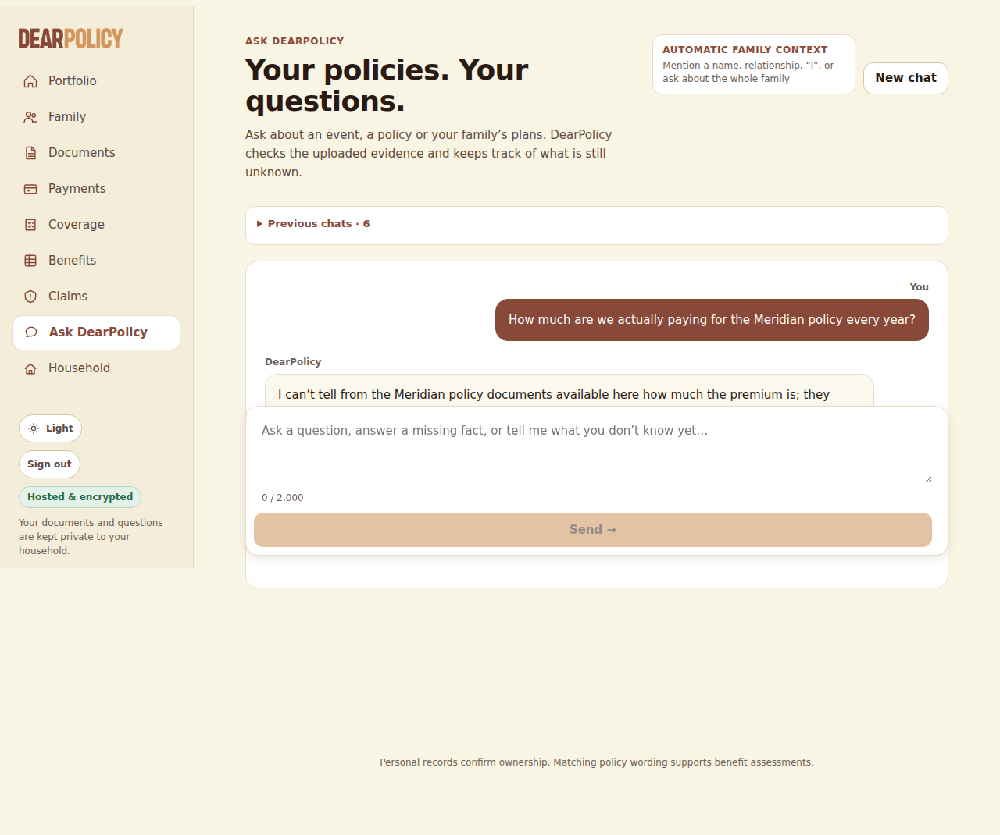

### Q8 -- conversation -- 10 s

**User** (composer): Isla might need to stay in hospital two nights next week. Will her JuniorShield plan pay the $150 a day?

**DearPolicy**: DearPolicy For Isla, JuniorShield lists Daily hospital income at S$150 per day, up to 30 days per policy year, but it is payable only from the fourth consecutive day of hospitalisation; the first three days are not payable, so a two-night stay would not meet that threshold. SOURCES

Sources shown: Kestrel Bay Insurance (Singapore) Ltd. · JuniorShield Child Hospital Income PlanYour uploaded documentPage 1; Kestrel Bay Insurance (Singapore) Ltd. · JuniorShield Child Hospital Income PlanYour uploaded documentPage 1

Loop: final_answer, 5 step(s), 31145 in / 591 out tokens, 8615 ms

| # | tool | ok | error / result | evidence |
|---|---|---|---|---|
| 1 | resolve_person | yes | {"status":"ok"} | 0 |
| 2 | note_facts | yes | {"facts":[{"key":"possible_hospital_stay","value":"might need to stay in hospital two nights next week","words":"might need to stay in hospital two nights next  | 0 |
| 3 | policies_for | yes | {} | 2 |
| 4 | search_passages | yes | {"hits":3} | 3 |
| 5 | select_table_value | yes | {"status":"ok","valueId":"v1","value":150,"column":"Amount payable","row":"Daily hospital income*"} | 1 |
| 6 | search_passages | yes | {"hits":5} | 5 |
| 7 | final_answer | yes |  | 0 |

Per call (tokens in/out): 1: 4911/18; 2: 5033/98; 3: 5249/48; 4: 6069/295; 5: 9883/132

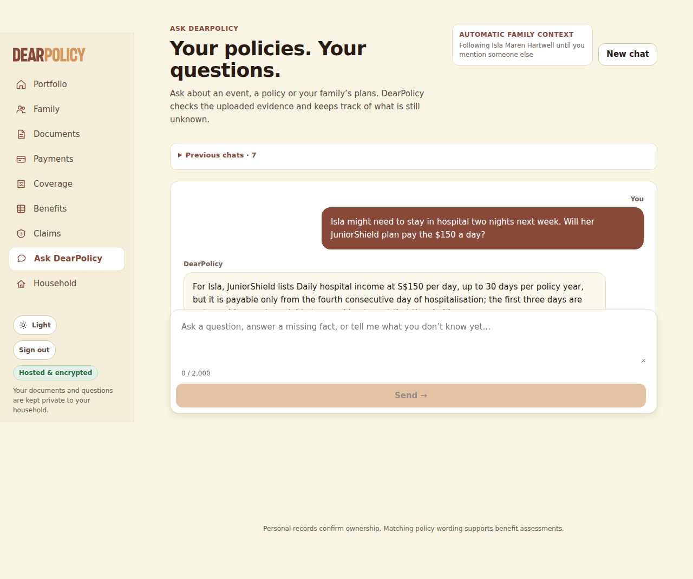

### Q9 -- conversation -- 10 s

**User** (composer): Oh, by the way, if one of the kids gets dengue, which of our policies would actually pay anything?

**DearPolicy**: DearPolicy For Isla, JuniorShield Child Hospital Income Plan lists “Hand, foot & mouth disease or dengue fever hospitalisation (lump sum)” of S$500; the certificate covers illness and accident, but refers to full policy conditions for definitions and exclusions, which are not in the available document. For Felix, the documents show SafeStay Family Hospital Cash & Personal Accident Plan, which is accident-only and excludes confinement due to illness, so it would not pay for dengue; the available documents do not show a dengue benefit for him. SOURCES

Sources shown: Kestrel Bay Insurance (Singapore) Ltd. · JuniorShield Child Hospital Income PlanYour uploaded documentPage 1; Kestrel Bay Insurance (Singapore) Ltd. · JuniorShield Child Hospital Income PlanYour uploaded documentPage 1; Kestrel Bay Insurance (Singapore) Ltd. · JuniorShield Child Hospital Income PlanYour uploaded documentPage 1; Meridian Harbour Assurance Pte. Ltd. · SafeStay Family Hospital Cash & Personal Accident PlanYour uploaded documentPage 2; Meridian Harbour Assurance Pte. Ltd. · SafeStay Family Hospital Cash & Personal Accident PlanYour uploaded documentPage 2; Meridian Harbour Assurance Pte. Ltd. · SafeStay Family Hospital Cash & Personal Accident PlanYour uploaded documentPage 1

Loop: final_answer, 4 step(s), 32271 in / 741 out tokens, 8421 ms

| # | tool | ok | error / result | evidence |
|---|---|---|---|---|
| 1 | resolve_person | yes | {"status":"ambiguous"} | 0 |
| 2 | search_passages | yes | {"hits":7} | 7 |
| 3 | ask_user | **no** | "one of the kids" means whoever it happens to: answer for the policy and the people it covers (each covered person's own column where the rows differ by person); do not ask who | 0 |
| 4 | policies_for | yes | {} | 1 |
| 5 | policies_for | yes | {} | 2 |
| 6 | select_table_value | yes | {"status":"missing"} | 0 |
| 7 | select_table_value | yes | {"status":"ok","valueId":"v1","value":500,"column":"Amount payable","row":"Hand, foot & mouth disease or dengue fever hospitalisation (lump sum)"} | 1 |
| 8 | search_passages | yes | {"hits":3} | 3 |
| 9 | final_answer | yes |  | 0 |

Per call (tokens in/out): 1: 4909/63; 2: 7987/97; 3: 8141/347; 4: 11234/234

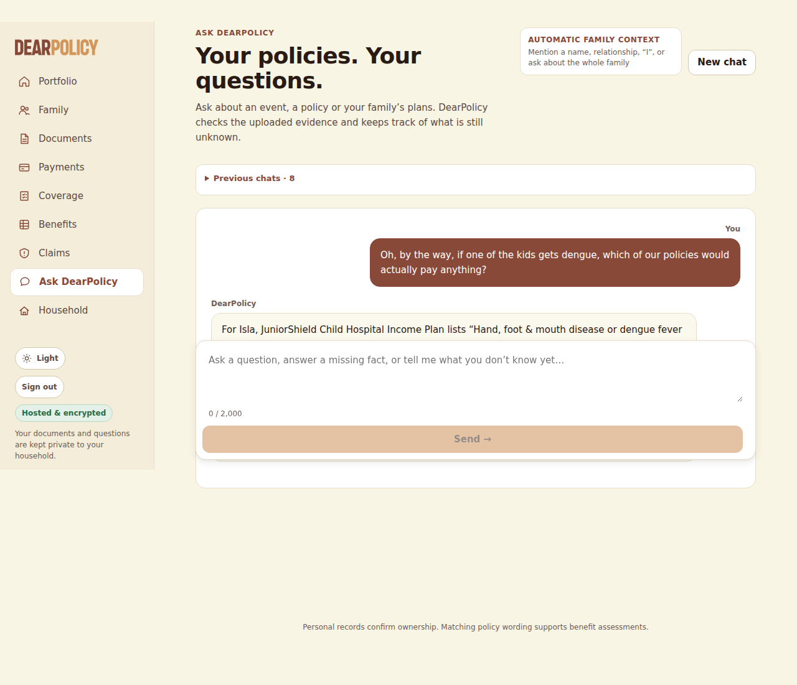

### R1 -- reopen -- 15 s

**User** (composer): So if Isla was in hospital for exactly 3 days in August after falling at the playground, how much would Meridian pay?

**DearPolicy**: DearPolicy I can’t determine Meridian’s amount from “exactly 3 days” alone because its day count depends on the admission and discharge times. For Isla, Meridian’s “Hospital daily allowance (per day of confinement)” is S$110 per day for confinement on or after 1 July 2026, subject to the policy’s accident-only condition and a maximum of 60 days per policy year. Meridian counts confinement from the hospital-recorded admission and discharge times: each complete 24-hour period counts as one day, a remaining period of at least 12 hours counts as another day, and a shorter remainder is disregarded. A FACT THAT CHANGES THIS ASSESSMENT What were Isla’s hospital admission and discharge dates and times? This changes what your policy pays under: “of discharge shown on the hospital record. Each complete period of 24 consecutive hours counts as one day. Any” (page 2); “remaining period of 12 hours or more counts as one further day; any remaining period of less than 12 hours is” (page 2) Answer Show full assessment

Sources shown: Meridian Harbour Assurance · SafeStay Family Hospital Cash & Personal Accident PlanYour uploaded documentPage 1; Meridian Harbour Assurance · SafeStay Family Hospital Cash & Personal Accident PlanYour uploaded documentPage 1; Meridian Harbour Assurance Pte. Ltd. · SafeStay Family Hospital Cash & Personal Accident PlanYour uploaded documentPage 2; Meridian Harbour Assurance Pte. Ltd. · SafeStay Family Hospital Cash & Personal Accident PlanYour uploaded documentPage 2; Meridian Harbour Assurance Pte. Ltd. · SafeStay Family Hospital Cash & Personal Accident PlanYour uploaded documentPage 2

Asks: What were Isla’s hospital admission and discharge dates and times? (no fixture answer)

Loop: ask_user, 7 step(s), 65847 in / 1194 out tokens, 13541 ms

| # | tool | ok | error / result | evidence |
|---|---|---|---|---|
| 1 | note_facts | yes | {"facts":[{"key":"nights_in_hospital","value":"3","words":"exactly 3 days"},{"key":"how_it_happened","value":"fell at the playground","words":"falling at the pl | 0 |
| 2 | note_facts | yes | {"facts":[{"key":"days_in_hospital","value":"3","words":"exactly 3 days"}],"subject_id":"6ebf3b32-02c6-4f55-9161-1b543ea01a55"} | 0 |
| 3 | policies_for | yes | {} | 2 |
| 4 | search_passages | yes | {"hits":10} | 10 |
| 5 | select_table_value | yes | {"status":"ok","valueId":"v1","value":110,"column":"Revised","row":"Hospital daily allowance (per day of confinement)"} | 2 |
| 6 | search_passages | yes | {"hits":5} | 5 |
| 7 | ask_user | **no** | ask exactly one question, ending with a question mark | 0 |
| 8 | ask_user | yes |  | 0 |

Per call (tokens in/out): 1: 5406/107; 2: 5702/66; 3: 5903/126; 4: 10828/90; 5: 11536/103; 6: 13009/365; 7: 13463/337

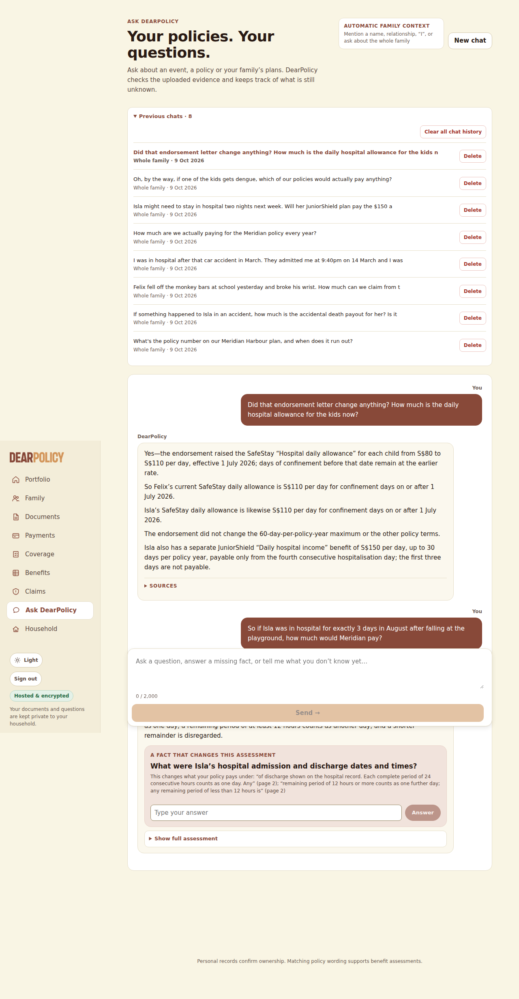

### D1 -- after_delete -- 7 s

**User** (composer): Did that endorsement letter change anything? How much is the daily hospital allowance for the kids now?

**DearPolicy**: DearPolicy I can’t confirm what the endorsement changed because that endorsement was removed from the library; it took effect on 1 July 2026, so the current amount may differ from the schedule. For Felix, the remaining schedule lists “Hospital daily allowance” at S$80 per day, up to 60 days per policy year; this is the issued schedule amount, not confirmed current cover. For Isla, the same schedule lists “Hospital daily allowance” at S$80 per day, up to 60 days per policy year; this is the issued schedule amount, not confirmed current cover. Isla also has a separate “Daily hospital income” benefit of S$150 per day, capped at 30 days per policy year, payable only from the fourth consecutive day of hospitalisation. SOURCES

Sources shown: Meridian Harbour Assurance Pte. Ltd. · SafeStay Family Hospital Cash & Personal Accident PlanYour uploaded documentPage 1; Meridian Harbour Assurance Pte. Ltd. · SafeStay Family Hospital Cash & Personal Accident PlanYour uploaded documentPage 1; Kestrel Bay Insurance (Singapore) Ltd. · JuniorShield Child Hospital Income PlanYour uploaded documentPage 1; Kestrel Bay Insurance (Singapore) Ltd. · JuniorShield Child Hospital Income PlanYour uploaded documentPage 1

Loop: final_answer, 3 step(s), 24598 in / 712 out tokens, 6862 ms

| # | tool | ok | error / result | evidence |
|---|---|---|---|---|
| 1 | policies_for | yes | {} | 1 |
| 2 | policies_for | yes | {} | 2 |
| 3 | select_table_value | yes | {"status":"ok","valueId":"v1","value":80,"column":"Child (each)","row":"Hospital daily allowance (per day of confinement, max 60 days per policy year) — see Cla… | 2 |
| 4 | select_table_value | yes | {"status":"ok","valueId":"v2","value":80,"column":"Child (each)","row":"Hospital daily allowance (per day of confinement, max 60 days per policy year) — see Cla… | 2 |
| 5 | select_table_value | yes | {"status":"ok","valueId":"v3","value":150,"column":"Amount payable","row":"Daily hospital income*"} | 1 |
| 6 | search_passages | yes | {"hits":10} | 10 |
| 7 | final_answer | yes |  | 0 |

Per call (tokens in/out): 1: 4905/106; 2: 6867/281; 3: 12826/325

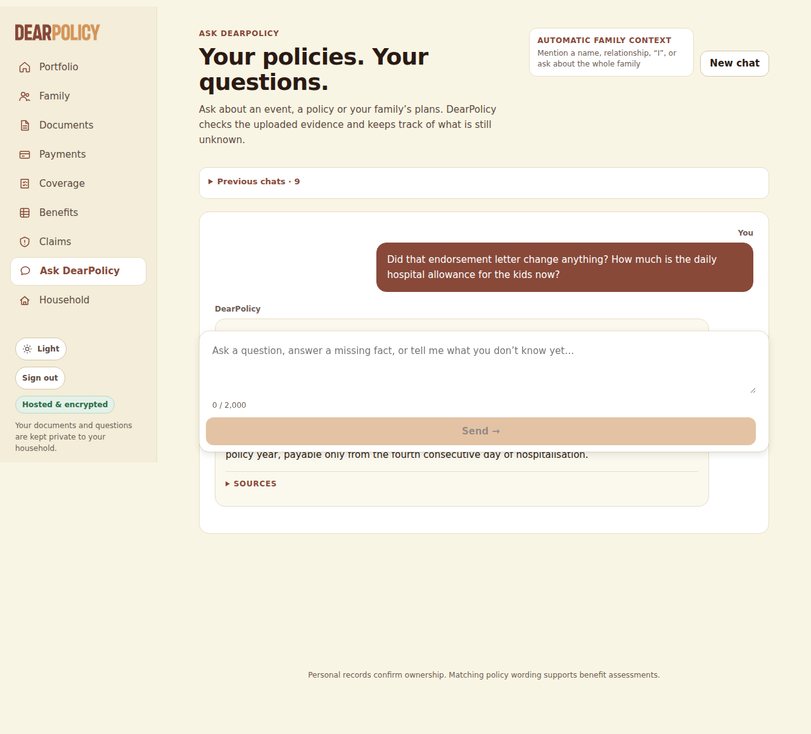

## Deterministic checks (EXPECTED.json, copied in after the conversations)

| scope | check | result | detail |
|---|---|---|---|
| hx-text.pdf | uploaded and processed | PASS | not_scanned_prototype/ready |
| hx-text.pdf | page 1 text extracted | PASS | native, 1842 chars |
| hx-text.pdf | page 1 contains "MHA-HC-2025-0748213" | PASS |  |
| hx-text.pdf | page 1 contains "S$150,000" | PASS |  |
| hx-text.pdf | page 1 contains "S$40,000" | PASS |  |
| hx-text.pdf | page 1 contains "S$120" | PASS |  |
| hx-text.pdf | page 1 contains "S$80" | PASS |  |
| hx-text.pdf | page 1 contains "S$600" | PASS |  |
| hx-text.pdf | page 1 contains "S$1,500" | PASS |  |
| hx-text.pdf | page 2 text extracted | PASS | native, 3002 chars |
| hx-text.pdf | page 2 contains "24 consecutive hours" | PASS |  |
| hx-text.pdf | page 2 contains "Accident-only cover" | PASS |  |
| hx-text.pdf | linked automatically to the right people | PASS | linked: Felix Oran Hartwell, Isla Maren Hartwell, Leonie Brigitte Hartwell, Simon Alastair Hartwell; expected: Simon Alastair Hartwell, Leonie Brigitte Hartwell, Felix Oran Hartwell, Isla Maren Hartwell |
| hx-endorsement.pdf | uploaded and processed | PASS | not_scanned_prototype/ready |
| hx-endorsement.pdf | page 1 text extracted | PASS | native, 1250 chars |
| hx-endorsement.pdf | page 1 contains "ME-26-0412" | PASS |  |
| hx-endorsement.pdf | page 1 contains "MHA-HC-2025-0748213" | PASS |  |
| hx-endorsement.pdf | page 1 contains "S$110" | PASS |  |
| hx-endorsement.pdf | page 1 contains "01 July 2026" | PASS |  |
| hx-scanned.pdf | uploaded and processed | PASS | not_scanned_prototype/ready |
| hx-scanned.pdf | page 1 text extracted | PASS | ocr, 1243 chars |
| hx-scanned.pdf | page 1 contains "KBJ-26-00391" | PASS |  |
| hx-scanned.pdf | page 1 contains "S$150" | PASS |  |
| hx-scanned.pdf | page 1 contains "S$500" | PASS |  |
| hx-scanned.pdf | linked automatically to the right people | PASS | linked: Isla Maren Hartwell; expected: Isla Maren Hartwell |
| delete hx-endorsement.pdf | deleted through the page and confirmed before the next question | PASS | notice: "Deleted SafeStay Family Hospital Cash & Personal Accident Plan. It is no longer used in answers, and your portfolio has been updated. ✕"; listed after: false; lifecycle: pending_deletion |
| Q1 (conversation) "What's the policy number on our Meridian Harbour plan, and w" | useful reply (a cited figure or condition, one material question, or what the documents do not say) | PASS | a cited statement |
| Q1 (conversation) "What's the policy number on our Meridian Harbour plan, and w" | every figure stated is one the expected facts give | PASS |  |
| Q1 (conversation) "What's the policy number on our Meridian Harbour plan, and w" | every date stated is one the expected facts give | PASS |  |
| Q1 (conversation) "What's the policy number on our Meridian Harbour plan, and w" | no placeholder where the documents give a figure | PASS |  |
| Q1 (conversation) "What's the policy number on our Meridian Harbour plan, and w" | no uncertainty the expected facts contradict | PASS |  |
| Q1 (conversation) "What's the policy number on our Meridian Harbour plan, and w" | no superseded figure presented as current | PASS |  |
| Q2 (conversation) "If something happened to Isla in an accident, how much is th" | useful reply (a cited figure or condition, one material question, or what the documents do not say) | PASS | a cited statement (generic note set aside: "I couldn’t confirm one of the figures against the cited page of your documents.") |
| Q2 (conversation) "If something happened to Isla in an accident, how much is th" | every figure stated is one the expected facts give | PASS |  |
| Q2 (conversation) "If something happened to Isla in an accident, how much is th" | every date stated is one the expected facts give | PASS |  |
| Q2 (conversation) "If something happened to Isla in an accident, how much is th" | no placeholder where the documents give a figure | PASS |  |
| Q2 (conversation) "If something happened to Isla in an accident, how much is th" | no uncertainty the expected facts contradict | PASS |  |
| Q2 (conversation) "If something happened to Isla in an accident, how much is th" | no superseded figure presented as current | PASS |  |
| Q3 (conversation) "Felix fell off the monkey bars at school yesterday and broke" | useful reply (a cited figure or condition, one material question, or what the documents do not say) | PASS | one material question |
| Q3 (conversation) "Felix fell off the monkey bars at school yesterday and broke" | every figure stated is one the expected facts give | PASS |  |
| Q3 (conversation) "Felix fell off the monkey bars at school yesterday and broke" | every date stated is one the expected facts give | PASS |  |
| Q3 (conversation) "Felix fell off the monkey bars at school yesterday and broke" | no placeholder where the documents give a figure | PASS |  |
| Q3 (conversation) "Felix fell off the monkey bars at school yesterday and broke" | no uncertainty the expected facts contradict | PASS |  |
| Q3 (conversation) "Felix fell off the monkey bars at school yesterday and broke" | no superseded figure presented as current | PASS |  |
| Q4 (conversation) "The doctor said it's a closed fracture, the X-ray confirmed " | useful reply (a cited figure or condition, one material question, or what the documents do not say) | PASS | a cited statement |
| Q4 (conversation) "The doctor said it's a closed fracture, the X-ray confirmed " | every figure stated is one the expected facts give | PASS |  |
| Q4 (conversation) "The doctor said it's a closed fracture, the X-ray confirmed " | every date stated is one the expected facts give | PASS |  |
| Q4 (conversation) "The doctor said it's a closed fracture, the X-ray confirmed " | no placeholder where the documents give a figure | PASS |  |
| Q4 (conversation) "The doctor said it's a closed fracture, the X-ray confirmed " | no uncertainty the expected facts contradict | PASS |  |
| Q4 (conversation) "The doctor said it's a closed fracture, the X-ray confirmed " | no superseded figure presented as current | PASS |  |
| Q5 (conversation) "I was in hospital after that car accident in March. They adm" | useful reply (a cited figure or condition, one material question, or what the documents do not say) | PASS | a cited statement |
| Q5 (conversation) "I was in hospital after that car accident in March. They adm" | every figure stated is one the expected facts give | PASS |  |
| Q5 (conversation) "I was in hospital after that car accident in March. They adm" | every date stated is one the expected facts give | PASS |  |
| Q5 (conversation) "I was in hospital after that car accident in March. They adm" | no placeholder where the documents give a figure | PASS |  |
| Q5 (conversation) "I was in hospital after that car accident in March. They adm" | no uncertainty the expected facts contradict | PASS |  |
| Q5 (conversation) "I was in hospital after that car accident in March. They adm" | no superseded figure presented as current | PASS |  |
| Q6 (conversation) "Did that endorsement letter change anything? How much is the" | useful reply (a cited figure or condition, one material question, or what the documents do not say) | PASS | a cited statement |
| Q6 (conversation) "Did that endorsement letter change anything? How much is the" | every figure stated is one the expected facts give | PASS |  |
| Q6 (conversation) "Did that endorsement letter change anything? How much is the" | every date stated is one the expected facts give | PASS |  |
| Q6 (conversation) "Did that endorsement letter change anything? How much is the" | no placeholder where the documents give a figure | PASS |  |
| Q6 (conversation) "Did that endorsement letter change anything? How much is the" | no uncertainty the expected facts contradict | PASS |  |
| Q6 (conversation) "Did that endorsement letter change anything? How much is the" | no superseded figure presented as current | PASS |  |
| Q7 (conversation) "How much are we actually paying for the Meridian policy ever" | useful reply (a cited figure or condition, one material question, or what the documents do not say) | PASS | a cited statement |
| Q7 (conversation) "How much are we actually paying for the Meridian policy ever" | every figure stated is one the expected facts give | PASS |  |
| Q7 (conversation) "How much are we actually paying for the Meridian policy ever" | every date stated is one the expected facts give | PASS |  |
| Q7 (conversation) "How much are we actually paying for the Meridian policy ever" | no placeholder where the documents give a figure | PASS |  |
| Q7 (conversation) "How much are we actually paying for the Meridian policy ever" | no uncertainty the expected facts contradict | PASS |  |
| Q7 (conversation) "How much are we actually paying for the Meridian policy ever" | no superseded figure presented as current | PASS |  |
| Q8 (conversation) "Isla might need to stay in hospital two nights next week. Wi" | useful reply (a cited figure or condition, one material question, or what the documents do not say) | PASS | a cited statement |
| Q8 (conversation) "Isla might need to stay in hospital two nights next week. Wi" | every figure stated is one the expected facts give | PASS |  |
| Q8 (conversation) "Isla might need to stay in hospital two nights next week. Wi" | every date stated is one the expected facts give | PASS |  |
| Q8 (conversation) "Isla might need to stay in hospital two nights next week. Wi" | no placeholder where the documents give a figure | PASS |  |
| Q8 (conversation) "Isla might need to stay in hospital two nights next week. Wi" | no uncertainty the expected facts contradict | PASS |  |
| Q8 (conversation) "Isla might need to stay in hospital two nights next week. Wi" | no superseded figure presented as current | PASS |  |
| Q9 (conversation) "Oh, by the way, if one of the kids gets dengue, which of our" | useful reply (a cited figure or condition, one material question, or what the documents do not say) | PASS | says what the documents do not say |
| Q9 (conversation) "Oh, by the way, if one of the kids gets dengue, which of our" | every figure stated is one the expected facts give | PASS |  |
| Q9 (conversation) "Oh, by the way, if one of the kids gets dengue, which of our" | every date stated is one the expected facts give | PASS |  |
| Q9 (conversation) "Oh, by the way, if one of the kids gets dengue, which of our" | no placeholder where the documents give a figure | PASS |  |
| Q9 (conversation) "Oh, by the way, if one of the kids gets dengue, which of our" | no uncertainty the expected facts contradict | PASS |  |
| Q9 (conversation) "Oh, by the way, if one of the kids gets dengue, which of our" | no superseded figure presented as current | PASS |  |
| R1 (reopen) "So if Isla was in hospital for exactly 3 days in August afte" | useful reply (a cited figure or condition, one material question, or what the documents do not say) | PASS | one material question |
| R1 (reopen) "So if Isla was in hospital for exactly 3 days in August afte" | every figure stated is one the expected facts give | PASS |  |
| R1 (reopen) "So if Isla was in hospital for exactly 3 days in August afte" | every date stated is one the expected facts give | PASS |  |
| R1 (reopen) "So if Isla was in hospital for exactly 3 days in August afte" | no placeholder where the documents give a figure | PASS |  |
| R1 (reopen) "So if Isla was in hospital for exactly 3 days in August afte" | no uncertainty the expected facts contradict | PASS |  |
| R1 (reopen) "So if Isla was in hospital for exactly 3 days in August afte" | no superseded figure presented as current | PASS |  |
| D1 (after_delete) "Did that endorsement letter change anything? How much is the" | useful reply (a cited figure or condition, one material question, or what the documents do not say) | PASS | a cited statement |
| D1 (after_delete) "Did that endorsement letter change anything? How much is the" | every figure stated is one the expected facts give | PASS |  |
| D1 (after_delete) "Did that endorsement letter change anything? How much is the" | every date stated is one the expected facts give | PASS |  |
| D1 (after_delete) "Did that endorsement letter change anything? How much is the" | no placeholder where the documents give a figure | PASS |  |
| D1 (after_delete) "Did that endorsement letter change anything? How much is the" | no uncertainty the expected facts contradict | PASS |  |
| D1 (after_delete) "Did that endorsement letter change anything? How much is the" | no superseded figure presented as current | PASS |  |
| D1 (after_delete) "Did that endorsement letter change anything? How much is the" | asked after a confirmed deletion | PASS |  |
| D1 (after_delete) "Did that endorsement letter change anything? How much is the" | does not rely on the deleted hx-endorsement.pdf | PASS | cites: hx-text.pdf, hx-text.pdf, hx-scanned.pdf, hx-scanned.pdf |
| Q1 | states "MHA-HC-2025-0748213" | PASS |  |
| Q1 | states one of ["31 January 2027","31 Jan 2027","31/01/2027","2027-01-31","31 Jan. 2027"] | PASS |  |
| Q1 | never states "MHA-HC-2025-0748218" | PASS |  |
| Q1 | never states "01 Feb 2027" | PASS |  |
| Q1 | never states "1 February 2027" | PASS |  |
| Q1 | never states "14 March 2027" | PASS |  |
| Q1 | cites hx-text.pdf page 1 | PASS | cited: hx-text.pdf p1 |
| Q1 | answers without an unnecessary follow-up | PASS |  |
| Q2 | states "S$40,000" | **FAIL** |  |
| Q2 | states "S$150,000" | **FAIL** |  |
| Q2 | cites hx-text.pdf page 1 | PASS | cited: hx-text.pdf p1, hx-text.pdf p1, hx-scanned.pdf p1 |
| Q2 | never: the JuniorShield child accidental death benefit presented as the Meridian figure without naming the other policy (source Q2 forbidden 3) | PASS |  |
| Q2 | answers without an unnecessary follow-up | PASS |  |
| Q3 | never states "S$2,100" | PASS |  |
| Q3 | never states "S$2,500" | PASS |  |
| Q3 | about Felix Oran Hartwell | PASS | no stored subject; answer names Felix |
| Q3 | asks a follow-up before answering | PASS | Has a registered medical practitioner certified the fracture type in writing and confirmed it by X-ray? |
| Q4 | states "S$600" | PASS |  |
| Q4 | never states "S$2,100" | PASS |  |
| Q4 | never states "S$2,600" | PASS |  |
| Q4 | cites hx-text.pdf page 1 | PASS | cited: hx-text.pdf p1, hx-text.pdf p2, hx-text.pdf p1 |
| Q4 | about Felix Oran Hartwell | PASS | resolved to Felix Oran Hartwell |
| Q4 | the answered question is not asked again | PASS | answered: "Has a registered medical practitioner certified the fracture type in writing and confirmed it by X-ray?" |
| Q5 | states "S$360" | PASS |  |
| Q5 | never states "S$480" | PASS |  |
| Q5 | never states "S$330" | PASS |  |
| Q5 | never states "S$440" | PASS |  |
| Q5 | cites hx-text.pdf page 1 | PASS | cited: hx-text.pdf p2, hx-text.pdf p1, hx-text.pdf p2 |
| Q5 | about Simon Alastair Hartwell | PASS | resolved to Simon Alastair Hartwell |
| Q6 | states "S$110" | PASS |  |
| Q6 | states one of ["01 July 2026","1 July 2026","1 Jul 2026","01 Jul 2026"] | PASS |  |
| Q6 | cites hx-endorsement.pdf page 1 | PASS | cited: hx-endorsement.pdf p1, hx-endorsement.pdf p1, hx-scanned.pdf p1, hx-scanned.pdf p1 |
| Q6 | uses the current version (hx-endorsement.pdf) | PASS | cited: hx-endorsement.pdf, hx-scanned.pdf |
| Q7 | states one of ["not stated","isn't stated","is not stated","not shown","isn't shown","doesn't show","does not show","not in your","not in the","don't show","do not show","no premium","doesn't state","does not state","doesn't mention","does not mention","couldn't find","could not find"] | **FAIL** |  |
| Q8 | states one of ["4th","fourth"] | PASS |  |
| Q8 | never states "S$300" | PASS |  |
| Q8 | never states "S$450" | PASS |  |
| Q8 | cites hx-scanned.pdf page 1 | PASS | cited: hx-scanned.pdf p1, hx-scanned.pdf p1 |
| Q8 | about Isla Maren Hartwell | PASS | resolved to Isla Maren Hartwell |
| Q9 | states "S$500" | PASS |  |
| Q9 | states one of ["accident only","accident-only","only covers accidents","accidents only","only for accidents","only pays for accidents"] | PASS |  |
| Q9 | cites hx-scanned.pdf page 1 | PASS | cited: hx-scanned.pdf p1, hx-scanned.pdf p1, hx-scanned.pdf p1, hx-text.pdf p2, hx-text.pdf p2, hx-text.pdf p1 |
| Q9 | never: Meridian's daily allowance presented as paying for dengue (source Q9 forbidden 1) | PASS |  |
| Q9 | never: JuniorShield presented as covering Felix or the adults (source Q9 forbidden 2) | PASS |  |
| R1 | never states "S$240" | PASS |  |
| R1 | about Isla Maren Hartwell | PASS | no stored subject; answer names Isla |
| R1 | one accepted answer: asks for the admission and discharge times \| S$330 conditioned on exactly 72 hours | PASS | asks: "What were Isla’s hospital admission and discharge dates and times?" |
| R1 | S$330 only with its condition | PASS |  |
| D1 | never states "S$110" | PASS |  |
| D1 | does not cite hx-endorsement.pdf | PASS |  |

## Every provider request (process-wide fetch guard)

| seq | kind | model → reported | provider request id | status / refused | in | cached | out | reasoning | reserved | charged | ms |
|---|---|---|---|---|---|---|---|---|---|---|---|
| 1 | structured | gpt-6-luna → gpt-6-luna | chatcmpl-EXCLywq6cbi4E3LWAQTLQJvsVMCeJ | 200 | 2743 | 0 | 2727 | 0 | US$0.003506 | US$0.001638 | 13557 |
| 2 | structured | gpt-6-luna → gpt-6-luna | chatcmpl-EXCMBEtqw07q5DVnNGqp66VqvyYsF | 200 | 1336 | 0 | 11 | 0 | US$0.000592 | US$0.000139 | 1305 |
| 2 | structured | gpt-6-luna → gpt-6-luna | chatcmpl-EXCMBGSFZe0vskb8ZMvrGacZ7Nhnv | 200 | 1201 | 0 | 11 | 0 | US$0.000548 | US$0.000126 | 1447 |
| 4 | structured | gpt-6-luna → gpt-6-luna | chatcmpl-EXCMD5zoSXZt8i3GkeMOmgRIBy4H5 | 200 | 1612 | 0 | 900 | 0 | US$0.000746 | US$0.000611 | 5727 |
| 5 | structured | gpt-6-luna → gpt-6-luna | chatcmpl-EXCMJEXgVjD8OLMVJdYzQcqG0BoMv | 200 | 2454 | 0 | 4000 | 0 | US$0.002416 | US$0.002245 | 20997 |
| 6 | structured | gpt-6-luna → gpt-6-luna | chatcmpl-EXCMd6D8qoaungcrEtITUCl88S6sf | 200 | 3282 | 0 | 911 | 0 | US$0.001273 | US$0.000784 | 6319 |
| 7 | structured | gpt-6-luna → gpt-6-luna | chatcmpl-EXCMl86A2VRDwW8s9v78MJp0rNQyk | 200 | 2006 | 1646 | 316 | 0 | US$0.003391 | US$0.000210 | 2689 |
| 8 | structured | gpt-6-luna → gpt-6-luna | chatcmpl-EXCMnfzhVxPY5IN8aFP8SLEaQH3Ev | 200 | 958 | 0 | 117 | 0 | US$0.000522 | US$0.000154 | 1575 |
| 9 | structured | gpt-6-luna → gpt-6-luna | chatcmpl-EXCMpwninQQIOuyukBAwOYK0Rb484 | 200 | 1234 | 0 | 107 | 0 | US$0.000675 | US$0.000177 | 2501 |
| 10 | structured | gpt-6-luna → gpt-6-luna | chatcmpl-EXCMsJvwmFI8KbNnANqcZ2zVC8XhZ | 200 | 1486 | 1073 | 320 | 0 | US$0.002265 | US$0.000212 | 3313 |
| 11 | structured | gpt-6-luna → gpt-6-luna | chatcmpl-EXCMwoA3pT1N2x48vRiYYd7gwYzRe | 200 | 847 | 0 | 93 | 0 | US$0.000900 | US$0.000131 | 1806 |
| 12 | document (pdf 1p) | gpt-6-luna → gpt-6-luna | chatcmpl-EXCMyKU0BgpQlFp0Il54tgjZefdWY | 200 | 1351 | 0 | 381 | 0 | US$0.008615 | US$0.000326 | 4161 |
| 13 | structured | gpt-6-luna → gpt-6-luna | chatcmpl-EXCN30Mim3LKEXshTWwrhxj9kiwue | 200 | 2017 | 1646 | 860 | 0 | US$0.003391 | US$0.000484 | 6200 |
| 14 | structured | gpt-6-luna → gpt-6-luna | chatcmpl-EXCN97diaS1NjDUKkas1VCCrqCZU7 | 200 | 672 | 0 | 118 | 0 | US$0.000580 | US$0.000126 | 2094 |
| 15 | structured | gpt-6-luna → gpt-6-luna | chatcmpl-EXCNAjoL9rU5GlM4RCvs3skRgv0ng | 200 | 1246 | 0 | 252 | 0 | US$0.000675 | US$0.000251 | 2552 |
| 16 | structured | gpt-6-luna → gpt-6-luna | chatcmpl-EXCNDJBOcwL4C4UBPiROUjqjKTYrH | 200 | 1479 | 1073 | 631 | 0 | US$0.002261 | US$0.000367 | 4554 |
| 17 | loop | gpt-6-luna → gpt-6-luna | chatcmpl-EXCNJwGerxYm2hY09sgnzrKj9UG1K | 200 | 4903 | 0 | 29 | 0 | US$0.002040 | US$0.000505 | 1228 |
| 17 | structured | gpt-6-luna → gpt-6-luna | chatcmpl-EXCNILaP2e2W0YBHSBfECswSE8E5O | 200 | 1033 | 0 | 190 | 0 | US$0.000929 | US$0.000198 | 2569 |
| 18 | loop | gpt-6-luna → gpt-6-luna | chatcmpl-EXCNL2lVzacxlLY6auerW2ubbYqd5 | 200 | 7432 | 4777 | 93 | 0 | US$0.002401 | US$0.000360 | 2148 |
| 20 | loop | gpt-6-luna → gpt-6-luna | chatcmpl-EXCNPulSK3Qd98SYiVpK56YUIeI0O | 200 | 4912 | 4756 | 48 | 0 | US$0.002041 | US$0.000087 | 1544 |
| 21 | loop | gpt-6-luna → gpt-6-luna | chatcmpl-EXCNQzeBGc895jQHuWOFdgjHwu6HV | 200 | 5198 | 4786 | 109 | 0 | US$0.002085 | US$0.000144 | 1624 |
| 22 | loop | gpt-6-luna → gpt-6-luna | chatcmpl-EXCNS3Lv7ajdmznOnRMROpo0YJnna | 200 | 6999 | 5072 | 269 | 0 | US$0.002306 | US$0.000378 | 2442 |
| 23 | loop | gpt-6-luna → gpt-6-luna | chatcmpl-EXCNUntDuAEJLU1r3QdZh26VXNSsW | 200 | 13872 | 6873 | 324 | 0 | US$0.003260 | US$0.000931 | 3155 |
| 24 | loop | gpt-6-luna → gpt-6-luna | chatcmpl-EXCNYPVRwaVfJBtC8JStIdTriTlcP | 200 | 14484 | 13746 | 324 | 0 | US$0.003358 | US$0.000373 | 2887 |
| 25 | loop | gpt-6-luna → gpt-6-luna | chatcmpl-EXCNcz9HqmZXiomsCXSS5Cqv7C9Cf | 200 | 4911 | 4756 | 108 | 0 | US$0.002041 | US$0.000117 | 1723 |
| 26 | loop | gpt-6-luna → gpt-6-luna | chatcmpl-EXCNeM50820wuNHlkT5bWdJvAS11b | 200 | 5166 | 4785 | 121 | 0 | US$0.002087 | US$0.000146 | 1799 |
| 27 | loop | gpt-6-luna → gpt-6-luna | chatcmpl-EXCNgz9N4krtnIBCD3MRVjfeQAjwE | 200 | 9675 | 5040 | 92 | 0 | US$0.002715 | US$0.000560 | 1638 |
| 28 | loop | gpt-6-luna → gpt-6-luna | chatcmpl-EXCNhpdpxCoMViUbHpKxy8CTEQEBX | 200 | 10061 | 9549 | 235 | 0 | US$0.002776 | US$0.000264 | 2497 |
| 29 | loop | gpt-6-luna → gpt-6-luna | chatcmpl-EXCNmGIdc2rRA0wwSZOzzP12jw2ey | 200 | 5383 | 0 | 104 | 0 | US$0.002124 | US$0.000590 | 1448 |
| 30 | loop | gpt-6-luna → gpt-6-luna | chatcmpl-EXCNnblh7xzUD9D4iF6qIVZ4SzRdu | 200 | 5700 | 5257 | 292 | 0 | US$0.002182 | US$0.000243 | 2750 |
| 31 | loop | gpt-6-luna → gpt-6-luna | chatcmpl-EXCNsnGBfS6m96wMmHB8TLjRj2z4j | 200 | 4934 | 4756 | 17 | 0 | US$0.002044 | US$0.000074 | 1482 |
| 32 | loop | gpt-6-luna → gpt-6-luna | chatcmpl-EXCNujU7liYPgmTQVTlhFMbCqSTAz | 200 | 5053 | 4808 | 130 | 0 | US$0.002067 | US$0.000138 | 2673 |
| 33 | loop | gpt-6-luna → gpt-6-luna | chatcmpl-EXCNwqbWZueyVhRvJtQvJaFAzzrrb | 200 | 5351 | 4927 | 46 | 0 | US$0.002116 | US$0.000115 | 1183 |
| 34 | loop | gpt-6-luna → gpt-6-luna | chatcmpl-EXCNxm5XH7KnRYhbxTXEFSdn0kgCE | 200 | 6106 | 5225 | 196 | 0 | US$0.002225 | US$0.000238 | 2080 |
| 35 | loop | gpt-6-luna → gpt-6-luna | chatcmpl-EXCO05oSzrKC7hSz45Nseg17TgVxy | 200 | 11230 | 5980 | 96 | 0 | US$0.002940 | US$0.000633 | 1646 |
| 36 | loop | gpt-6-luna → gpt-6-luna | chatcmpl-EXCO14ZPctufryZBfbbIllWjeP6A7 | 200 | 11672 | 11104 | 175 | 0 | US$0.003010 | US$0.000255 | 1981 |
| 37 | loop | gpt-6-luna → gpt-6-luna | chatcmpl-EXCO3Q1IkBEPigel69M9WIjeU7Xe9 | 200 | 12449 | 11546 | 348 | 0 | US$0.003139 | US$0.000380 | 3754 |
| 38 | loop | gpt-6-luna → gpt-6-luna | chatcmpl-EXCO9PHpXwbf9KATNZJ3Dn0kKk8Jm | 200 | 4905 | 4756 | 136 | 0 | US$0.002041 | US$0.000130 | 1637 |
| 39 | loop | gpt-6-luna → gpt-6-luna | chatcmpl-EXCOArVnFMLqxyggpGanDAjpUjkOn | 200 | 10154 | 4779 | 433 | 0 | US$0.002739 | US$0.000802 | 3718 |
| 40 | loop | gpt-6-luna → gpt-6-luna | chatcmpl-EXCOGQv6aQdIQg1cy7Sl8WNsZTgGZ | 200 | 4899 | 4756 | 29 | 0 | US$0.002039 | US$0.000076 | 1200 |
| 41 | loop | gpt-6-luna → gpt-6-luna | chatcmpl-EXCOHq4WtJVPgPMBVf6Nj5TxLkCN0 | 200 | 7653 | 4773 | 58 | 0 | US$0.002438 | US$0.000365 | 1638 |
| 42 | loop | gpt-6-luna → gpt-6-luna | chatcmpl-EXCOJcilFLteD9GRpozQHccBWBFDy | 200 | 10063 | 7527 | 43 | 0 | US$0.002798 | US$0.000350 | 1334 |
| 43 | loop | gpt-6-luna → gpt-6-luna | chatcmpl-EXCOKp3OXMw7lKwr4sNXYHJ3LrIGk | 200 | 10940 | 9937 | 63 | 0 | US$0.002923 | US$0.000231 | 1474 |
| 44 | loop | gpt-6-luna → gpt-6-luna | chatcmpl-EXCOOQsHy3FUv9NEM3u8Tk7LIxkZb | 200 | 4911 | 4756 | 18 | 0 | US$0.002041 | US$0.000072 | 1123 |
| 45 | loop | gpt-6-luna → gpt-6-luna | chatcmpl-EXCOPfoOshYgekZpKB4VVWT8sCIlF | 200 | 5033 | 4785 | 98 | 0 | US$0.002063 | US$0.000122 | 1553 |
| 46 | loop | gpt-6-luna → gpt-6-luna | chatcmpl-EXCOQHUQH31iAehzQobCFPChxFqYB | 200 | 5249 | 4907 | 48 | 0 | US$0.002103 | US$0.000107 | 1148 |
| 47 | loop | gpt-6-luna → gpt-6-luna | chatcmpl-EXCOR3vhpSKk9yekMPd3iRr1Z9JD4 | 200 | 6069 | 5123 | 295 | 0 | US$0.002217 | US$0.000293 | 2725 |
| 48 | loop | gpt-6-luna → gpt-6-luna | chatcmpl-EXCOUb6BJU2djCpwd8gDzLGjziW3m | 200 | 9883 | 5943 | 132 | 0 | US$0.002728 | US$0.000519 | 2007 |
| 49 | loop | gpt-6-luna → gpt-6-luna | chatcmpl-EXCOY7JmCs4kltCdpitITuRgdjMwH | 200 | 4909 | 4756 | 63 | 0 | US$0.002040 | US$0.000094 | 1378 |
| 50 | loop | gpt-6-luna → gpt-6-luna | chatcmpl-EXCOa43uVoVD4fI4AZXhvBxMJsfZg | 200 | 7987 | 4783 | 97 | 0 | US$0.002475 | US$0.000417 | 1889 |
| 51 | loop | gpt-6-luna → gpt-6-luna | chatcmpl-EXCOcgshIFhxgrjisMtNjFuTYQvFB | 200 | 8141 | 7861 | 347 | 0 | US$0.002502 | US$0.000280 | 2720 |
| 52 | loop | gpt-6-luna → gpt-6-luna | chatcmpl-EXCOefXi3tRqrEpER4MO7QtcIlYee | 200 | 11234 | 8015 | 234 | 0 | US$0.002915 | US$0.000519 | 2369 |
| 53 | loop | gpt-6-luna → gpt-6-luna | chatcmpl-EXCOjwXYS9gMUr6uzaQ70kFsYnqit | 200 | 5406 | 0 | 107 | 0 | US$0.002128 | US$0.000594 | 1559 |
| 54 | loop | gpt-6-luna → gpt-6-luna | chatcmpl-EXCOl7au4uyTzgNYXlPKuMmDwAE5K | 200 | 5702 | 5280 | 66 | 0 | US$0.002181 | US$0.000128 | 1431 |
| 55 | loop | gpt-6-luna → gpt-6-luna | chatcmpl-EXCOmV4Jvcg3S7ajedp7b0OdAGL2l | 200 | 5903 | 5576 | 126 | 0 | US$0.002217 | US$0.000151 | 1594 |
| 56 | loop | gpt-6-luna → gpt-6-luna | chatcmpl-EXCOo43d2paWYbiWi2xAoxxIt0icv | 200 | 10828 | 5777 | 90 | 0 | US$0.002883 | US$0.000608 | 1543 |
| 57 | loop | gpt-6-luna → gpt-6-luna | chatcmpl-EXCOpfalOgrFe6OpJpb25c64vH2v2 | 200 | 11536 | 10702 | 103 | 0 | US$0.002989 | US$0.000242 | 1518 |
| 58 | loop | gpt-6-luna → gpt-6-luna | chatcmpl-EXCOrWFaExWHzANo4H83c9hTrj6Ib | 200 | 13009 | 11410 | 365 | 0 | US$0.003221 | US$0.000456 | 3004 |
| 59 | loop | gpt-6-luna → gpt-6-luna | chatcmpl-EXCOub58cd0Yi598qeCPf3Z4hBBCi | 200 | 13463 | 12883 | 337 | 0 | US$0.003301 | US$0.000355 | 2829 |
| 60 | loop | gpt-6-luna → gpt-6-luna | chatcmpl-EXCP0xvO29aXMTPIt3pDETYze8rlZ | 200 | 4905 | 4779 | 106 | 0 | US$0.002041 | US$0.000113 | 1402 |
| 61 | loop | gpt-6-luna → gpt-6-luna | chatcmpl-EXCP2njj9WAUHnlReRiL1EWk09sr6 | 200 | 6867 | 4779 | 281 | 0 | US$0.002296 | US$0.000397 | 2552 |
| 62 | loop | gpt-6-luna → gpt-6-luna | chatcmpl-EXCP4lB7LVnHl8zjRmccpl0KHRjEt | 200 | 12826 | 6741 | 325 | 0 | US$0.003123 | US$0.000838 | 2842 |

## App provenance (model_executions) joined to the guard's calls

| operation | attempt | requested | resolved provider / model | provider request id | status | in | cached | out | cost | guard seq |
|---|---|---|---|---|---|---|---|---|---|---|
| policy_extraction | 0 | openai:gpt-6-luna | openai:gpt-6-luna | chatcmpl-EXCLywq6cbi4E3LWAQTLQJvsVMCeJ | succeeded | 2743 | 0 | 2727 | US$0.001638 | 1 |
| catalog_building | 0 | openai:gpt-6-luna | openai:gpt-6-luna | chatcmpl-EXCMBGSFZe0vskb8ZMvrGacZ7Nhnv | succeeded | 1201 | 0 | 11 | US$0.000126 | 2 |
| catalog_building | 0 | openai:gpt-6-luna | openai:gpt-6-luna | chatcmpl-EXCMBEtqw07q5DVnNGqp66VqvyYsF | succeeded | 1336 | 0 | 11 | US$0.000139 | - |
| condition_catalog_extraction | 0 | openai:gpt-6-luna | openai:gpt-6-luna | chatcmpl-EXCMD5zoSXZt8i3GkeMOmgRIBy4H5 | succeeded | 1612 | 0 | 900 | US$0.000611 | 4 |
| benefit_extraction | 0 | openai:gpt-6-luna | openai:gpt-6-luna | chatcmpl-EXCMJEXgVjD8OLMVJdYzQcqG0BoMv | succeeded | 2454 | 0 | 4000 | US$0.002245 | 5 |
| benefit_extraction | 0 | openai:gpt-6-luna | openai:gpt-6-luna | chatcmpl-EXCMd6D8qoaungcrEtITUCl88S6sf | succeeded | 3282 | 0 | 911 | US$0.000784 | 6 |
| policy_extraction | 0 | openai:gpt-6-luna | openai:gpt-6-luna | chatcmpl-EXCMl86A2VRDwW8s9v78MJp0rNQyk | succeeded | 2006 | 1646 | 316 | US$0.000210 | 7 |
| catalog_building | 0 | openai:gpt-6-luna | openai:gpt-6-luna | chatcmpl-EXCMnfzhVxPY5IN8aFP8SLEaQH3Ev | succeeded | 958 | 0 | 117 | US$0.000154 | 8 |
| condition_catalog_extraction | 0 | openai:gpt-6-luna | openai:gpt-6-luna | chatcmpl-EXCMpwninQQIOuyukBAwOYK0Rb484 | succeeded | 1234 | 0 | 107 | US$0.000177 | 9 |
| benefit_extraction | 0 | openai:gpt-6-luna | openai:gpt-6-luna | chatcmpl-EXCMsJvwmFI8KbNnANqcZ2zVC8XhZ | succeeded | 1486 | 1073 | 320 | US$0.000212 | 10 |
| benefit_extraction | 0 | openai:gpt-6-luna | openai:gpt-6-luna | chatcmpl-EXCMwoA3pT1N2x48vRiYYd7gwYzRe | succeeded | 847 | 0 | 93 | US$0.000131 | 11 |
| hosted_ocr | 0 | openai:gpt-6-luna | openai:gpt-6-luna | chatcmpl-EXCMyKU0BgpQlFp0Il54tgjZefdWY | succeeded | 1351 | 0 | 381 | US$0.000326 | 12 |
| policy_extraction | 0 | openai:gpt-6-luna | openai:gpt-6-luna | chatcmpl-EXCN30Mim3LKEXshTWwrhxj9kiwue | succeeded | 2017 | 1646 | 860 | US$0.000484 | 13 |
| catalog_building | 0 | openai:gpt-6-luna | openai:gpt-6-luna | chatcmpl-EXCN97diaS1NjDUKkas1VCCrqCZU7 | succeeded | 672 | 0 | 118 | US$0.000126 | 14 |
| condition_catalog_extraction | 0 | openai:gpt-6-luna | openai:gpt-6-luna | chatcmpl-EXCNAjoL9rU5GlM4RCvs3skRgv0ng | succeeded | 1246 | 0 | 252 | US$0.000251 | 15 |
| benefit_extraction | 0 | openai:gpt-6-luna | openai:gpt-6-luna | chatcmpl-EXCNDJBOcwL4C4UBPiROUjqjKTYrH | succeeded | 1479 | 1073 | 631 | US$0.000367 | 16 |
| benefit_extraction | 0 | openai:gpt-6-luna | openai:gpt-6-luna | chatcmpl-EXCNILaP2e2W0YBHSBfECswSE8E5O | succeeded | 1033 | 0 | 190 | US$0.000198 | 17 |
| rag_answer | 0 | openai:gpt-6-luna | openai:gpt-6-luna | chatcmpl-EXCNJwGerxYm2hY09sgnzrKj9UG1K | succeeded | 4903 | 0 | 29 | US$0.000505 | - |
| rag_answer | 1 | openai:gpt-6-luna | openai:gpt-6-luna | chatcmpl-EXCNL2lVzacxlLY6auerW2ubbYqd5 | succeeded | 7432 | 4777 | 93 | US$0.000360 | 18 |
| rag_answer | 0 | openai:gpt-6-luna | openai:gpt-6-luna | chatcmpl-EXCNPulSK3Qd98SYiVpK56YUIeI0O | succeeded | 4912 | 4756 | 48 | US$0.000087 | 20 |
| rag_answer | 1 | openai:gpt-6-luna | openai:gpt-6-luna | chatcmpl-EXCNQzeBGc895jQHuWOFdgjHwu6HV | succeeded | 5198 | 4786 | 109 | US$0.000144 | 21 |
| rag_answer | 2 | openai:gpt-6-luna | openai:gpt-6-luna | chatcmpl-EXCNS3Lv7ajdmznOnRMROpo0YJnna | succeeded | 6999 | 5072 | 269 | US$0.000378 | 22 |
| rag_answer | 3 | openai:gpt-6-luna | openai:gpt-6-luna | chatcmpl-EXCNUntDuAEJLU1r3QdZh26VXNSsW | succeeded | 13872 | 6873 | 324 | US$0.000931 | 23 |
| rag_answer | 4 | openai:gpt-6-luna | openai:gpt-6-luna | chatcmpl-EXCNYPVRwaVfJBtC8JStIdTriTlcP | succeeded | 14484 | 13746 | 324 | US$0.000373 | 24 |
| rag_answer | 0 | openai:gpt-6-luna | openai:gpt-6-luna | chatcmpl-EXCNcz9HqmZXiomsCXSS5Cqv7C9Cf | succeeded | 4911 | 4756 | 108 | US$0.000117 | 25 |
| rag_answer | 1 | openai:gpt-6-luna | openai:gpt-6-luna | chatcmpl-EXCNeM50820wuNHlkT5bWdJvAS11b | succeeded | 5166 | 4785 | 121 | US$0.000146 | 26 |
| rag_answer | 2 | openai:gpt-6-luna | openai:gpt-6-luna | chatcmpl-EXCNgz9N4krtnIBCD3MRVjfeQAjwE | succeeded | 9675 | 5040 | 92 | US$0.000560 | 27 |
| rag_answer | 3 | openai:gpt-6-luna | openai:gpt-6-luna | chatcmpl-EXCNhpdpxCoMViUbHpKxy8CTEQEBX | succeeded | 10061 | 9549 | 235 | US$0.000264 | 28 |
| rag_answer | 0 | openai:gpt-6-luna | openai:gpt-6-luna | chatcmpl-EXCNmGIdc2rRA0wwSZOzzP12jw2ey | succeeded | 5383 | 0 | 104 | US$0.000590 | 29 |
| rag_answer | 1 | openai:gpt-6-luna | openai:gpt-6-luna | chatcmpl-EXCNnblh7xzUD9D4iF6qIVZ4SzRdu | succeeded | 5700 | 5257 | 292 | US$0.000243 | 30 |
| rag_answer | 0 | openai:gpt-6-luna | openai:gpt-6-luna | chatcmpl-EXCNsnGBfS6m96wMmHB8TLjRj2z4j | succeeded | 4934 | 4756 | 17 | US$0.000074 | 31 |
| rag_answer | 1 | openai:gpt-6-luna | openai:gpt-6-luna | chatcmpl-EXCNujU7liYPgmTQVTlhFMbCqSTAz | succeeded | 5053 | 4808 | 130 | US$0.000138 | 32 |
| rag_answer | 2 | openai:gpt-6-luna | openai:gpt-6-luna | chatcmpl-EXCNwqbWZueyVhRvJtQvJaFAzzrrb | succeeded | 5351 | 4927 | 46 | US$0.000115 | 33 |
| rag_answer | 3 | openai:gpt-6-luna | openai:gpt-6-luna | chatcmpl-EXCNxm5XH7KnRYhbxTXEFSdn0kgCE | succeeded | 6106 | 5225 | 196 | US$0.000238 | 34 |
| rag_answer | 4 | openai:gpt-6-luna | openai:gpt-6-luna | chatcmpl-EXCO05oSzrKC7hSz45Nseg17TgVxy | succeeded | 11230 | 5980 | 96 | US$0.000633 | 35 |
| rag_answer | 5 | openai:gpt-6-luna | openai:gpt-6-luna | chatcmpl-EXCO14ZPctufryZBfbbIllWjeP6A7 | succeeded | 11672 | 11104 | 175 | US$0.000255 | 36 |
| rag_answer | 6 | openai:gpt-6-luna | openai:gpt-6-luna | chatcmpl-EXCO3Q1IkBEPigel69M9WIjeU7Xe9 | succeeded | 12449 | 11546 | 348 | US$0.000380 | 37 |
| rag_answer | 0 | openai:gpt-6-luna | openai:gpt-6-luna | chatcmpl-EXCO9PHpXwbf9KATNZJ3Dn0kKk8Jm | succeeded | 4905 | 4756 | 136 | US$0.000130 | 38 |
| rag_answer | 1 | openai:gpt-6-luna | openai:gpt-6-luna | chatcmpl-EXCOArVnFMLqxyggpGanDAjpUjkOn | succeeded | 10154 | 4779 | 433 | US$0.000802 | 39 |
| rag_answer | 0 | openai:gpt-6-luna | openai:gpt-6-luna | chatcmpl-EXCOGQv6aQdIQg1cy7Sl8WNsZTgGZ | succeeded | 4899 | 4756 | 29 | US$0.000076 | 40 |
| rag_answer | 1 | openai:gpt-6-luna | openai:gpt-6-luna | chatcmpl-EXCOHq4WtJVPgPMBVf6Nj5TxLkCN0 | succeeded | 7653 | 4773 | 58 | US$0.000365 | 41 |
| rag_answer | 2 | openai:gpt-6-luna | openai:gpt-6-luna | chatcmpl-EXCOJcilFLteD9GRpozQHccBWBFDy | succeeded | 10063 | 7527 | 43 | US$0.000350 | 42 |
| rag_answer | 3 | openai:gpt-6-luna | openai:gpt-6-luna | chatcmpl-EXCOKp3OXMw7lKwr4sNXYHJ3LrIGk | succeeded | 10940 | 9937 | 63 | US$0.000231 | 43 |
| rag_answer | 0 | openai:gpt-6-luna | openai:gpt-6-luna | chatcmpl-EXCOOQsHy3FUv9NEM3u8Tk7LIxkZb | succeeded | 4911 | 4756 | 18 | US$0.000072 | 44 |
| rag_answer | 1 | openai:gpt-6-luna | openai:gpt-6-luna | chatcmpl-EXCOPfoOshYgekZpKB4VVWT8sCIlF | succeeded | 5033 | 4785 | 98 | US$0.000122 | 45 |
| rag_answer | 2 | openai:gpt-6-luna | openai:gpt-6-luna | chatcmpl-EXCOQHUQH31iAehzQobCFPChxFqYB | succeeded | 5249 | 4907 | 48 | US$0.000107 | 46 |
| rag_answer | 3 | openai:gpt-6-luna | openai:gpt-6-luna | chatcmpl-EXCOR3vhpSKk9yekMPd3iRr1Z9JD4 | succeeded | 6069 | 5123 | 295 | US$0.000293 | 47 |
| rag_answer | 4 | openai:gpt-6-luna | openai:gpt-6-luna | chatcmpl-EXCOUb6BJU2djCpwd8gDzLGjziW3m | succeeded | 9883 | 5943 | 132 | US$0.000519 | 48 |
| rag_answer | 0 | openai:gpt-6-luna | openai:gpt-6-luna | chatcmpl-EXCOY7JmCs4kltCdpitITuRgdjMwH | succeeded | 4909 | 4756 | 63 | US$0.000094 | 49 |
| rag_answer | 1 | openai:gpt-6-luna | openai:gpt-6-luna | chatcmpl-EXCOa43uVoVD4fI4AZXhvBxMJsfZg | succeeded | 7987 | 4783 | 97 | US$0.000417 | 50 |
| rag_answer | 2 | openai:gpt-6-luna | openai:gpt-6-luna | chatcmpl-EXCOcgshIFhxgrjisMtNjFuTYQvFB | succeeded | 8141 | 7861 | 347 | US$0.000280 | 51 |
| rag_answer | 3 | openai:gpt-6-luna | openai:gpt-6-luna | chatcmpl-EXCOefXi3tRqrEpER4MO7QtcIlYee | succeeded | 11234 | 8015 | 234 | US$0.000519 | 52 |
| rag_answer | 0 | openai:gpt-6-luna | openai:gpt-6-luna | chatcmpl-EXCOjwXYS9gMUr6uzaQ70kFsYnqit | succeeded | 5406 | 0 | 107 | US$0.000594 | 53 |
| rag_answer | 1 | openai:gpt-6-luna | openai:gpt-6-luna | chatcmpl-EXCOl7au4uyTzgNYXlPKuMmDwAE5K | succeeded | 5702 | 5280 | 66 | US$0.000128 | 54 |
| rag_answer | 2 | openai:gpt-6-luna | openai:gpt-6-luna | chatcmpl-EXCOmV4Jvcg3S7ajedp7b0OdAGL2l | succeeded | 5903 | 5576 | 126 | US$0.000151 | 55 |
| rag_answer | 3 | openai:gpt-6-luna | openai:gpt-6-luna | chatcmpl-EXCOo43d2paWYbiWi2xAoxxIt0icv | succeeded | 10828 | 5777 | 90 | US$0.000608 | 56 |
| rag_answer | 4 | openai:gpt-6-luna | openai:gpt-6-luna | chatcmpl-EXCOpfalOgrFe6OpJpb25c64vH2v2 | succeeded | 11536 | 10702 | 103 | US$0.000242 | 57 |
| rag_answer | 5 | openai:gpt-6-luna | openai:gpt-6-luna | chatcmpl-EXCOrWFaExWHzANo4H83c9hTrj6Ib | succeeded | 13009 | 11410 | 365 | US$0.000457 | 58 |
| rag_answer | 6 | openai:gpt-6-luna | openai:gpt-6-luna | chatcmpl-EXCOub58cd0Yi598qeCPf3Z4hBBCi | succeeded | 13463 | 12883 | 337 | US$0.000355 | 59 |
| rag_answer | 0 | openai:gpt-6-luna | openai:gpt-6-luna | chatcmpl-EXCP0xvO29aXMTPIt3pDETYze8rlZ | succeeded | 4905 | 4779 | 106 | US$0.000113 | 60 |
| rag_answer | 1 | openai:gpt-6-luna | openai:gpt-6-luna | chatcmpl-EXCP2njj9WAUHnlReRiL1EWk09sr6 | succeeded | 6867 | 4779 | 281 | US$0.000397 | 61 |
| rag_answer | 2 | openai:gpt-6-luna | openai:gpt-6-luna | chatcmpl-EXCP4lB7LVnHl8zjRmccpl0KHRjEt | succeeded | 12826 | 6741 | 325 | US$0.000838 | 62 |
