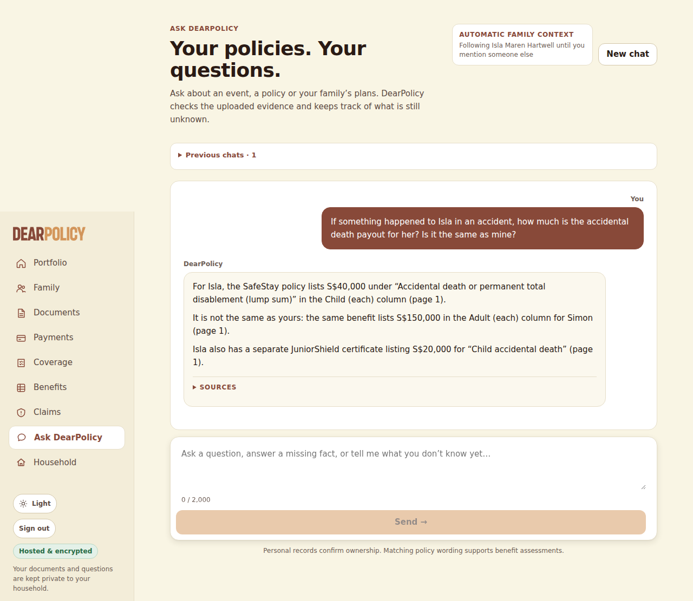
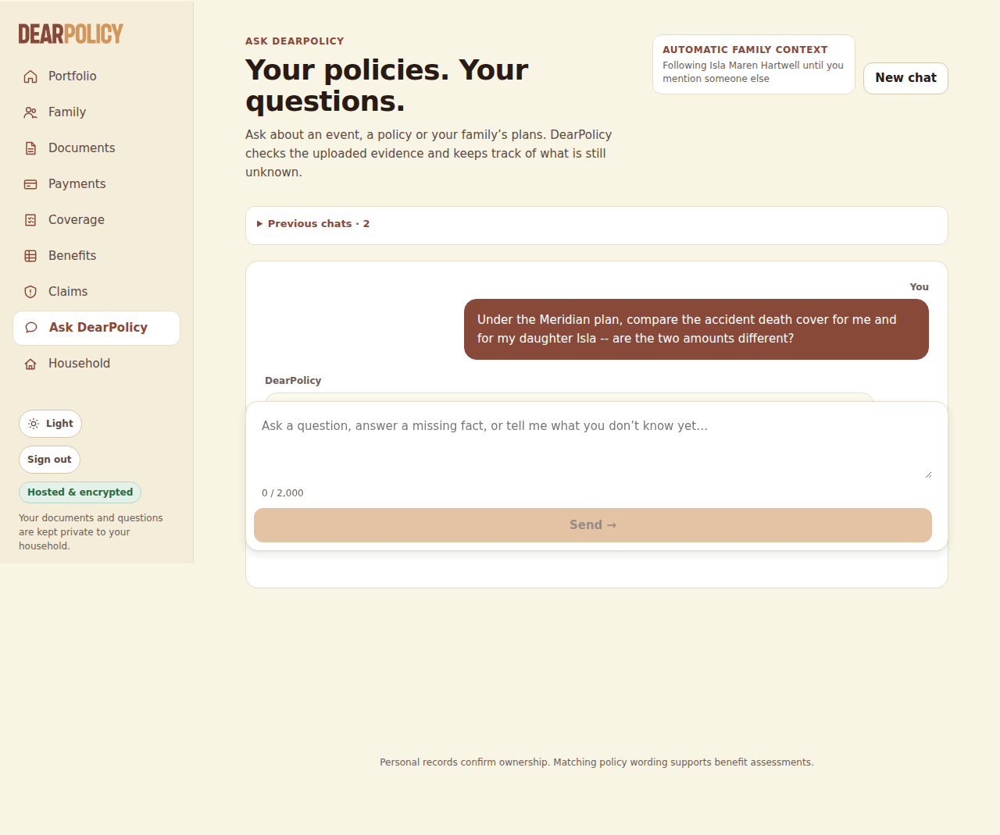

**Exercise spend (LEDGER.json)**: US$0.322889 of US$0.50 -- 13 earlier run(s) US$0.311222 + this run US$0.011667 (not yet in the ledger); US$0.177111 left

# Live ingestion test -- LIVE MODEL RUN

- **Tested code**: `fa531705d544a9531d044552d42c554d09608375` (request commit `6605ad02c64047778c5c8780fca039d06199077d`), tree `73061fbfb0dbcc50ccd0d31291c9fafce5381975`, build T9Cy3Qh3E0GT_ob8Ib9q3
- **Models requested**: CHAT_MODEL=openai:gpt-6-luna, JUDGEMENT_MODEL=openai:gpt-6-luna, NARRATION_MODEL=openai:gpt-6-luna, READING_MODEL=openai:gpt-6-luna; **provider-reported**: gpt-6-luna
- **Spend**: US$0.011667 of a US$0.050000 run cap; 26 calls sent, 0 refused, 0 failed; reserved-unsettled US$0.000000
- **Verdict**: FAIL (43 checks passed, 2 failed)

## Uploads (through the policies page; processing by request drain)

| file | final | time to final | states | linked automatically | needs review | screenshots |
|---|---|---|---|---|---|---|
| hx-text.pdf | not_scanned_prototype/ready | 43 s | uploaded/queued:queued @0s → not_scanned_prototype/extracting:reading_pdf @7s → not_scanned_prototype/extracting:ai_extraction @9s → not_scanned_prototype/indexing:benefits @29s → not_scanned_prototype/indexing:conditions @34s → not_scanned_prototype/ready:complete @42s | Felix Oran Hartwell, Isla Maren Hartwell, Leonie Brigitte Hartwell, Simon Alastair Hartwell | no | [02-upload-1-received.png](screenshots/02-upload-1-received.png) [03-upload-1-processing.png](screenshots/03-upload-1-processing.png) [04-upload-1-final.png](screenshots/04-upload-1-final.png) |
| hx-endorsement.pdf | not_scanned_prototype/ready | 35 s | uploaded/queued:queued @0s → not_scanned_prototype/extracting:ai_extraction @26s → not_scanned_prototype/indexing:benefits @29s → not_scanned_prototype/indexing:conditions @31s → not_scanned_prototype/ready:complete @34s | Felix Oran Hartwell, Isla Maren Hartwell, Leonie Brigitte Hartwell, Simon Alastair Hartwell | no | [05-upload-2-received.png](screenshots/05-upload-2-received.png) [06-upload-2-processing.png](screenshots/06-upload-2-processing.png) [07-upload-2-final.png](screenshots/07-upload-2-final.png) |
| hx-scanned.pdf | not_scanned_prototype/ready | 20 s | uploaded/queued:queued @0s → not_scanned_prototype/extracting:ocr @4s → not_scanned_prototype/extracting:ai_extraction @6s → not_scanned_prototype/indexing:benefits @14s → not_scanned_prototype/indexing:conditions @16s → not_scanned_prototype/ready:complete @19s | Isla Maren Hartwell | no | [08-upload-3-received.png](screenshots/08-upload-3-received.png) [09-upload-3-processing.png](screenshots/09-upload-3-processing.png) [10-upload-3-final.png](screenshots/10-upload-3-final.png) |

## Library and automatic person links

| file | product | linked | detected names (matched) |
|---|---|---|---|
| hx-scanned.pdf | JuniorShield Child Hospital Income Plan | Isla Maren Hartwell | Isla Maren Hartwell → Isla Maren Hartwell |
| hx-text.pdf | SafeStay Family Hospital Cash & Personal Accident Plan | Felix Oran Hartwell, Isla Maren Hartwell, Leonie Brigitte Hartwell, Simon Alastair Hartwell | Felix Oran Hartwell → Felix Oran Hartwell; Isla Maren Hartwell → Isla Maren Hartwell; Leonie Brigitte Hartwell → Leonie Brigitte Hartwell; Simon Alastair Hartwell → Simon Alastair Hartwell |
| hx-endorsement.pdf | SafeStay Family Hospital Cash & Personal Accident Plan | Felix Oran Hartwell, Isla Maren Hartwell, Leonie Brigitte Hartwell, Simon Alastair Hartwell |  |

Extracted page text per document: `extracted/` (after processing: `dump-processing/extracted/`). Stored records, jobs and provenance: `dump-processing/dump.json`, `dump-final/dump.json`.

## Conversation (in the browser)

### Q2 -- conversation -- 13 s

**User** (composer): If something happened to Isla in an accident, how much is the accidental death payout for her? Is it the same as mine?

**DearPolicy**: DearPolicy For Isla, the SafeStay policy lists S$40,000 under “Accidental death or permanent total disablement (lump sum)” in the Child (each) column (page 1). It is not the same as yours: the same benefit lists S$150,000 in the Adult (each) column for Simon (page 1). Isla also has a separate JuniorShield certificate listing S$20,000 for “Child accidental death” (page 1). SOURCES

Sources shown: Meridian Harbour Assurance Pte. Ltd. · SafeStay Family Hospital Cash & Personal Accident PlanYour uploaded documentPage 1; Kestrel Bay Insurance (Singapore) Ltd. · JuniorShield Child Hospital Income PlanYour uploaded documentPage 1

Loop: final_answer, 5 step(s), 44472 in / 774 out tokens, 11819 ms

| # | tool | ok | error / result | evidence |
|---|---|---|---|---|
| 1 | resolve_person | yes | {"status":"ok"} | 0 |
| 2 | policies_for | yes | {} | 2 |
| 3 | policies_for | yes | {} | 1 |
| 4 | search_passages | yes | {"hits":10} | 10 |
| 5 | search_passages | yes | {"hits":9} | 9 |
| 6 | select_table_value | yes | {"status":"ok","valueId":"v1","value":40000,"column":"Child (each)","row":"Accidental death or permanent total disablement (lump sum)"} | 1 |
| 7 | select_table_value | yes | {"status":"ok","valueId":"v2","value":150000,"column":"Adult (each)","row":"Accidental death or permanent total disablement (lump sum)"} | 1 |
| 8 | final_answer | yes |  | 0 |

Per call (tokens in/out): 1: 4909/18; 2: 5030/109; 3: 6815/205; 4: 13431/199; 5: 14287/243

### C2T1 -- conversation -- 10 s

**User** (composer): Under the Meridian plan, compare the accident death cover for me and for my daughter Isla -- are the two amounts different?

**DearPolicy**: DearPolicy An amendment document for this policy was removed from the library, so the current amounts may differ from these schedule figures.

Loop: final_answer, 4 step(s), 27550 in / 552 out tokens, 9019 ms

| # | tool | ok | error / result | evidence |
|---|---|---|---|---|
| 1 | resolve_person | yes | {"status":"ok"} | 0 |
| 2 | resolve_person | yes | {"status":"ok"} | 0 |
| 3 | policies_for | yes | {} | 1 |
| 4 | policies_for | yes | {} | 2 |
| 5 | select_table_value | yes | {"status":"ok","valueId":"v1","value":150000,"column":"Adult (each)","row":"Accidental death or permanent total disablement (lump sum)"} | 2 |
| 6 | select_table_value | yes | {"status":"ok","valueId":"v2","value":40000,"column":"Child (each)","row":"Accidental death or permanent total disablement (lump sum)"} | 1 |
| 7 | search_passages | yes | {"hits":7} | 7 |
| 8 | final_answer | yes |  | 0 |

Per call (tokens in/out): 1: 4907/49; 2: 5196/109; 3: 6981/233; 4: 10466/161

Composer dropped: [{"reason":"S$110,000 is printed in none of the evidence the sentence cites","sentence":"Yes—the Meridian schedule lists “Accidental death or permanent total disablement (lump sum)” as S$150,000 for you, Simon, and S$40,000 for Isla, so your amounts differ by S$110,000."}]

## Deterministic checks (EXPECTED.json, copied in after the conversations)

| scope | check | result | detail |
|---|---|---|---|
| hx-text.pdf | uploaded and processed | PASS | not_scanned_prototype/ready |
| hx-text.pdf | page 1 text extracted | PASS | native, 1842 chars |
| hx-text.pdf | page 1 contains "MHA-HC-2025-0748213" | PASS |  |
| hx-text.pdf | page 1 contains "S$150,000" | PASS |  |
| hx-text.pdf | page 1 contains "S$40,000" | PASS |  |
| hx-text.pdf | page 1 contains "S$120" | PASS |  |
| hx-text.pdf | page 1 contains "S$80" | PASS |  |
| hx-text.pdf | page 1 contains "S$600" | PASS |  |
| hx-text.pdf | page 1 contains "S$1,500" | PASS |  |
| hx-text.pdf | page 2 text extracted | PASS | native, 3002 chars |
| hx-text.pdf | page 2 contains "24 consecutive hours" | PASS |  |
| hx-text.pdf | page 2 contains "Accident-only cover" | PASS |  |
| hx-text.pdf | linked automatically to the right people | PASS | linked: Felix Oran Hartwell, Isla Maren Hartwell, Leonie Brigitte Hartwell, Simon Alastair Hartwell; expected: Simon Alastair Hartwell, Leonie Brigitte Hartwell, Felix Oran Hartwell, Isla Maren Hartwell |
| hx-endorsement.pdf | uploaded and processed | PASS | not_scanned_prototype/ready |
| hx-endorsement.pdf | page 1 text extracted | PASS | native, 1250 chars |
| hx-endorsement.pdf | page 1 contains "ME-26-0412" | PASS |  |
| hx-endorsement.pdf | page 1 contains "MHA-HC-2025-0748213" | PASS |  |
| hx-endorsement.pdf | page 1 contains "S$110" | PASS |  |
| hx-endorsement.pdf | page 1 contains "01 July 2026" | PASS |  |
| hx-scanned.pdf | uploaded and processed | PASS | not_scanned_prototype/ready |
| hx-scanned.pdf | page 1 text extracted | PASS | ocr, 1243 chars |
| hx-scanned.pdf | page 1 contains "KBJ-26-00391" | PASS |  |
| hx-scanned.pdf | page 1 contains "S$150" | PASS |  |
| hx-scanned.pdf | page 1 contains "S$500" | PASS |  |
| hx-scanned.pdf | linked automatically to the right people | PASS | linked: Isla Maren Hartwell; expected: Isla Maren Hartwell |
| Q2 (conversation) "If something happened to Isla in an accident, how much is th" | useful reply (a cited figure or condition, one material question, or what the documents do not say) | PASS | a cited statement |
| Q2 (conversation) "If something happened to Isla in an accident, how much is th" | every figure stated is one the expected facts give | PASS |  |
| Q2 (conversation) "If something happened to Isla in an accident, how much is th" | every date stated is one the expected facts give | PASS |  |
| Q2 (conversation) "If something happened to Isla in an accident, how much is th" | no placeholder where the documents give a figure | PASS |  |
| Q2 (conversation) "If something happened to Isla in an accident, how much is th" | no uncertainty the expected facts contradict | PASS |  |
| Q2 (conversation) "If something happened to Isla in an accident, how much is th" | no superseded figure presented as current | PASS |  |
| C2T1 (conversation) "Under the Meridian plan, compare the accident death cover fo" | useful reply (a cited figure or condition, one material question, or what the documents do not say) | **FAIL** | nothing cited: "An amendment document for this policy was removed from the library, so the current amounts may differ from these schedule figures." |
| C2T1 (conversation) "Under the Meridian plan, compare the accident death cover fo" | every figure stated is one the expected facts give | PASS |  |
| C2T1 (conversation) "Under the Meridian plan, compare the accident death cover fo" | every date stated is one the expected facts give | PASS |  |
| C2T1 (conversation) "Under the Meridian plan, compare the accident death cover fo" | no placeholder where the documents give a figure | PASS |  |
| C2T1 (conversation) "Under the Meridian plan, compare the accident death cover fo" | no uncertainty the expected facts contradict | PASS |  |
| C2T1 (conversation) "Under the Meridian plan, compare the accident death cover fo" | no superseded figure presented as current | PASS |  |
| Q2 | states "S$40,000" | PASS |  |
| Q2 | states "S$150,000" | PASS |  |
| Q2 | cites hx-text.pdf page 1 | PASS | cited: hx-text.pdf p1, hx-scanned.pdf p1 |
| Q2 | never: the JuniorShield child accidental death benefit presented as the Meridian figure without naming the other policy (source Q2 forbidden 3) | PASS |  |
| Q2 | never: the Adult amount stated as Isla's (source Q2 forbidden 1: S$150,000 stated for Isla) | PASS |  |
| Q2 | never: the Child amount stated as the adult's (source Q2 forbidden 2: S$40,000 stated for Simon) | PASS |  |
| Q2 | answers without an unnecessary follow-up | PASS |  |
| Q2P | asked | **FAIL** | this question was never asked (run stopped earlier?) |

## Every provider request (process-wide fetch guard)

| seq | kind | model → reported | provider request id | status / refused | in | cached | out | reasoning | reserved | charged | ms |
|---|---|---|---|---|---|---|---|---|---|---|---|
| 1 | structured | gpt-6-luna → gpt-6-luna | chatcmpl-EXNeMzSMMqLInIdNiV1S6fY4WyYac | 200 | 2743 | 0 | 2734 | 0 | US$0.003506 | US$0.001641 | 20174 |
| 2 | structured | gpt-6-luna → gpt-6-luna | chatcmpl-EXNeiVNstVpv9eq9tK7TxQieNCdMI | 200 | 1336 | 0 | 11 | 0 | US$0.000592 | US$0.000139 | 1931 |
| 2 | structured | gpt-6-luna → gpt-6-luna | chatcmpl-EXNei2tIdLjn0YuRMG3pnHVUX4vyL | 200 | 1201 | 0 | 549 | 0 | US$0.000548 | US$0.000395 | 4834 |
| 4 | structured | gpt-6-luna → gpt-6-luna | chatcmpl-EXNenb9WdqlQWFtCd4mCrHHKxwoiS | 200 | 1612 | 0 | 900 | 0 | US$0.000746 | US$0.000611 | 6316 |
| 5 | structured | gpt-6-luna → gpt-6-luna | chatcmpl-EXNetaESqgem7fsxCIyANewuOthJ1 | 200 | 2454 | 0 | 4000 | 0 | US$0.002416 | US$0.002245 | 20995 |
| 6 | structured | gpt-6-luna → gpt-6-luna | chatcmpl-EXNfEBZW6MiTUxvVkSbRB08kir8I6 | 200 | 3173 | 0 | 921 | 0 | US$0.001256 | US$0.000778 | 6313 |
| 7 | structured | gpt-6-luna → gpt-6-luna | chatcmpl-EXNfLGlCU2CQdDSiRtOvjGqluluqs | 200 | 2006 | 1646 | 246 | 0 | US$0.003391 | US$0.000175 | 2611 |
| 8 | structured | gpt-6-luna → gpt-6-luna | chatcmpl-EXNfOplxxMd5iJFQTxw08nEP11s4y | 200 | 958 | 0 | 104 | 0 | US$0.000522 | US$0.000148 | 2203 |
| 9 | structured | gpt-6-luna → gpt-6-luna | chatcmpl-EXNfQ6FeFVmACt1iq627SjtYdG7wk | 200 | 1234 | 0 | 105 | 0 | US$0.000675 | US$0.000176 | 1420 |
| 10 | structured | gpt-6-luna → gpt-6-luna | chatcmpl-EXNfRTltXvDmBGPKMCsaunZNeImdF | 200 | 1490 | 1073 | 324 | 0 | US$0.002265 | US$0.000214 | 2748 |
| 11 | structured | gpt-6-luna → gpt-6-luna | chatcmpl-EXNfUJy8DvUUYwyP3FvusDyEwzWz8 | 200 | 847 | 0 | 113 | 0 | US$0.000900 | US$0.000141 | 1818 |
| 12 | document (pdf 1p) | gpt-6-luna → gpt-6-luna | chatcmpl-EXNfX0iTHt4sgPpaeoHYHPvKqsldk | 200 | 1351 | 0 | 381 | 0 | US$0.008615 | US$0.000326 | 4105 |
| 13 | structured | gpt-6-luna → gpt-6-luna | chatcmpl-EXNfaRQAOLisYLeSveUPKAJYhKYy4 | 200 | 2017 | 1646 | 875 | 0 | US$0.003391 | US$0.000491 | 7133 |
| 14 | structured | gpt-6-luna → gpt-6-luna | chatcmpl-EXNfiXbd8ZXVLJJ9UPL7Q09Ur1i65 | 200 | 672 | 0 | 120 | 0 | US$0.000580 | US$0.000127 | 1552 |
| 15 | structured | gpt-6-luna → gpt-6-luna | chatcmpl-EXNfjy2rIL14X8btZHH9Nq7ctoYiF | 200 | 1246 | 0 | 266 | 0 | US$0.000675 | US$0.000258 | 2396 |
| 16 | structured | gpt-6-luna → gpt-6-luna | chatcmpl-EXNfmdTvouOt3U0Equdm0M1z1xUvH | 200 | 1479 | 1073 | 648 | 0 | US$0.002261 | US$0.000375 | 4507 |
| 17 | loop | gpt-6-luna → gpt-6-luna | chatcmpl-EXNfr9KbTsKU3Gu9sqZbqoW78mkH0 | 200 | 4909 | 0 | 18 | 0 | US$0.002041 | US$0.000500 | 1414 |
| 17 | structured | gpt-6-luna → gpt-6-luna | chatcmpl-EXNfqvbxdyEcTYT3ivNlHxcmvn96L | 200 | 943 | 0 | 138 | 0 | US$0.000914 | US$0.000163 | 2542 |
| 18 | loop | gpt-6-luna → gpt-6-luna | chatcmpl-EXNftXaoXxfDFpCW0XNLHB7qlAEBY | 200 | 5030 | 4783 | 109 | 0 | US$0.002064 | US$0.000127 | 1929 |
| 20 | loop | gpt-6-luna → gpt-6-luna | chatcmpl-EXNfvHjKyq1QmJ5MXpQx8dh4IW1gK | 200 | 6815 | 4904 | 205 | 0 | US$0.002285 | US$0.000343 | 2788 |
| 21 | loop | gpt-6-luna → gpt-6-luna | chatcmpl-EXNfx9KtaJtCpkD3f1XjBfDQ6QUt8 | 200 | 13431 | 6689 | 199 | 0 | US$0.003195 | US$0.000841 | 2540 |
| 22 | loop | gpt-6-luna → gpt-6-luna | chatcmpl-EXNg00BBCgMV3X0q6HSZu4rG1ckHV | 200 | 14287 | 13305 | 243 | 0 | US$0.003313 | US$0.000353 | 3011 |
| 23 | loop | gpt-6-luna → gpt-6-luna | chatcmpl-EXNg543ulxij6Rew5PWG0kXpOdUfn | 200 | 4907 | 4753 | 49 | 0 | US$0.002041 | US$0.000087 | 1543 |
| 24 | loop | gpt-6-luna → gpt-6-luna | chatcmpl-EXNg6IYeX40azkRfCeZaTkGC5cH3S | 200 | 5196 | 4781 | 109 | 0 | US$0.002086 | US$0.000144 | 1688 |
| 25 | loop | gpt-6-luna → gpt-6-luna | chatcmpl-EXNg8J14lGyKytZJbrcOjPtrdlEhW | 200 | 6981 | 5070 | 233 | 0 | US$0.002307 | US$0.000358 | 2619 |
| 26 | loop | gpt-6-luna → gpt-6-luna | chatcmpl-EXNgBZtSRqgUxhzKlO6FwjUnvjKYT | 200 | 10466 | 6855 | 161 | 0 | US$0.002781 | US$0.000510 | 3116 |

## App provenance (model_executions) joined to the guard's calls

| operation | attempt | requested | resolved provider / model | provider request id | status | in | cached | out | cost | guard seq |
|---|---|---|---|---|---|---|---|---|---|---|
| policy_extraction | 0 | openai:gpt-6-luna | openai:gpt-6-luna | chatcmpl-EXNeMzSMMqLInIdNiV1S6fY4WyYac | succeeded | 2743 | 0 | 2734 | US$0.001641 | 1 |
| catalog_building | 0 | openai:gpt-6-luna | openai:gpt-6-luna | chatcmpl-EXNei2tIdLjn0YuRMG3pnHVUX4vyL | succeeded | 1201 | 0 | 549 | US$0.000395 | 2 |
| catalog_building | 0 | openai:gpt-6-luna | openai:gpt-6-luna | chatcmpl-EXNeiVNstVpv9eq9tK7TxQieNCdMI | succeeded | 1336 | 0 | 11 | US$0.000139 | - |
| condition_catalog_extraction | 0 | openai:gpt-6-luna | openai:gpt-6-luna | chatcmpl-EXNenb9WdqlQWFtCd4mCrHHKxwoiS | succeeded | 1612 | 0 | 900 | US$0.000611 | 4 |
| benefit_extraction | 0 | openai:gpt-6-luna | openai:gpt-6-luna | chatcmpl-EXNetaESqgem7fsxCIyANewuOthJ1 | succeeded | 2454 | 0 | 4000 | US$0.002245 | 5 |
| benefit_extraction | 0 | openai:gpt-6-luna | openai:gpt-6-luna | chatcmpl-EXNfEBZW6MiTUxvVkSbRB08kir8I6 | succeeded | 3173 | 0 | 921 | US$0.000778 | 6 |
| policy_extraction | 0 | openai:gpt-6-luna | openai:gpt-6-luna | chatcmpl-EXNfLGlCU2CQdDSiRtOvjGqluluqs | succeeded | 2006 | 1646 | 246 | US$0.000175 | 7 |
| catalog_building | 0 | openai:gpt-6-luna | openai:gpt-6-luna | chatcmpl-EXNfOplxxMd5iJFQTxw08nEP11s4y | succeeded | 958 | 0 | 104 | US$0.000148 | 8 |
| condition_catalog_extraction | 0 | openai:gpt-6-luna | openai:gpt-6-luna | chatcmpl-EXNfQ6FeFVmACt1iq627SjtYdG7wk | succeeded | 1234 | 0 | 105 | US$0.000176 | 9 |
| benefit_extraction | 0 | openai:gpt-6-luna | openai:gpt-6-luna | chatcmpl-EXNfRTltXvDmBGPKMCsaunZNeImdF | succeeded | 1490 | 1073 | 324 | US$0.000214 | 10 |
| benefit_extraction | 0 | openai:gpt-6-luna | openai:gpt-6-luna | chatcmpl-EXNfUJy8DvUUYwyP3FvusDyEwzWz8 | succeeded | 847 | 0 | 113 | US$0.000141 | 11 |
| hosted_ocr | 0 | openai:gpt-6-luna | openai:gpt-6-luna | chatcmpl-EXNfX0iTHt4sgPpaeoHYHPvKqsldk | succeeded | 1351 | 0 | 381 | US$0.000326 | 12 |
| policy_extraction | 0 | openai:gpt-6-luna | openai:gpt-6-luna | chatcmpl-EXNfaRQAOLisYLeSveUPKAJYhKYy4 | succeeded | 2017 | 1646 | 875 | US$0.000491 | 13 |
| catalog_building | 0 | openai:gpt-6-luna | openai:gpt-6-luna | chatcmpl-EXNfiXbd8ZXVLJJ9UPL7Q09Ur1i65 | succeeded | 672 | 0 | 120 | US$0.000127 | 14 |
| condition_catalog_extraction | 0 | openai:gpt-6-luna | openai:gpt-6-luna | chatcmpl-EXNfjy2rIL14X8btZHH9Nq7ctoYiF | succeeded | 1246 | 0 | 266 | US$0.000258 | 15 |
| benefit_extraction | 0 | openai:gpt-6-luna | openai:gpt-6-luna | chatcmpl-EXNfmdTvouOt3U0Equdm0M1z1xUvH | succeeded | 1479 | 1073 | 648 | US$0.000375 | 16 |
| benefit_extraction | 0 | openai:gpt-6-luna | openai:gpt-6-luna | chatcmpl-EXNfqvbxdyEcTYT3ivNlHxcmvn96L | succeeded | 943 | 0 | 138 | US$0.000163 | 17 |
| rag_answer | 0 | openai:gpt-6-luna | openai:gpt-6-luna | chatcmpl-EXNfr9KbTsKU3Gu9sqZbqoW78mkH0 | succeeded | 4909 | 0 | 18 | US$0.000500 | - |
| rag_answer | 1 | openai:gpt-6-luna | openai:gpt-6-luna | chatcmpl-EXNftXaoXxfDFpCW0XNLHB7qlAEBY | succeeded | 5030 | 4783 | 109 | US$0.000127 | 18 |
| rag_answer | 2 | openai:gpt-6-luna | openai:gpt-6-luna | chatcmpl-EXNfvHjKyq1QmJ5MXpQx8dh4IW1gK | succeeded | 6815 | 4904 | 205 | US$0.000343 | 20 |
| rag_answer | 3 | openai:gpt-6-luna | openai:gpt-6-luna | chatcmpl-EXNfx9KtaJtCpkD3f1XjBfDQ6QUt8 | succeeded | 13431 | 6689 | 199 | US$0.000841 | 21 |
| rag_answer | 4 | openai:gpt-6-luna | openai:gpt-6-luna | chatcmpl-EXNg00BBCgMV3X0q6HSZu4rG1ckHV | succeeded | 14287 | 13305 | 243 | US$0.000353 | 22 |
| rag_answer | 0 | openai:gpt-6-luna | openai:gpt-6-luna | chatcmpl-EXNg543ulxij6Rew5PWG0kXpOdUfn | succeeded | 4907 | 4753 | 49 | US$0.000087 | 23 |
| rag_answer | 1 | openai:gpt-6-luna | openai:gpt-6-luna | chatcmpl-EXNg6IYeX40azkRfCeZaTkGC5cH3S | succeeded | 5196 | 4781 | 109 | US$0.000144 | 24 |
| rag_answer | 2 | openai:gpt-6-luna | openai:gpt-6-luna | chatcmpl-EXNg8J14lGyKytZJbrcOjPtrdlEhW | succeeded | 6981 | 5070 | 233 | US$0.000358 | 25 |
| rag_answer | 3 | openai:gpt-6-luna | openai:gpt-6-luna | chatcmpl-EXNgBZtSRqgUxhzKlO6FwjUnvjKYT | succeeded | 10466 | 6855 | 161 | US$0.000510 | 26 |
