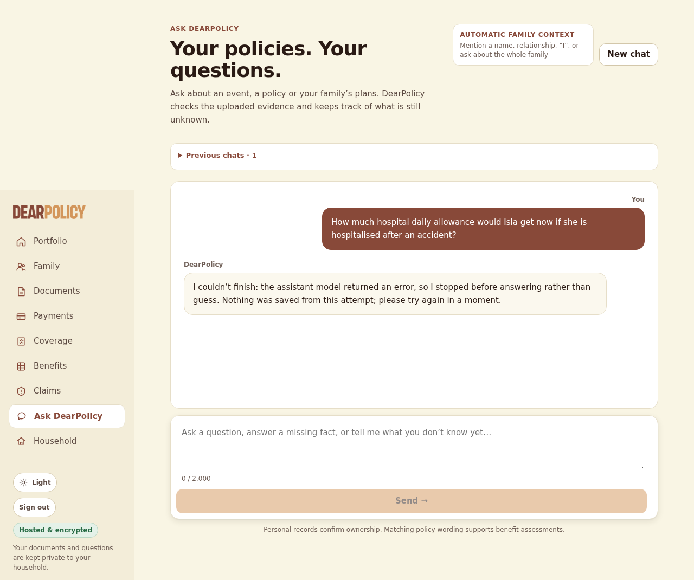

# Live ingestion test -- PREFLIGHT -- every model request refused; US$0

- **Tested code**: `393af0c0b4491c9e889feb8153c48dc2be5e29bd` (request commit `-`), tree `0eec1df119e6a07cba86c4dc13a7163516b778f1`, build HbHdRsSJofgujTjv5XSXg
- **Models requested**: CHAT_MODEL=openai:gpt-6-luna, JUDGEMENT_MODEL=openai:gpt-6-luna, NARRATION_MODEL=openai:gpt-6-luna, READING_MODEL=openai:gpt-6-luna; **provider-reported**: none (no call sent)
- **Spend**: US$0.000000 of a US$0.050000 run cap; 0 calls sent, 0 refused, 0 failed; reserved-unsettled US$0.000000
- **Verdict**: PREFLIGHT (not graded) (6 checks passed, 14 failed)
- **Preflight**: 10 model request(s) refused by the guard, none sent (US$0)

## Uploads (through the policies page; processing by request drain)

| file | final | time to final | states | linked automatically | needs review | screenshots |
|---|---|---|---|---|---|---|
| hx-text.pdf | not_scanned_prototype/queued | 92 s | not_scanned_prototype/extracting:reading_pdf @1s → not_scanned_prototype/queued:retrying @7s | nobody | no | [02-upload-1-received.png](screenshots/02-upload-1-received.png) [03-upload-1-processing.png](screenshots/03-upload-1-processing.png) [04-upload-1-final.png](screenshots/04-upload-1-final.png) |
| hx-endorsement.pdf | not_scanned_prototype/queued | 92 s | uploaded/queued:queued @1s → not_scanned_prototype/queued:retrying @5s | nobody | no | [05-upload-2-received.png](screenshots/05-upload-2-received.png) [06-upload-2-processing.png](screenshots/06-upload-2-processing.png) [07-upload-2-final.png](screenshots/07-upload-2-final.png) |
| hx-scanned.pdf | not_scanned_prototype/queued | 92 s | uploaded/queued:queued @1s → not_scanned_prototype/queued:retrying @5s | nobody | no | [08-upload-3-received.png](screenshots/08-upload-3-received.png) [09-upload-3-processing.png](screenshots/09-upload-3-processing.png) [10-upload-3-final.png](screenshots/10-upload-3-final.png) |

## Library and automatic person links

| file | product | linked | detected names (matched) |
|---|---|---|---|
| hx-scanned.pdf |  | nobody |  |
| hx-endorsement.pdf |  | nobody |  |
| hx-text.pdf |  | nobody |  |

Extracted page text per document: `extracted/` (after processing: `dump-processing/extracted/`). Stored records, jobs and provenance: `dump-processing/dump.json`, `dump-final/dump.json`.

## Conversation (in the browser)

### Q1 -- conversation -- 2 s

**User** (composer): How much hospital daily allowance would Isla get now if she is hospitalised after an accident?

**DearPolicy**: DearPolicy I couldn’t finish: the assistant model returned an error, so I stopped before answering rather than guess. Nothing was saved from this attempt; please try again in a moment.

## Deterministic checks (EXPECTED.json, copied in after the conversations)

| scope | check | result | detail |
|---|---|---|---|
| hx-text.pdf | uploaded and processed | **FAIL** | not_scanned_prototype/queued |
| hx-text.pdf | page 1 text extracted | PASS | native, 1842 chars |
| hx-text.pdf | page 1 contains "MHA-HC-2025-0748213" | PASS |  |
| hx-text.pdf | linked automatically to the right people | **FAIL** | linked: nobody; expected: Simon Alastair Hartwell, Leonie Brigitte Hartwell, Felix Oran Hartwell, Isla Maren Hartwell |
| hx-endorsement.pdf | uploaded and processed | **FAIL** | not_scanned_prototype/queued |
| hx-endorsement.pdf | page 1 text extracted | PASS | native, 1250 chars |
| hx-endorsement.pdf | page 1 contains "S$110" | PASS |  |
| hx-endorsement.pdf | page 1 contains "01 July 2026" | PASS |  |
| hx-scanned.pdf | uploaded and processed | **FAIL** | not_scanned_prototype/queued |
| hx-scanned.pdf | page 1 text extracted | **FAIL** | no stored page |
| Q1 (conversation) "How much hospital daily allowance would Isla get now if she " | useful reply | **FAIL** | 185 chars |
| Q1 | states "110" | **FAIL** |  |
| Q1 | never states "S$80 per day" | PASS |  |
| Q1 | cites hx-endorsement.pdf page 1 | **FAIL** | cited: nothing |
| Q1 | uses the current version (hx-endorsement.pdf) | **FAIL** | cited: nothing |
| Q1 | about Isla Maren Hartwell | **FAIL** | no stored subject; answer does not name Isla |
| Q2 | asked | **FAIL** | this question was never asked (run stopped earlier?) |
| Q3 | asked | **FAIL** | this question was never asked (run stopped earlier?) |
| R1 | asked | **FAIL** | this question was never asked (run stopped earlier?) |
| D1 | asked | **FAIL** | this question was never asked (run stopped earlier?) |

## Every provider request (process-wide fetch guard)

| seq | kind | model → reported | provider request id | status / refused | in | cached | out | reasoning | reserved | charged | ms |
|---|---|---|---|---|---|---|---|---|---|---|---|
| 1 | structured | gpt-6-luna → - | - | refused: preflight: no model call made | 0 | 0 | 0 | - | US$0.000000 | US$0.000000 | - |
| 2 | structured | gpt-6-luna → - | - | refused: preflight: no model call made | 0 | 0 | 0 | - | US$0.000000 | US$0.000000 | - |
| 3 | structured | gpt-6-luna → - | - | refused: preflight: no model call made | 0 | 0 | 0 | - | US$0.000000 | US$0.000000 | - |
| 4 | structured | gpt-6-luna → - | - | refused: preflight: no model call made | 0 | 0 | 0 | - | US$0.000000 | US$0.000000 | - |
| 5 | structured | gpt-6-luna → - | - | refused: preflight: no model call made | 0 | 0 | 0 | - | US$0.000000 | US$0.000000 | - |
| 6 | structured | gpt-6-luna → - | - | refused: preflight: no model call made | 0 | 0 | 0 | - | US$0.000000 | US$0.000000 | - |
| 7 | document (pdf 1p) | gpt-6-luna → - | - | refused: preflight: no model call made | 0 | 0 | 0 | - | US$0.000000 | US$0.000000 | - |
| 8 | document (pdf 1p) | gpt-6-luna → - | - | refused: preflight: no model call made | 0 | 0 | 0 | - | US$0.000000 | US$0.000000 | - |
| 9 | structured | gpt-6-luna → - | - | refused: preflight: no model call made | 0 | 0 | 0 | - | US$0.000000 | US$0.000000 | - |
| 10 | document (pdf 1p) | gpt-6-luna → - | - | refused: preflight: no model call made | 0 | 0 | 0 | - | US$0.000000 | US$0.000000 | - |

## App provenance (model_executions) joined to the guard's calls

| operation | attempt | requested | resolved provider / model | provider request id | status | in | cached | out | cost | guard seq |
|---|---|---|---|---|---|---|---|---|---|---|
| policy_extraction | 0 | openai:gpt-6-luna | openai:- | - | failed (model_provider) | 0 | 0 | 0 | - | - |
| policy_extraction | 0 | openai:gpt-6-luna | openai:- | - | failed (model_provider) | 0 | 0 | 0 | - | - |
| policy_extraction | 0 | openai:gpt-6-luna | openai:- | - | failed (model_provider) | 0 | 0 | 0 | - | - |
| policy_extraction | 0 | openai:gpt-6-luna | openai:- | - | failed (model_provider) | 0 | 0 | 0 | - | - |
| policy_extraction | 0 | openai:gpt-6-luna | openai:- | - | failed (model_provider) | 0 | 0 | 0 | - | - |
| policy_extraction | 0 | openai:gpt-6-luna | openai:- | - | failed (model_provider) | 0 | 0 | 0 | - | - |
| hosted_ocr | 0 | openai:gpt-6-luna | openai:- | - | failed (model_provider) | 0 | 0 | 0 | - | - |
| hosted_ocr | 0 | openai:gpt-6-luna | openai:- | - | failed (model_provider) | 0 | 0 | 0 | - | - |
| policy_extraction | 0 | openai:gpt-6-luna | openai:- | - | failed (model_provider) | 0 | 0 | 0 | - | - |
| hosted_ocr | 0 | openai:gpt-6-luna | openai:- | - | failed (model_provider) | 0 | 0 | 0 | - | - |
| rag_answer | 0 | openai:gpt-6-luna | openai:- | - | failed (model_provider) | 0 | 0 | 0 | - | - |
